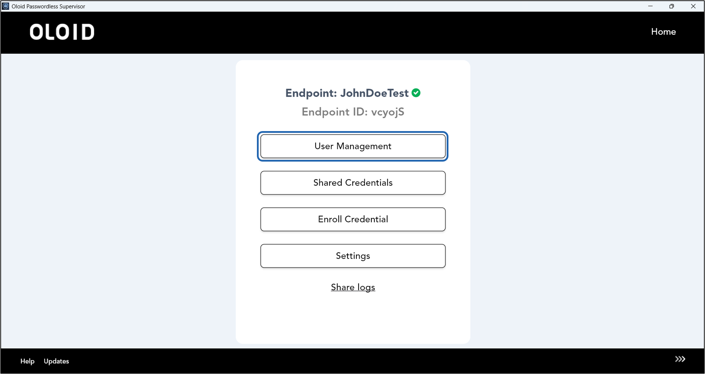
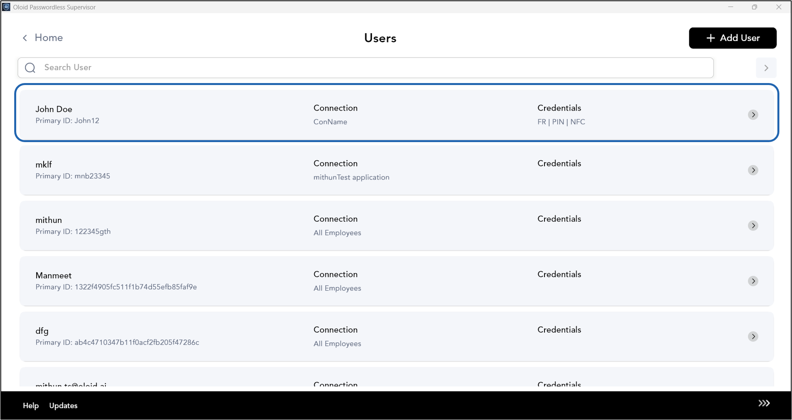
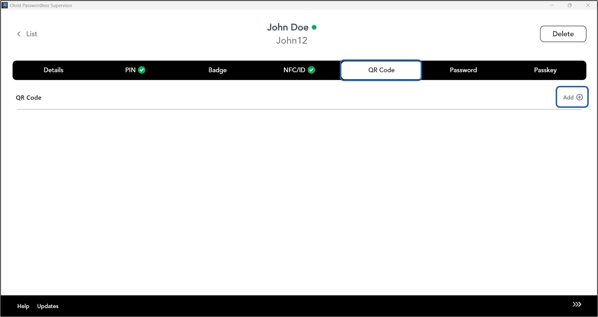
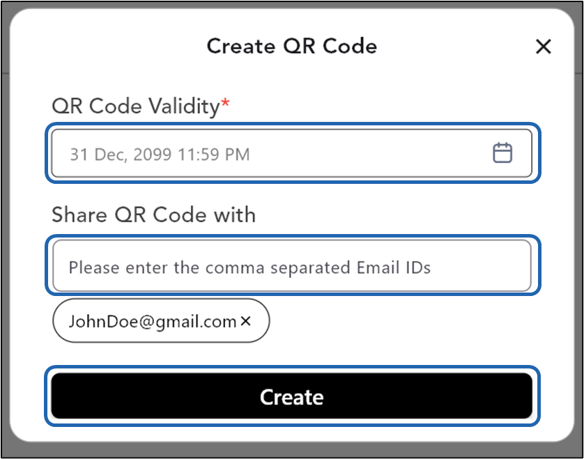
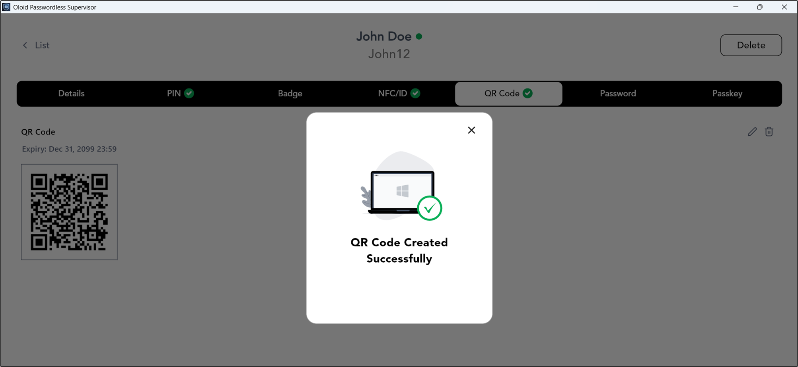

{/* Source: Intercom article 15457358 - https://oloid.help/en/articles/15457358-windows-login-how-to-add-qr-code-using-supervisor-app */}
{/* Generated by intercom_to_mintlify.py - re-running overwrites this file. */}

## Introduction

QR Code assignment allows the Supervisor to generate and assign QR-based credentials to users through the Supervisor App. These QR codes can be shared with users for authentication, providing a secure and contactless login option.

## Prerequisite

- The endpoint must be paired with the Windows Login application. For more information, refer to [Windows Login - How to manually pair the Supervisor App](/platforms/windows/supervisor-app/windows-login-how-to-manually-pair-the-supervisor-app)
- Log in to the Supervisor App using an Admin or Supervisor account. For more, refer [How to log in to Supervisor App](/platforms/windows/supervisor-app/how-to-log-in-to-supervisor-app)
- The user must exist. You can add a user from the Supervisor App or the Tenant Admin Portal. For more information, refer to [Tenant Admin Portal - How to Create User](/platform/tenant-admin-portal/tenant-admin-portal-how-to-create-user)

## Steps to Add QR Code in Supervisor App

1. Log in to **Supervisor App**. For more, refer to [How to log in to Supervisor App](/platforms/windows/supervisor-app/how-to-log-in-to-supervisor-app)
   The **Admin Home** screen is displayed.
2. On the Admin Home screen, select **User Management**.

   

   The **Users** screen with list of users is displayed.
3. Select **user** from the list, or search for a user using the search bar at the top.

   

   The user's **Details** screen is displayed
4. Select **QR Code** tab > Tap **ADD +**.

   

   The Create QR Code pop-up box is displayed.
5. Do the following:
   1. Select the QR Code Validity date.
   2. Enter Email ID of user(s) to Share QR Code with.
   3. Tap **Create.**

The QR Code is successfully assigned to user.

