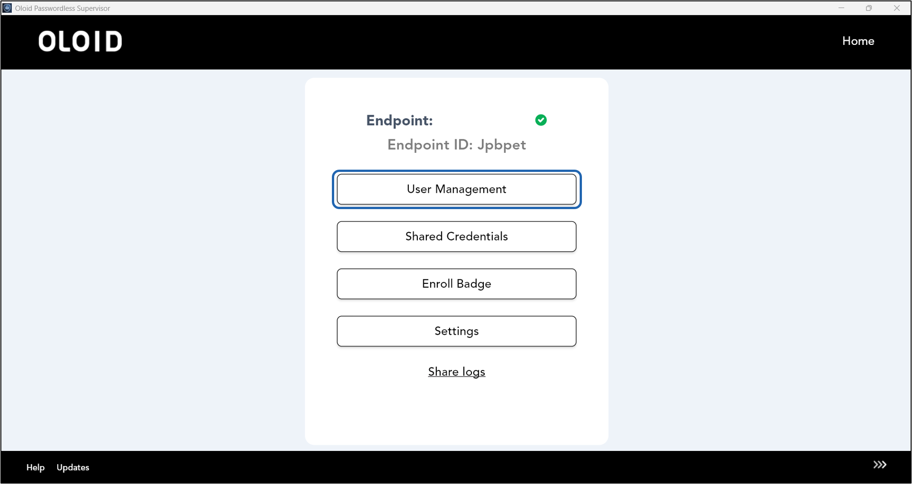
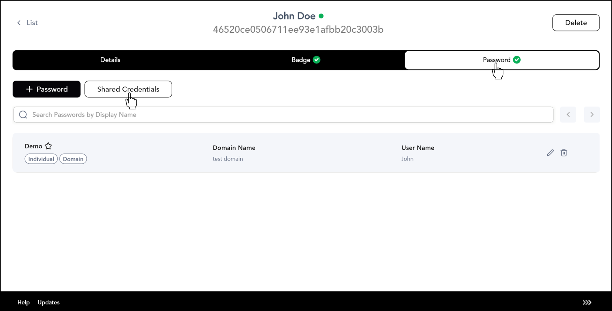
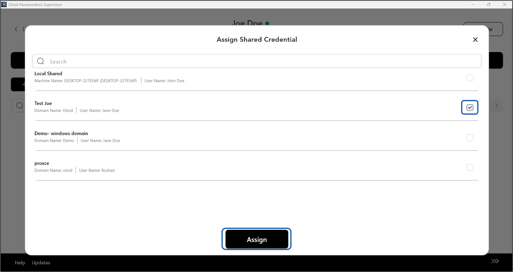
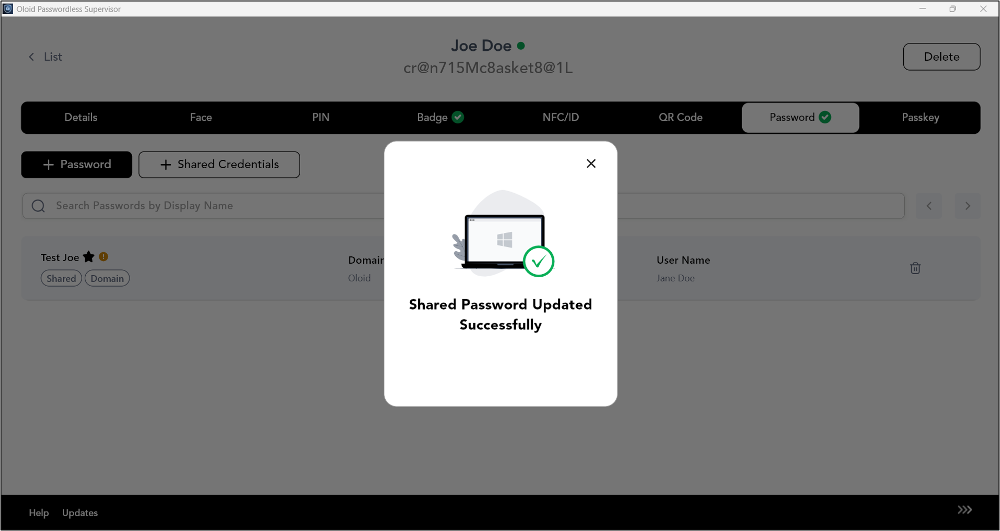

{/* Source: Intercom article 9207046 - https://oloid.help/en/articles/9207046-windows-login-how-to-assign-shared-credential */}
{/* Generated by intercom_to_mintlify.py - re-running overwrites this file. */}

## Introduction

Shared Credentials allow multiple users to securely access shared Windows accounts without requiring individual password credentials. Admin and Supervisor can assign one or more shared credentials to a user

## Prerequisites

- Ensure the endpoint is paired with the Windows Login application.
- Log in to the Supervisor App using an Admin or Supervisor account. For more, refer [How to log in to Supervisor App](/platforms/windows/supervisor-app/how-to-log-in-to-supervisor-app)
- Ensure at least one connection is configured for the selected application in the Tenant Admin Portal. For more information, refer: [How to Configure a Connection in the Tenant Admin Portal](/platform/tenant-admin-portal/tenant-admin-portal-how-to-configure-a-connection-in-the-tenant-admin)
- Shared Credentials must be created for the users. Refer: [How to create Shared Credentials using the Supervisor App](/platforms/windows/supervisor-app/windows-login-how-to-create-shared-password-using-the-supervisor-app)

## Steps to Assign Shared Credentials

1. Log in to **Supervisor App**. For more, refer to [How to log in to Supervisor App](/platforms/windows/supervisor-app/how-to-log-in-to-supervisor-app)
   The **Admin Home** screen is displayed.
2. On the Admin Home screen, select **User Management**.

   

   The **Users** screen is displayed.
3. Select a user to view details.

   

   The **Details** tab is displayed.
4. Go to **Password** tab > **Shared Credentials**.

   

   The **Assign Shared Credential** screen is displayed.
5. Do the following:
   1. Select one or more **Shared Credentials** to assign to the user.
   2. Click **Assign**.

The shared credential is successfully assigned to the user.

---

##### Video Tutorial

Watch our video **[How to assign shared credentials in Supervisor App for Windows - Video Tutorial](/platforms/windows/videos/how-to-assign-shared-credentials-in-supervisor-app-for-windows-video)**.
