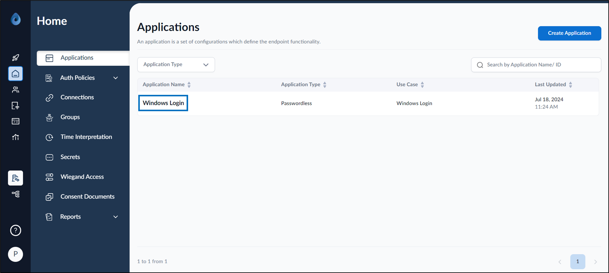
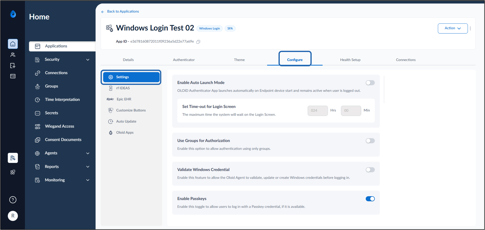
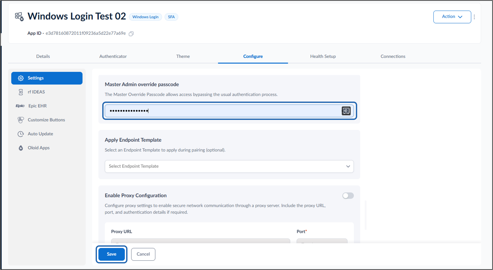
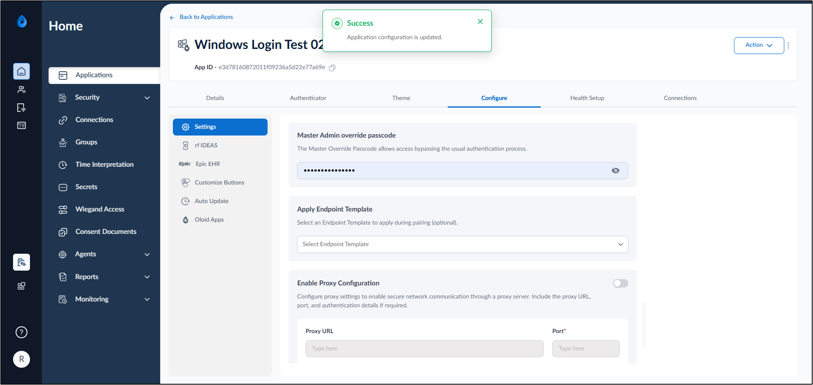

{/* Source: Intercom article 9244629 - https://oloid.help/en/articles/9244629-windows-login-how-to-create-device-admin-passcode-for-supervisor-app */}
{/* Generated by intercom_to_mintlify.py - re-running overwrites this file. */}

## Introduction

The Device-Admin Passcode (Master Admin Override Passcode) provides an administrative override that allows authorized personnel to access administrative functions on a Windows endpoint when standard authentication is unavailable. This passcode is configured at the application level and is used by the Supervisor App when required.

## Prerequisites

- You must have access to the Tenant Admin Portal.
- Ensure Windows Login application is created in the Tenant Admin Portal.

## Steps to Create Device-admin Passcode

1. Log in to the Tenant Admin Portal.
   The Application Detail page is displayed.
2. Select the application that is configured in the Supervisor App.

   

   The Application Details page is displayed.
3. Select **Configure** tab> click **Settings**.

   

   The configuration page is displayed.
4. Do the following:
   1. Enter the **Master Admin Override Passcode**.
   2. Click **Save**.

The Device-Admin Passcode is created successfully and the application settings are updated.

---

##### Video Tutorial

Watch our video **[How to create device-admin passcode for Supervisor App- Video Tutorial.](/platforms/windows/videos/how-to-create-device-admin-passcode-for-supervisor-app-video-tutorial)**
