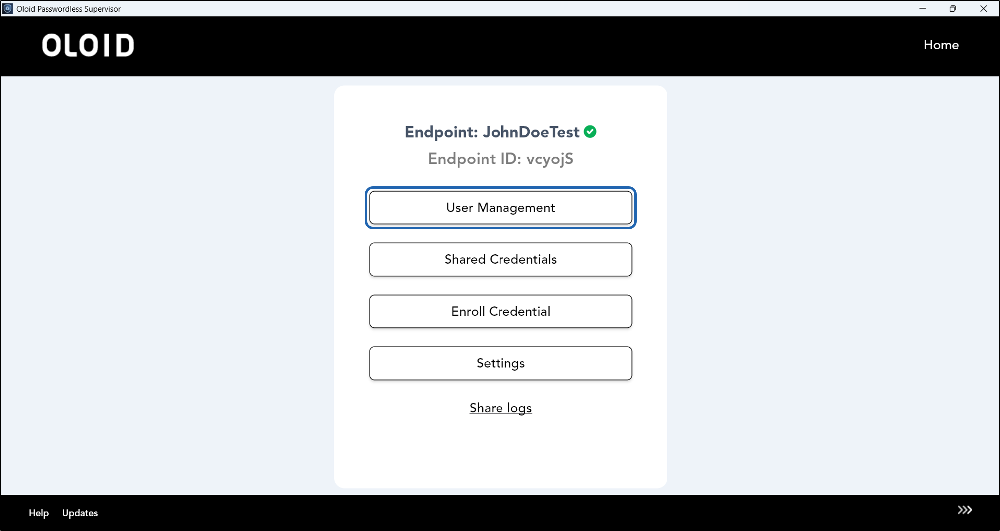
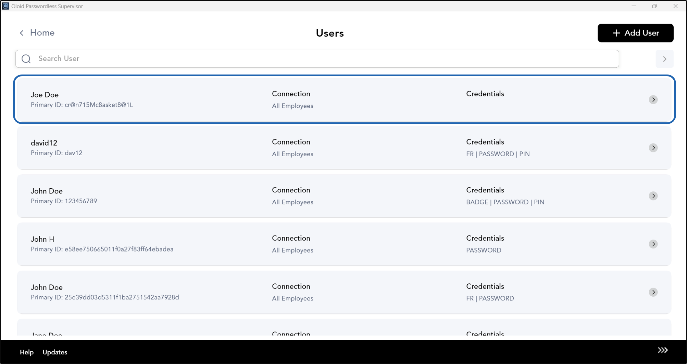
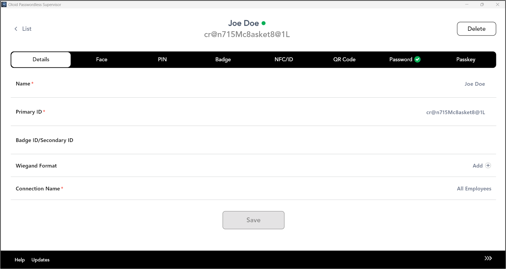
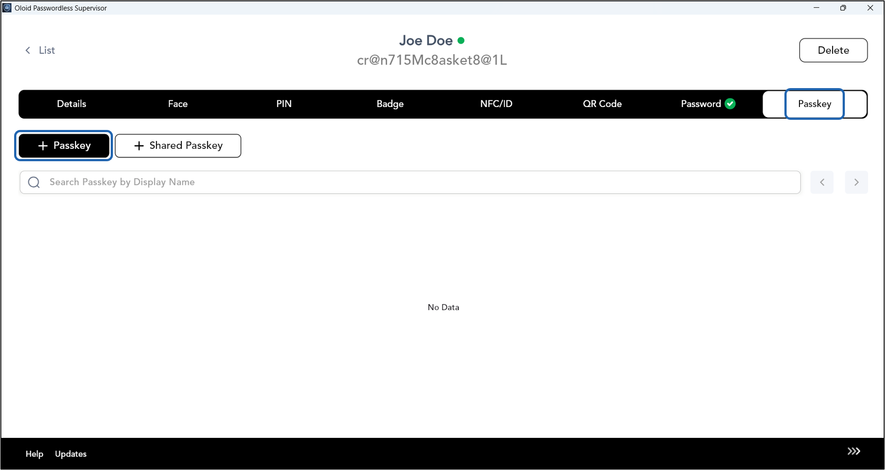
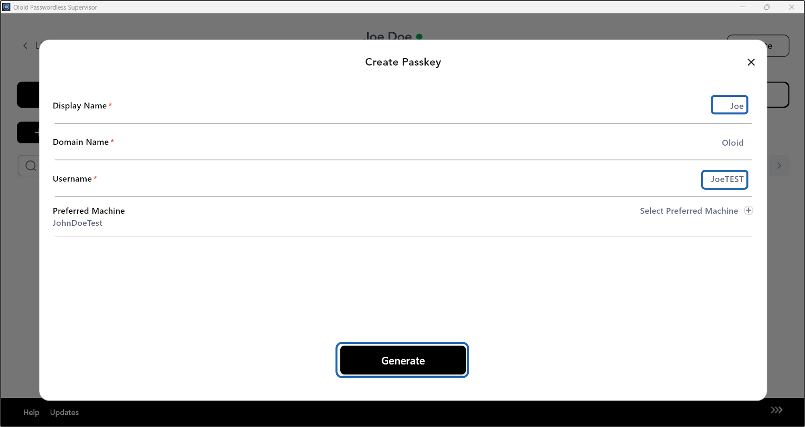
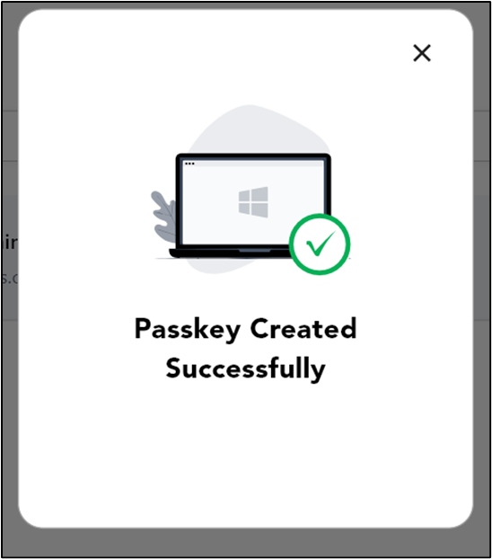

{/* Source: Intercom article 13842978 - https://oloid.help/en/articles/13842978-windows-login-how-to-create-passkey-for-a-user-in-supervisor-app */}
{/* Generated by intercom_to_mintlify.py - re-running overwrites this file. */}

## Introduction

The **Create Passkey** feature in the Windows Supervisor App allows authorized supervisors to generate and assign passkeys for users.

## Prerequisites

- Ensure the endpoint is paired with the Windows Login application. For more information, refer: [Windows Login - How to manually pair the Supervisor App](/platforms/windows/supervisor-app/windows-login-how-to-manually-pair-the-supervisor-app)
- Log in to the Supervisor App using an Admin or Supervisor account. For more, refer [How to log in to Supervisor App](/platforms/windows/supervisor-app/how-to-log-in-to-supervisor-app)
- Ensure you have Windows Pro Machine.
- Connect to OpenVPN.
- Ensure the user exists in the Tenant Admin Portal. Refer: [Windows Login - How to Add a User](/platforms/windows/supervisor-app/windows-login-how-to-add-a-user)

## Steps to Create Passkey in Windows Supervisor app

1. Log in to **Supervisor App**. For more, refer to[How to log in to Supervisor App](/platforms/windows/supervisor-app/how-to-log-in-to-supervisor-app)
   The **Supervisor App Home** screen is displayed.

   

2. Click **User Management**
   The **Users** screen is displayed.

   

3. Select the appropriate **User.**
   The **User Details** screen is displayed.

   

4. Select **Passkey** > click **+ Passkey.**

   

   The Create Passkey pop-up box is displayed.
5. Do the following
   1. Enter **Display Name.**
   2. **Domain Name** (System Default Domain name is selected)
   3. Enter **Username.**
   4. Select **Preferred Machine** from the Preferred Machine list. (System Default paired machine name is selected)
   5. Click **Generate.**

The Passkey is successfully generated.

