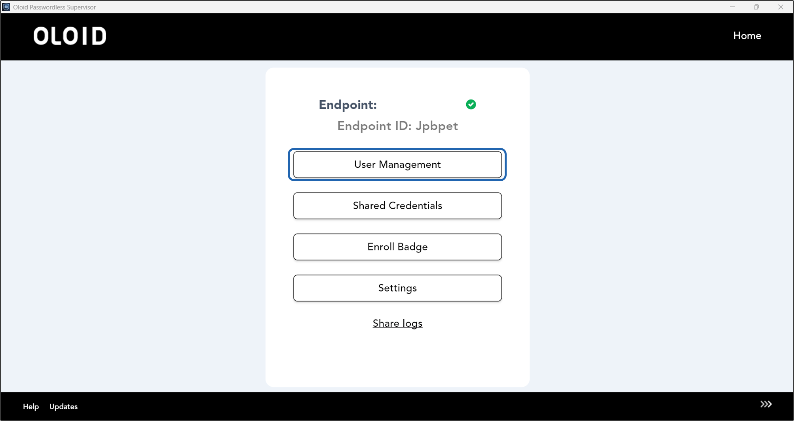
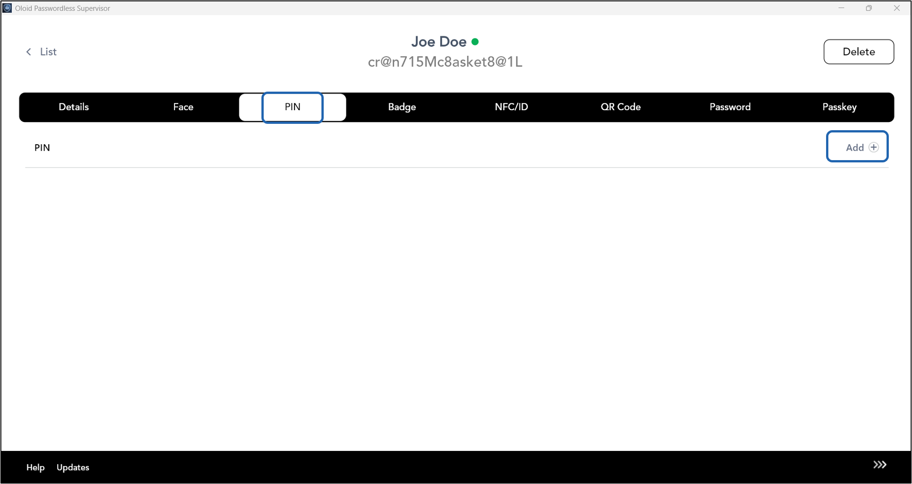
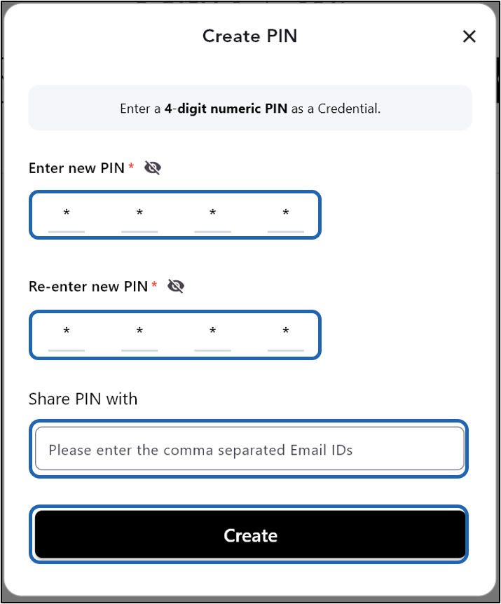
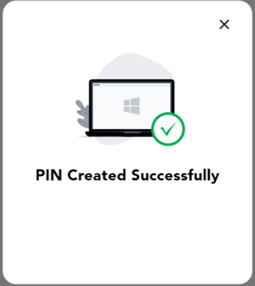
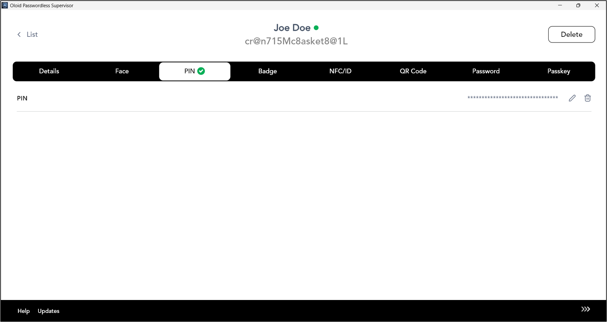

{/* Source: Intercom article 9088123 - https://oloid.help/en/articles/9088123-windows-login-how-to-create-pin-for-user */}
{/* Generated by intercom_to_mintlify.py - re-running overwrites this file. */}

## Introduction

Admin and Supervisor can create a PIN for a user through the Supervisor App and optionally share it with the user via email.

## Prerequisites

- Ensure the endpoint is paired with the Windows Login application.
- Log in to the Supervisor App using an Admin or Supervisor account. For more, refer [How to log in to Supervisor App](/platforms/windows/supervisor-app/how-to-log-in-to-supervisor-app)
- Ensure at least one connection is configured for the selected application in the Tenant Admin Portal. For more information, refer: [How to Configure a Connection in the Tenant Admin Portal](/platform/tenant-admin-portal/tenant-admin-portal-how-to-configure-a-connection-in-the-tenant-admin)
- Ensure User is created. Refer: **[Windows Login - How to Add a User](/platforms/windows/supervisor-app/windows-login-how-to-add-a-user)**

## Steps to Create PIN

1. Log in to **Supervisor App**. For more, refer to[How to log in to Supervisor App](/platforms/windows/supervisor-app/how-to-log-in-to-supervisor-app)
   The **Admin Home** screen is displayed.
2. Select **User Management**.

   

   The **Users** screen is displayed.
3. Select the user to view details.

   

   The user details page is displayed.
4. Go to **PIN** tab > Click **Add**.

   

   The **Create PIN** dialog box is displayed.
5. Do the following:
   1. Enter **new PIN**.
   2. Re-enter **new PIN**.
   3. In the Share PIN with field add the email IDs of users to share this pin Via email. (Optional)
   4. Click **Create**.

      

      The PIN is successfully created.

      

The newly created PIN is displayed on the PIN tab.

---

##### Video Tutorial

Watch our video **[How to Create PIN in the Supervisor App for Windows - Video Tutorial](/platforms/windows/videos/how-to-create-pin-in-the-supervisor-app-for-windows-video-tutorial)**
