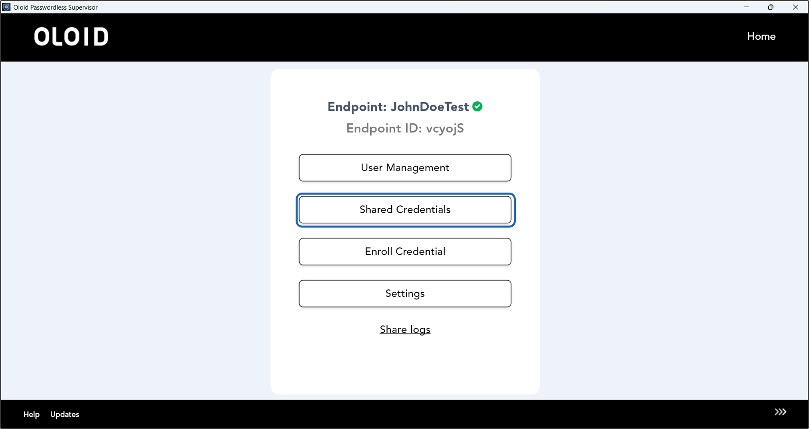
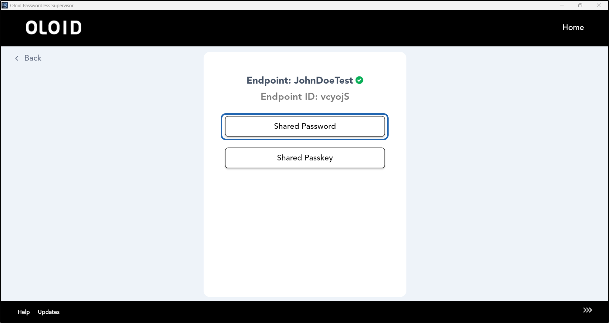
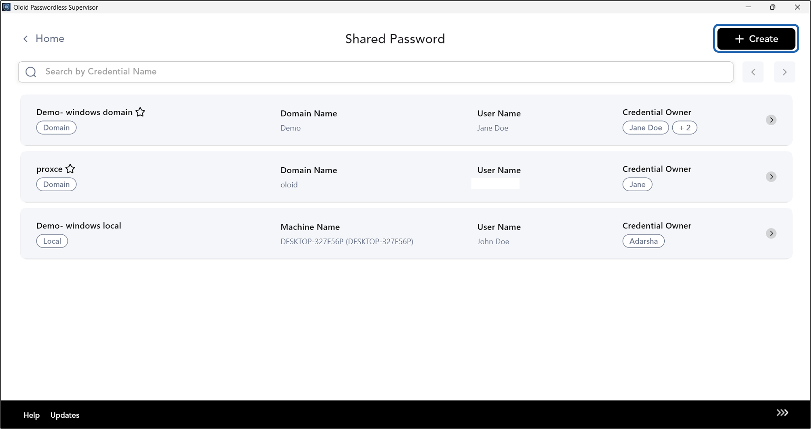
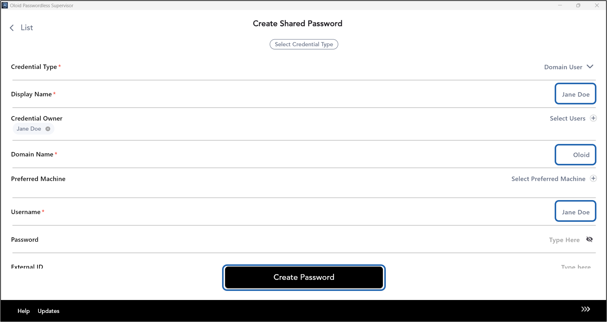
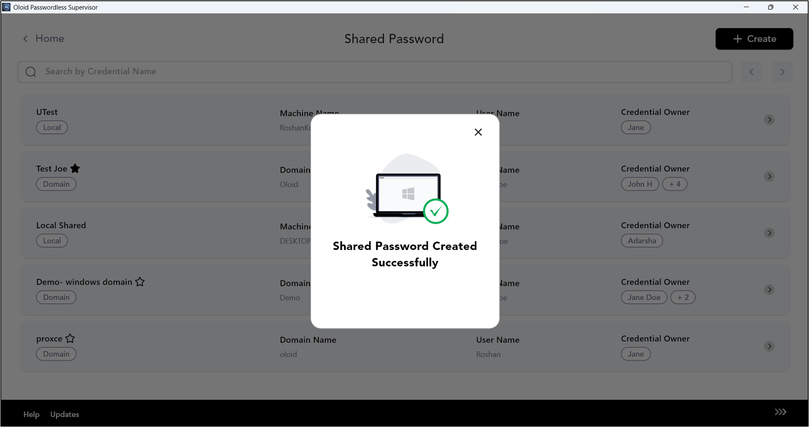
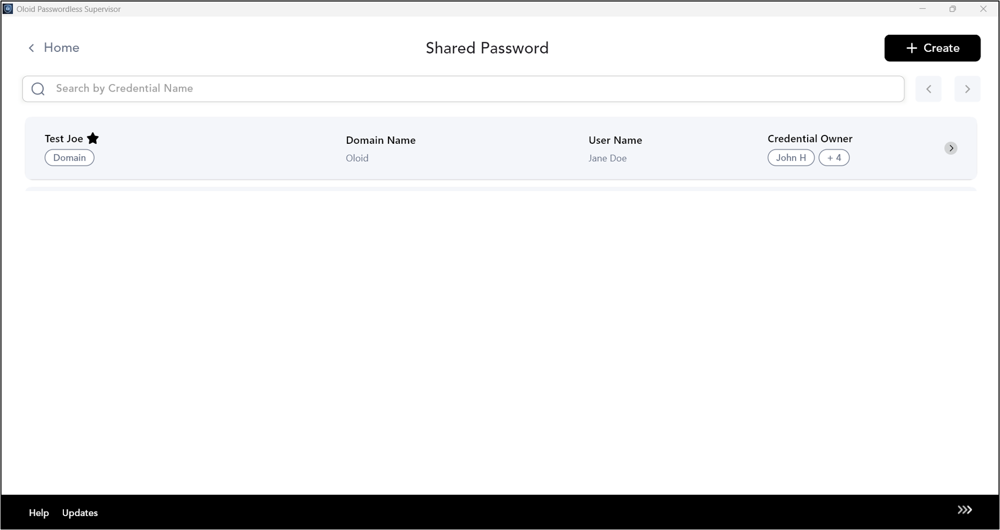
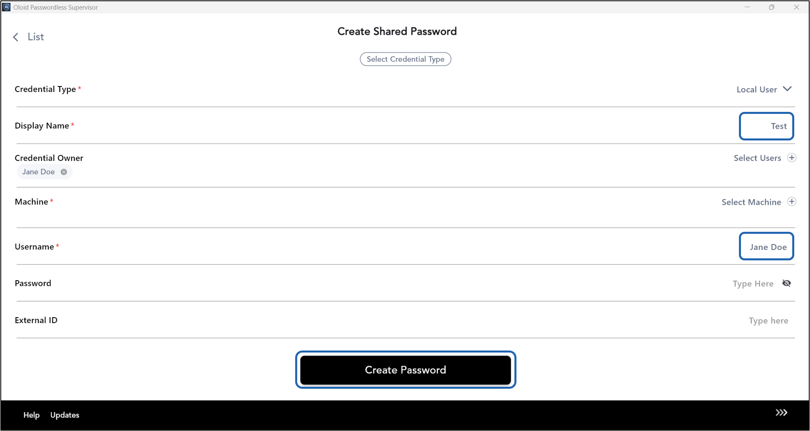
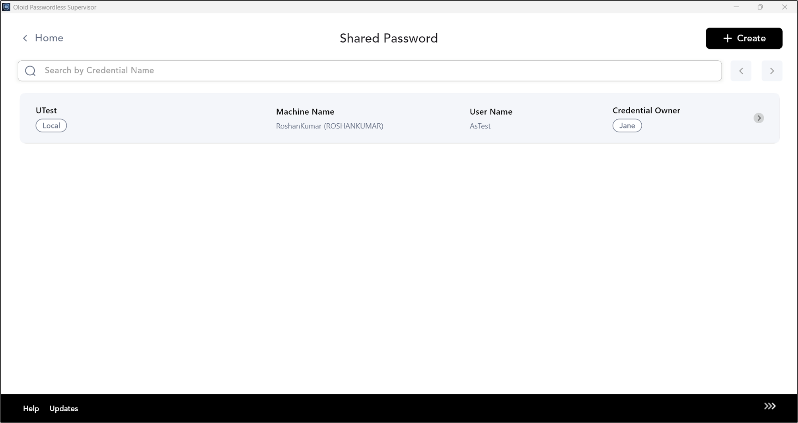

{/* Source: Intercom article 9045726 - https://oloid.help/en/articles/9045726-windows-login-how-to-create-shared-password-using-the-supervisor-app */}
{/* Generated by intercom_to_mintlify.py - re-running overwrites this file. */}

## Introduction

Shared Credentials are passwords that can be used to access a local Windows machine or a domain. It is shared among the users to whom they are assigned.

This document comprises the following:

- Create Shared Credential for Domain User
- Create Shared Credential for Local User

## Prerequisites

- Ensure the endpoint is paired with the Windows Login application. For more information, refer: [Windows Login - How to manually pair the Supervisor App](/platforms/windows/supervisor-app/windows-login-how-to-manually-pair-the-supervisor-app)
- Log in to the Supervisor App using an Admin or Supervisor account. Refer: [How to log in to Supervisor App](/platforms/windows/supervisor-app/how-to-log-in-to-supervisor-app)

## Steps to Create Shared Password for Domain user

1. Log in to **Supervisor App**.
   The **Admin Home** screen is displayed.
2. Select **Shared Credentials**.

   

3. Select **Shared Password**.

   

   The **Shared Password** page is displayed.
4. On the top right, click **+ Create**.

   

   The **Create Shared Password** page is displayed.
5. Do the following:
   1. Select **Credential Type** as Domain User.
   2. Enter **Display Name**.
   3. Select **Users** for **Credential Owner**. (System Default)
   4. Enter **Domain Name**.
   5. Select **Preferred Machine** from the Preferred Machine list. (System Default paired machine name is selected)
   6. Enter **Username**.
   7. Enter **Password**.
   8. Enter **External ID**. (Optional)
   9. Click **Create Password**.

The Shared Password is created successfully.

The shared credential of type Domain User is created and listed on the **Shared Credential** screen.

## Steps to Create Shared Password for Local User

1. Log in to **Supervisor App**.
   The **Admin Home** screen is displayed.
2. Select **Shared Credentials**.

   

3. Select **Shared Password**.

   

   The **Shared Password** page is displayed.
4. On the top right, click **+ Create**.

   

   The **Create Shared Password** page is displayed.
5. Do the following:
   1. Enter **Display Name**.
   2. Select user(s) for **Credential Owner**. (System Default)
   3. Select **Machine.** (System Default paired machine name is selected)
   4. Enter **User Name**.
   5. Enter **Password**.
   6. Enter **External ID**. (Optional)
   7. Click **Create Password**.

The Shared Password is created successfully.

The shared credential of type Windows Local User is created and listed on the **Shared Credential** screen.

---

##### Related Video

Watch our video **[How to create Shared Credentials using the Supervisor App - Video Tutorial](/platforms/windows/videos/how-to-create-shared-credentials-using-the-supervisor-app-video)**
