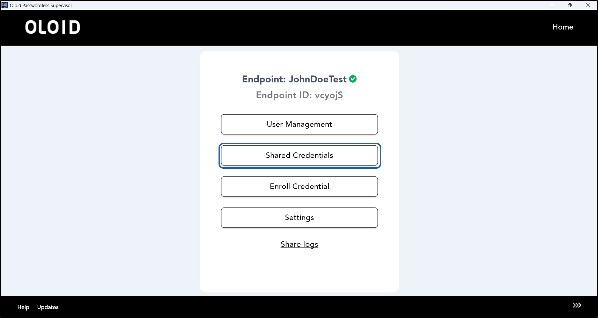
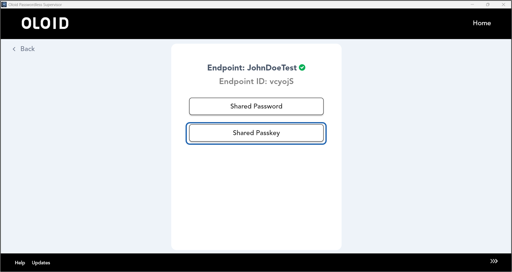
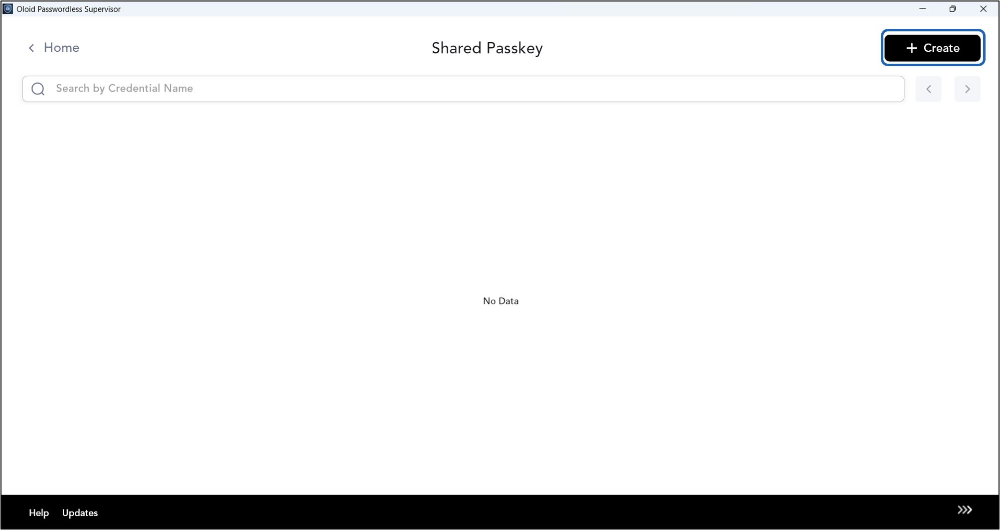
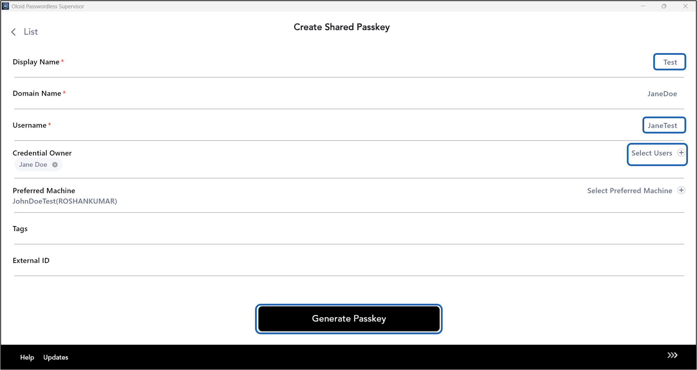
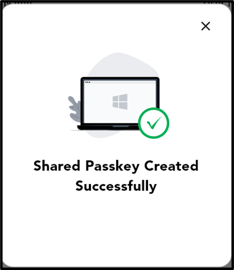

{/* Source: Intercom article 14338949 - https://oloid.help/en/articles/14338949-windows-login-how-to-create-shared-windows-passkey-in-supervisor-app */}
{/* Generated by intercom_to_mintlify.py - re-running overwrites this file. */}

## Introduction

This document explains how to create a shared Windows passkey in the Supervisor App. With the **Create Shared Passkey** feature, an authorized Admin or Supervisor can generate a shared Windows passkey and assign it to one or more users.

## Prerequisites

- The endpoint must be paired with the Windows Login application. For more information, refer to [Windows Login - How to manually pair the Supervisor App](/platforms/windows/supervisor-app/windows-login-how-to-manually-pair-the-supervisor-app)
- You must be logged in to the Supervisor App with an Admin or Supervisor account. For more information, refer to [How to log in to Supervisor App](/platforms/windows/supervisor-app/how-to-log-in-to-supervisor-app)
- The device must be running Windows Pro.
- OpenVPN must be connected.
- The user must exist in the Tenant Admin Portal. For more information, refer to [Tenant Admin Portal - How to Create User](/platform/tenant-admin-portal/tenant-admin-portal-how-to-create-user)
- The user should have a domain account.

## Steps to Create Shared Passkey in Supervisor app

1. Log in to **Supervisor App**. For more, refer to[How to log in to Supervisor App](/platforms/windows/supervisor-app/how-to-log-in-to-supervisor-app)
   The **Supervisor App Home** screen is displayed.
2. Click **Shared Credentials**

   

   The **Shared Credentials** screen is displayed
3. Select **Shared Passkey**.

   

   The **Shared Passkey** details page is displayed
4. Click **Create**.

   

   The Create Shared Passkey pop-up box is displayed.
5. Do the following
   1. Enter **Display Name**
   2. Edit **Domain Name** (System Default Domain name is selected)
   3. Enter **Username**
   4. Select **Credential Owner(s)**
   5. Select **Preferred Machine** from the Preferred Machine list. (System Default paired machine name is selected)
   6. Enter **Tags.** (Optional)
   7. Enter **External ID** (Optional)
   8. Click **Generate.**

      

The Shared Passkey is successfully created.

