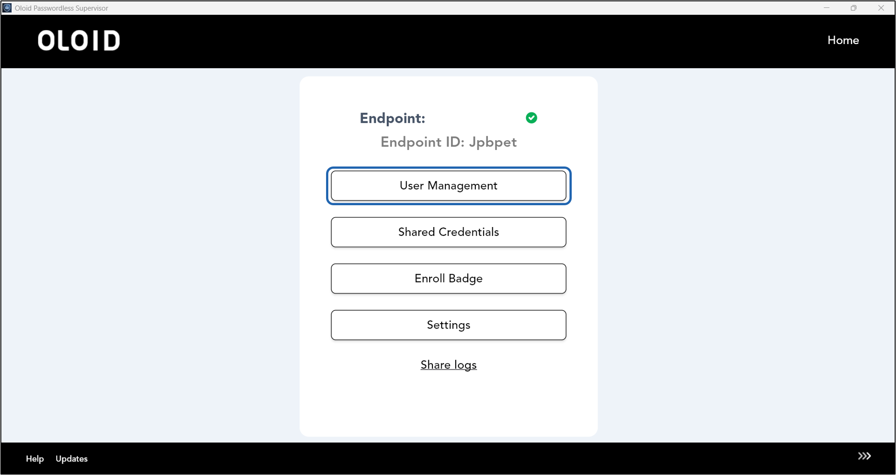
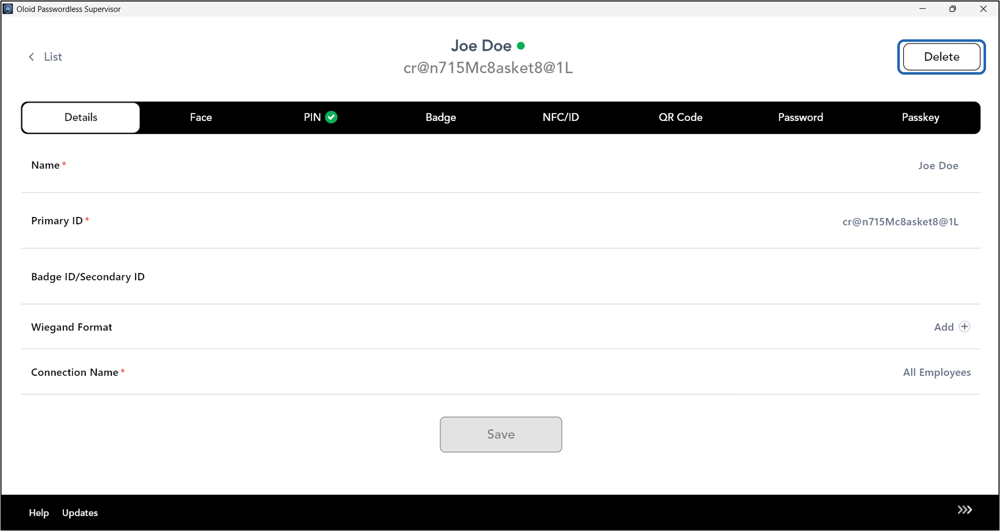
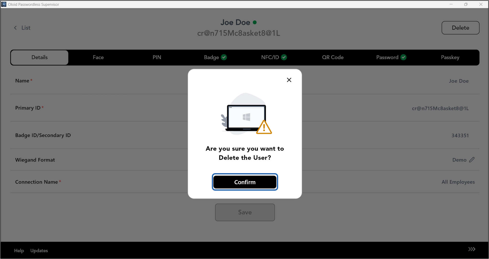
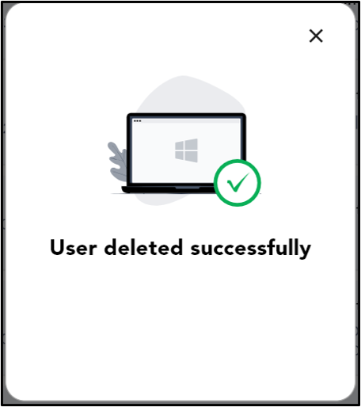

{/* Source: Intercom article 9546517 - https://oloid.help/en/articles/9546517-windows-login-how-to-delete-users-using-supervisor-app */}
{/* Generated by intercom_to_mintlify.py - re-running overwrites this file. */}

## Introduction

The **Delete User** feature in the Supervisor App allows authorized Admins and Supervisors to permanently remove users from the application when they no longer require access.

## Prerequisites

- Ensure the endpoint is paired with the Windows Login application. For more information, refer: [Windows Login - How to manually pair the Supervisor App](/platforms/windows/supervisor-app/windows-login-how-to-manually-pair-the-supervisor-app)
- Supervisors can delete users only if the required Delete User privilege is enabled for the application.
- Log in to the Supervisor App using an Admin or Supervisor account. For more, refer [How to log in to Supervisor App](/platforms/windows/supervisor-app/how-to-log-in-to-supervisor-app)
- Ensure at least one connection is configured for the selected application in the Tenant Admin Portal. For more information, refer: [How to Configure a Connection in the Tenant Admin Portal](/platform/tenant-admin-portal/tenant-admin-portal-how-to-configure-a-connection-in-the-tenant-admin)

## Steps to Delete a User

1. Log in to **Supervisor App**. For more, refer [How to log in to Supervisor App](/platforms/windows/supervisor-app/how-to-log-in-to-supervisor-app)
   The **Admin Home** screen is displayed.
2. Select **User Management**.

   

   The **Users** screen is displayed.
3. Select the **User** you want to delete.

   

   The user details screen is displayed.
4. Click Delete on the top right corner of the screen.

   

   The confirmation dialog box is displayed.
5. Click **Confirm** to delete the user.

The user is successfully deleted.

<Note>
  **Note:** Deleting a user permanently removes the user from the Oloid platform. This action cannot be undone. Supervisors cannot delete users who are assigned to one or more groups.
</Note>

---

##### Video Tutorial

Watch our video **[How to delete users using Supervisor App - Video Tutorial](/platforms/windows/videos/how-to-delete-users-using-supervisor-app-video-tutorial)**
