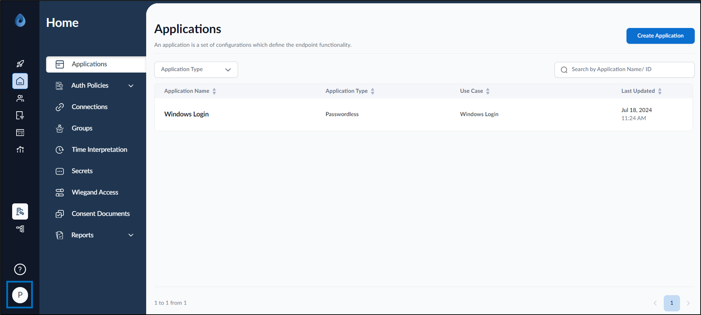
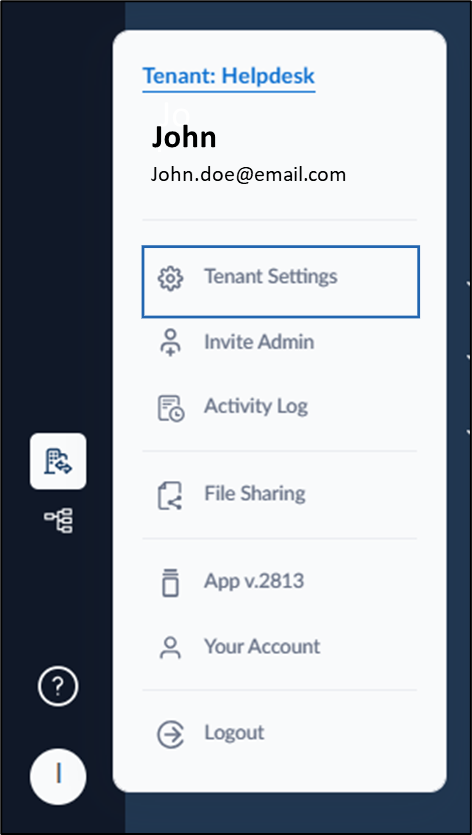
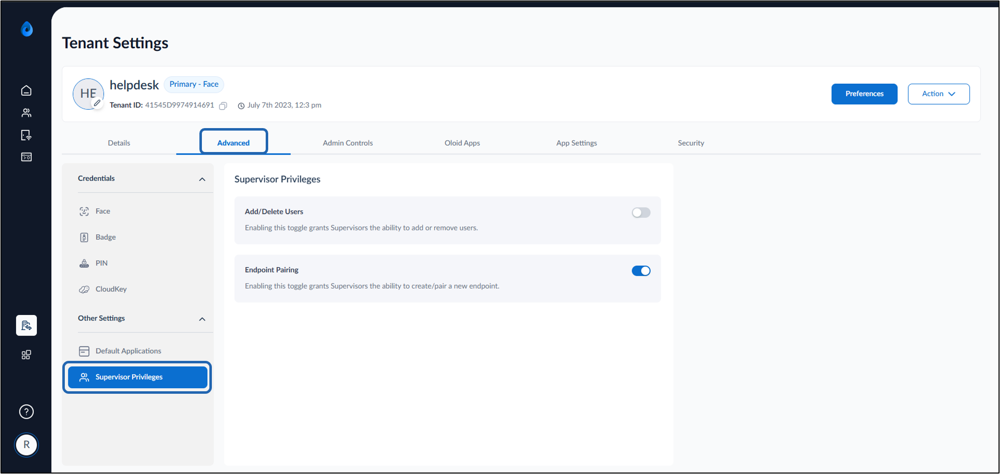
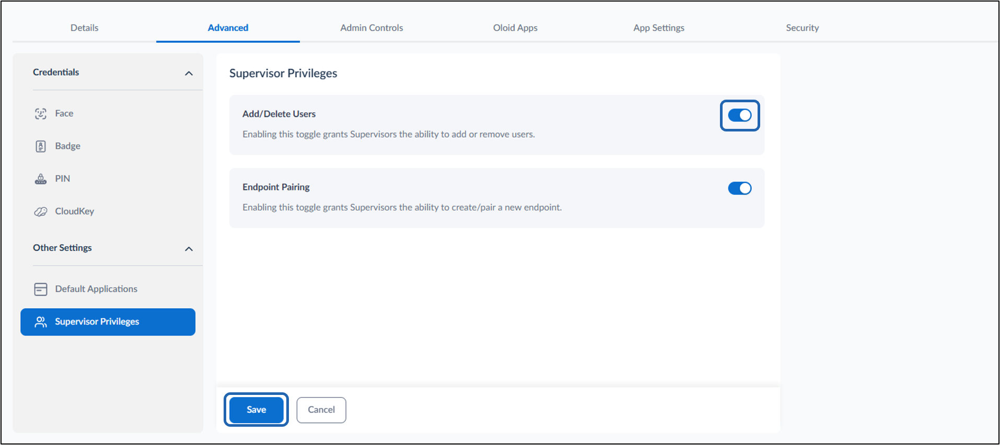
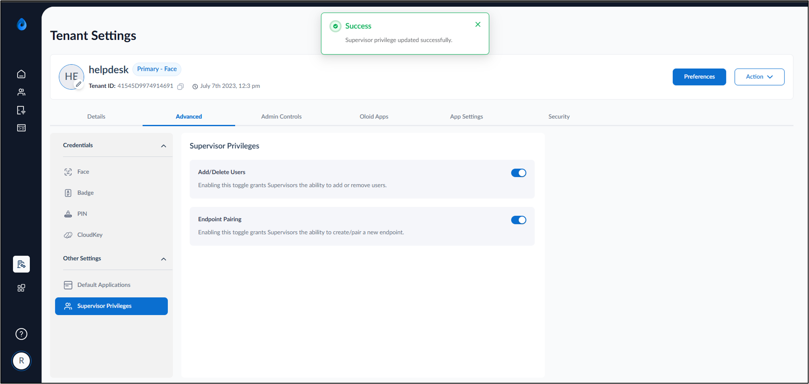

{/* Source: Intercom article 9127132 - https://oloid.help/en/articles/9127132-windows-login-how-to-enable-add-delete-users-in-tenant-admin-portal-for-supervisors */}
{/* Generated by intercom_to_mintlify.py - re-running overwrites this file. */}

## Introduction

The **Activate Add/Delete Users** setting allows the Tenant Admin to grant Supervisors permission to add and delete users directly from the Supervisor App. When enabled, authorized Supervisors can manage users without requiring Tenant Admin intervention.

## Prerequisites

- You must have access to the Tenant Admin Portal.
- Ensure Windows Login application is created in the Tenant Admin Portal. For more information, refer [Windows Login - How to create and configure Windows Login application in the Tenant Admin Portal](/platforms/windows/windows-login/windows-login-how-to-create-and-configure-windows-login-application)

## Steps to Enable the Add/Delete Users Privilege

1. Log in to the **Tenant Admin Portal**.
2. On the homepage of the portal, click **user profile icon** on the bottom left corner of the menu panel.

   

   The user profile menu is displayed.
3. Click **Tenant Settings**.

   

   The **Tenant Settings** page is displayed.
4. Go to **Advanced** > click **Supervisor Privileges**.

   

5. Enable the **Add/Delete Users** toggle.
6. Click **Save.**

Now, the supervisor can manage users.

---

##### Video Tutorial

Watch our video **[How to Activate Add/Delete User Action on the App for Supervisor- Video Tutorial](/platforms/windows/videos/how-to-activate-add-delete-user-action-on-the-app-for-supervisor)**
