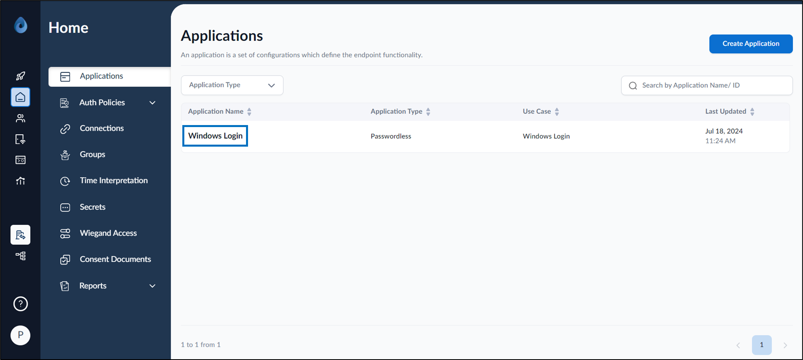
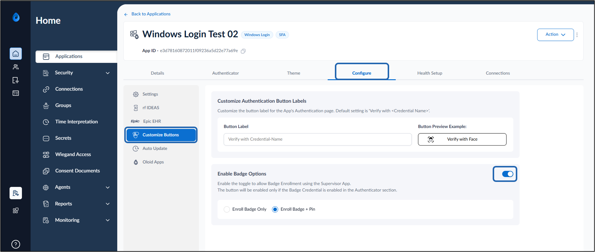
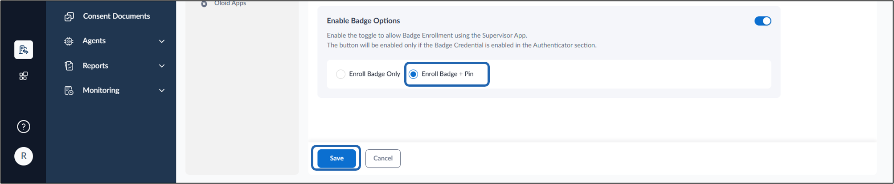
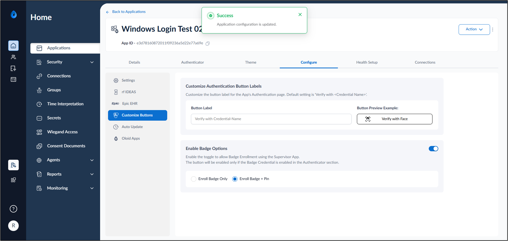

{/* Source: Intercom article 9182568 - https://oloid.help/en/articles/9182568-windows-login-how-to-enable-enroll-badge-option-for-supervisor-app */}
{/* Generated by intercom_to_mintlify.py - re-running overwrites this file. */}

## Introduction

The Enable Badge Options setting allows Tenant Admin to control the badge enrollment options available in the Supervisor App. Depending on your authentication requirements, you can allow users to enroll using Badge only or require Badge + PIN authentication.

## Prerequisites

- You must have access to the Tenant Admin Portal.
- Ensure Windows Login application is created in the Tenant Admin Portal. For more information, refer [Windows Login - How to create and configure Windows Login application in the Tenant Admin Portal](/platforms/windows/windows-login/windows-login-how-to-create-and-configure-windows-login-application)

## Steps to Enable Badge Enrollment Options

1. Log in to the Tenant Admin Portal.
   The Application Detail page is displayed.
2. Select the application that is configured in the Supervisor App.

   

   The Application Details page is displayed.
   Go to **Configure** > click **Customize Buttons** > click **Enable Badge Options**.

   

   The Configuration page is displayed.
3. Do one of the following:
   1. Select **Enroll Badge Only** to allow badge-only enrollment.
   2. Select **Enroll Badge + PIN** to require badge and PIN authentication.
4. Click **Save**.

The badge enrollment configuration is saved successfully.

---

##### Video Tutorial

Watch our video **[How to enable Badge option for Supervisor App for Windows in Oloid Portal - Video Tutorial](/platforms/windows/videos/how-to-enable-badge-option-for-supervisor-app-for-windows-in-oloid)**
