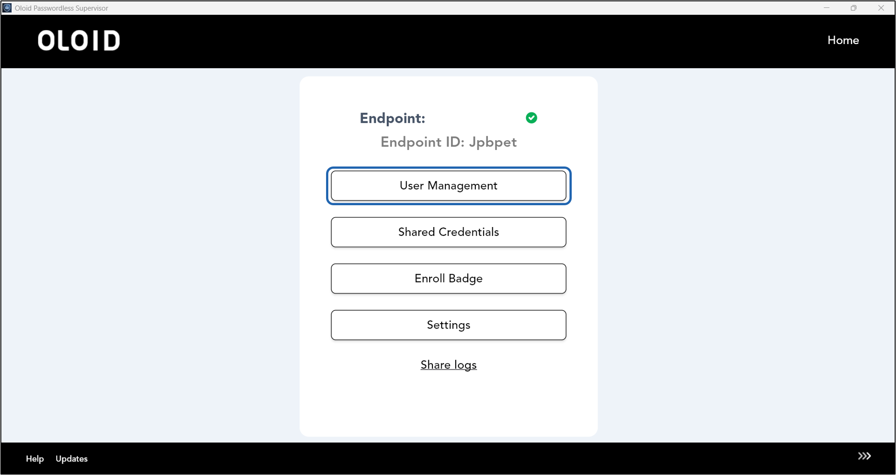
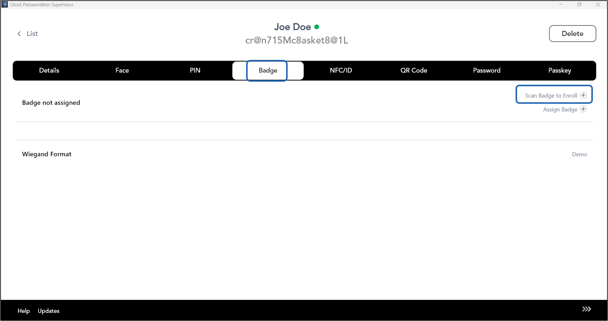
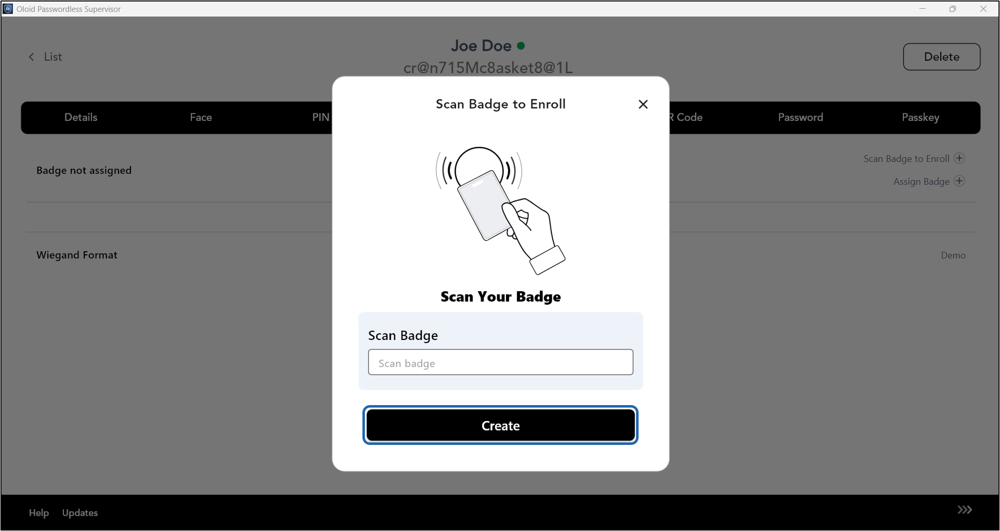
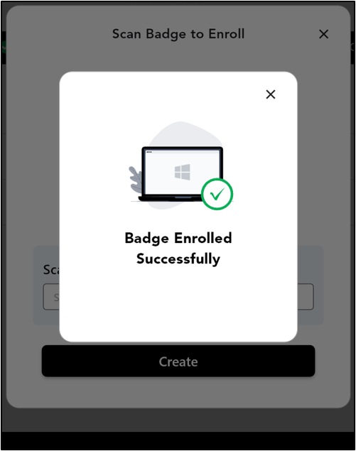

{/* Source: Intercom article 9619247 - https://oloid.help/en/articles/9619247-windows-login-how-to-enroll-badge-for-a-user-using-supervisor-app */}
{/* Generated by intercom_to_mintlify.py - re-running overwrites this file. */}

## Introduction

The Scan Badge to Enroll feature in the Supervisor App allows Admins and Supervisors to enroll a user’s badge by scanning it with a connected badge reader.

## Prerequisites

- Windows Login Application must be created in the Tenant Admin Portal. For more information, refer: [How to create and configure Windows Login application in the Tenant Admin Portal](/platforms/windows/windows-login/windows-login-how-to-create-and-configure-windows-login-application)
- Ensure the endpoint is paired with the Windows Login application. refer [Windows Login - How to Manually Pair the Supervisor App](/platforms/windows/supervisor-app/windows-login-how-to-manually-pair-the-supervisor-app)
- Log in to the Supervisor App using an Admin or Supervisor account. For more, refer [How to log in to Supervisor App](/platforms/windows/supervisor-app/how-to-log-in-to-supervisor-app)
- Ensure at least one connection is configured for the selected application in the Tenant Admin Portal. For more information, refer: [How to Configure a Connection in the Tenant Admin Portal](/platform/tenant-admin-portal/tenant-admin-portal-how-to-configure-a-connection-in-the-tenant-admin)
- Ensure User is created. Refer: **[Windows Login - How to Add a User](/platforms/windows/supervisor-app/windows-login-how-to-add-a-user)**

## Steps to Enroll badge

1. Log in to **Supervisor App**. For more, refer to [How to log in to Supervisor App](/platforms/windows/supervisor-app/how-to-log-in-to-supervisor-app)
   The **Admin Home** screen is displayed.
2. On the Admin Home screen, select **User Management**.

   

   The **Users** screen is displayed.
3. Select a user to view details.

   

   The **Details** tab is displayed.
4. Select **Badge** tab > **Scan Badge to Enroll**.

   

   The **Scan Badge to Enroll** pop-up box is displayed.
5. Do the following:
   1. Scan your badge in the Badge Reader.
      The badge number is filled in automatically in the **Scan Badge to Edit** field.
   2. Click **Create**.

The badge is enrolled successfully.

