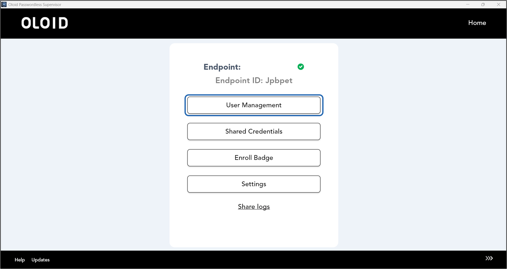
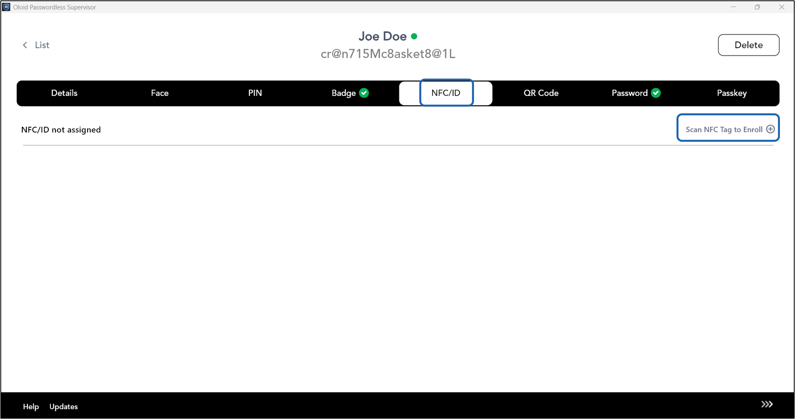
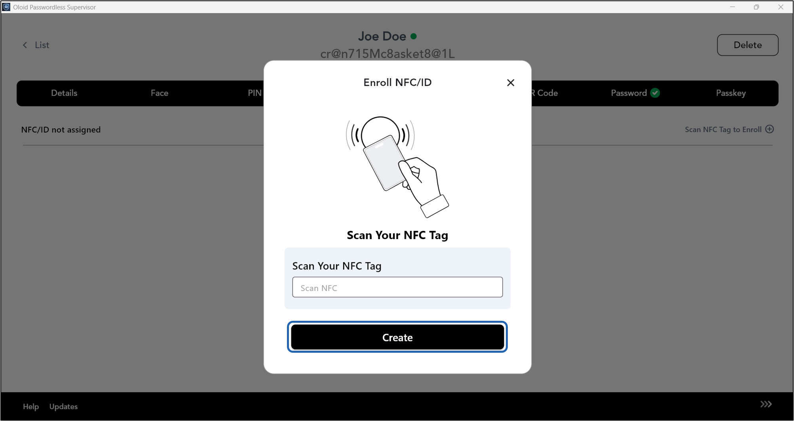
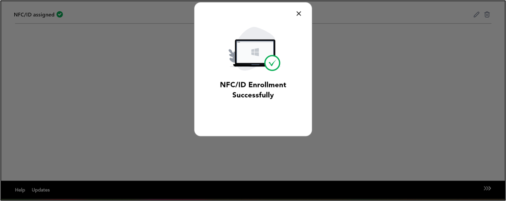

{/* Source: Intercom article 9526633 - https://oloid.help/en/articles/9526633-windows-login-how-to-enroll-nfc-id */}
{/* Generated by intercom_to_mintlify.py - re-running overwrites this file. */}

## Introduction

The NFC tab in the Supervisor App allows Admin and Supervisor to enroll an NFC tag as a user's authentication credential.

## Prerequisites

- Ensure the endpoint is paired with the Windows Login application. For more information, refer: [Windows Login - How to manually pair the Supervisor App](/platforms/windows/supervisor-app/windows-login-how-to-manually-pair-the-supervisor-app)
- Log in to the Supervisor App using an Admin or Supervisor account. For more, refer [How to log in to Supervisor App](/platforms/windows/supervisor-app/how-to-log-in-to-supervisor-app)
- Ensure at least one connection is configured for the selected application in the Tenant Admin Portal. For more information, refer: [How to Configure a Connection in the Tenant Admin Portal](/platform/tenant-admin-portal/tenant-admin-portal-how-to-configure-a-connection-in-the-tenant-admin)

## Steps to Enroll NFC

1. Log in to Supervisor App. Refer [How to log in to Supervisor App](/platforms/windows/supervisor-app/how-to-log-in-to-supervisor-app)
   The Admin Home screen is displayed.
   On the Admin Home screen, select User Management.

   

   The Users screen is displayed.
2. Select a user to view details.

   

   The **Details** tab is displayed.
3. Select **NFC** tab > **Scan NFC Tag to Enroll**.

   

   The **Enroll NFC/ID** pop-up box is displayed.
4. Scan your NFC Tag in the Reader.
   The scanned NFC number is auto-populated on the **Add Your NFC Tag** field.
5. Click **Create**.

   <Note>
     **Note:** If Keystroke is selected under **RFID HF/LF Settings**, users can enter the NFC number manually using the keyboard or scan the NFC tag to add the NFC credential.
   </Note>

The NFC Tag is enrolled successfully.

---

##### Video Tutorial

Watch our video **[How to assign NFC in Supervisor App for Windows - Video Tutorial](/platforms/windows/videos/how-to-assign-nfc-in-supervisor-app-for-windows-video-tutorial)**
