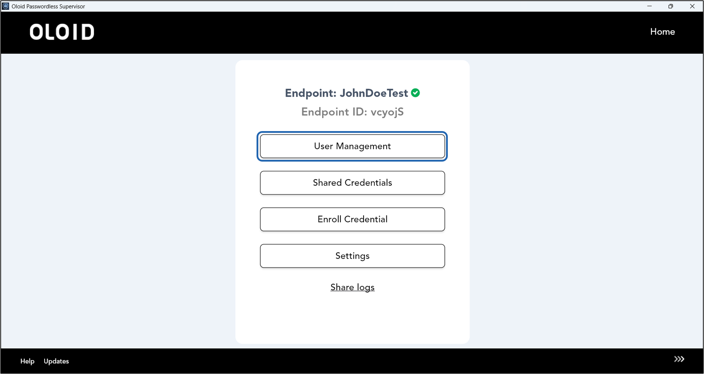
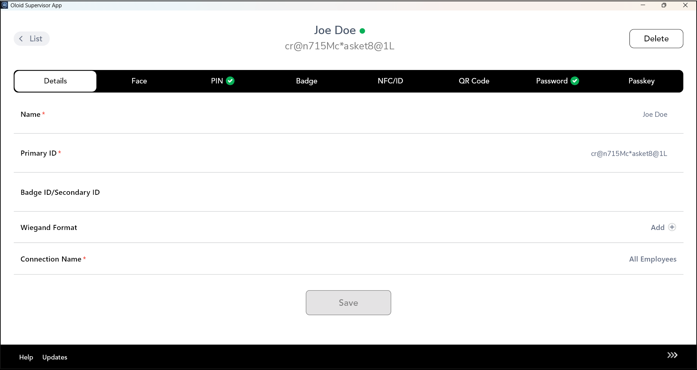
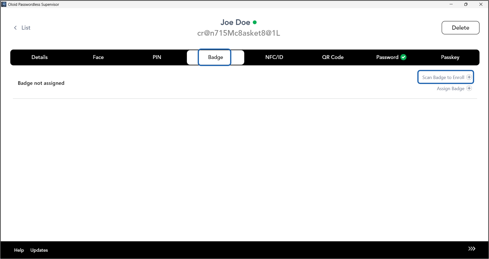
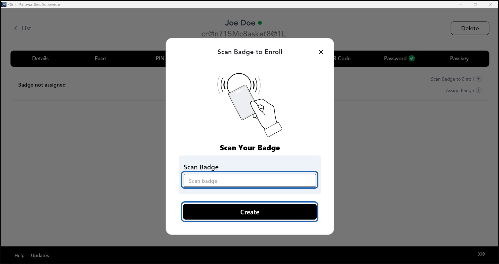
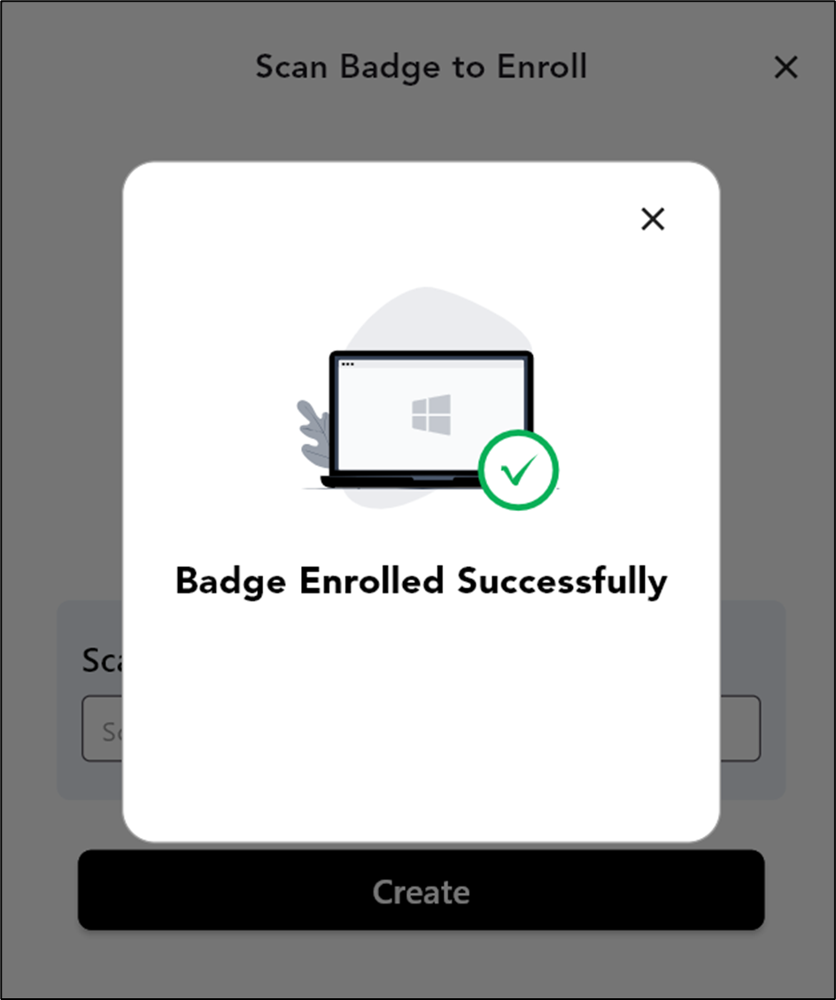

{/* Source: Intercom article 11721445 - https://oloid.help/en/articles/11721445-windows-login-how-to-enroll-pc-sc-badge-using-supervisor-app */}
{/* Generated by intercom_to_mintlify.py - re-running overwrites this file. */}

## Introduction

This document provides instructions for enrolling a PC/SC badge to a user through the Supervisor App. The badge can be scanned using a connected PC/SC badge reader and enrolled directly from the user's Badge details.

## Prerequisites

- The endpoint must be paired with the Windows Login application. For more information, refer to [Windows Login - How to manually pair the Supervisor App](/platforms/windows/supervisor-app/windows-login-how-to-manually-pair-the-supervisor-app)
- You must be logged in to the Supervisor App with an Admin or Supervisor account. For more information, refer to [How to log in to Supervisor App](/platforms/windows/supervisor-app/how-to-log-in-to-supervisor-app)
- A supported badge reader must be connected to the system.
- The user must exist. You can add a user from the Supervisor App or the Tenant Admin Portal. For more information, refer to [Tenant Admin Portal - How to Create User](/platform/tenant-admin-portal/tenant-admin-portal-how-to-create-user)
- A badge must be assigned to the user. For more information, refer to [Supervisor App: Assign Badge](/platforms/windows/supervisor-app/windows-login-how-to-enroll-assign-badge).
- PC/SC Badge input must be enabled for the application’s connection. For more information, refer to [How to add PC/SC Badge input enabled Connection to the Application in the Tenant Admin Portal](/platform/tenant-admin-portal/how-to-add-personal-computer-smart-card-pc-sc-badge-input-enabled).

## Steps to Enroll PC/SC Badge in the Supervisor App

1. Log in to **Supervisor App**. For more, refer [How to log in to Supervisor App](/platforms/windows/supervisor-app/how-to-log-in-to-supervisor-app)
   The **Admin Home** screen is displayed.
2. On the Admin Home screen, select **User Management**.

   

   The **Users** screen is displayed.
3. Select the user to view details.

   

   The User details screen is displayed.

   

4. Select **Badge** tab.
   The **Badge** tab is displayed.
5. Click **Scan Badge to Enroll.**

   

   The **Scan Badge to Enroll** pop-up box is displayed.
6. Tap the **Badge** on the **Reader** to scan it.

   <Note>
     **Note:** PC/SC Badge reader must be connected to the system.
   </Note>

7. Click **Create**.

   

   The **Badge** is enrolled successfully.

   
