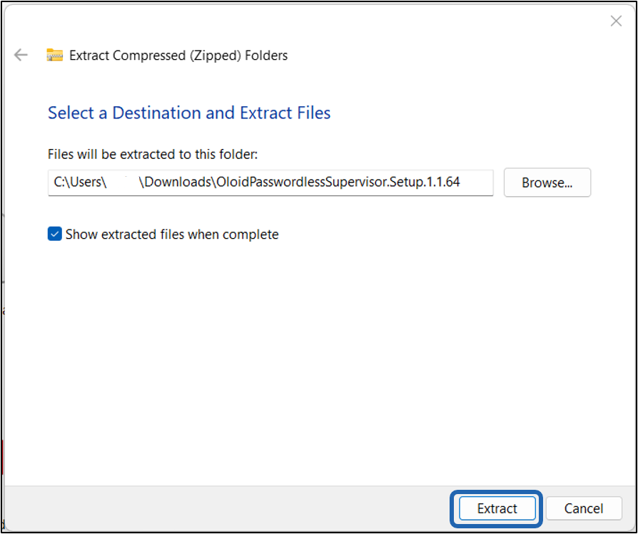
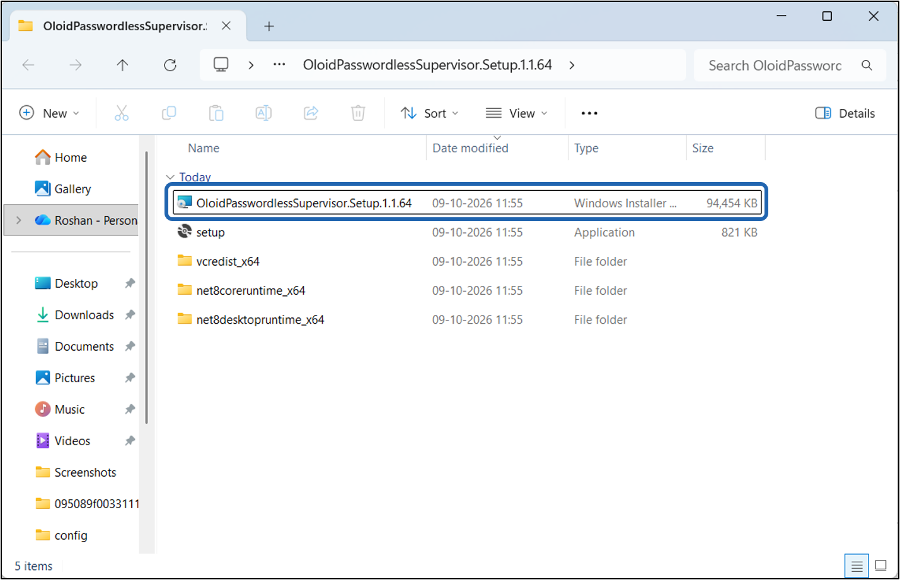
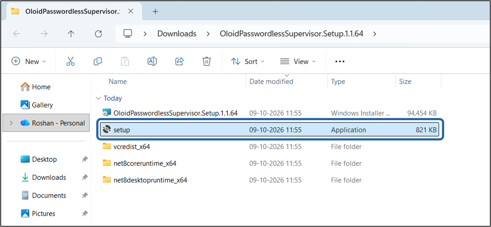
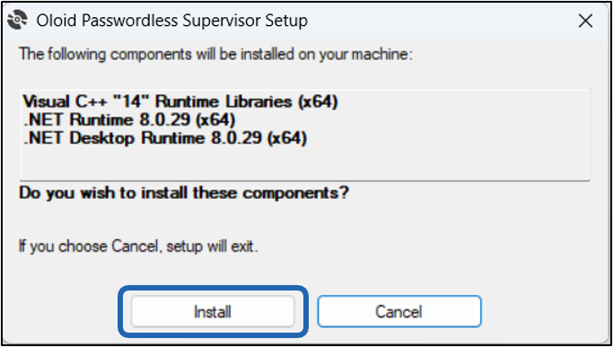
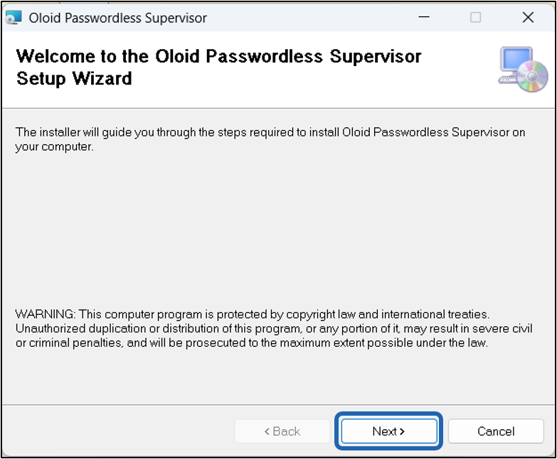
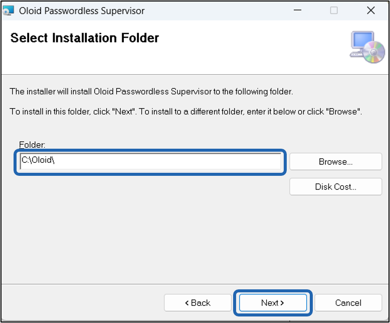

{/* Source: Intercom article 9036683 - https://oloid.help/en/articles/9036683-windows-login-how-to-install-windows-authenticator-app */}
{/* Generated by intercom_to_mintlify.py - re-running overwrites this file. */}

## Introduction

The Windows Authenticator App is a Windows-based application that enables you to configure the Windows Login app. It allows you to set up endpoints, manage users and shared credentials, and support multiple authentication methods such as badge, PIN, and password.

## Pre-requisite

The Windows Authenticator App must be downloaded. For detailed instructions, see [How to download Windows Authenticator App](/platforms/windows/supervisor-app/how-to-download-supervisor-app)

<Note>
  **Note:** It is recommended to use [Tenant Settings](/platforms/windows/supervisor-app/how-to-download-supervisor-app) tab to download the installer file.
</Note>

Make sure your system has the following installed components:

- Visual C++ "14.44" Runtime Libraries (x64) or later
- .NET Runtime 8.0.7 (x64) or later 8.0.x
- .NET Desktop Runtime 8.0.7 (x64) or later 8.0.x

If any of these components are missing, you'll need to run the **setup.exe** file included in the installation file.

**Steps to install Windows Authenticator App:**

1. Download **Windows Authenticator App** file on your system.

   

   <Note>
     **Note:** If you have subscribed to Presence Detection feature, then download **Windows Authenticator App (Presence Detection)** file on your system.
   </Note>

   

   The **OloidPasswordlessSupervisor.Setup.zip** file is downloaded to your system.
2. Right-click and select **Extract All** > **OloidPasswordlessSupervisor.Setup.zip** file.
3. The extract folder pop-up is displayed, click **Extract.**

   

4. Confirm the presence of required components:
   - If all required components are already installed, then double-click **OloidPasswordlessSupervisor.Setup** file.

     

   - If any component is missing, double-click **setup.exe** to install missing dependencies.

     

5. In the **Oloid Passwordless Supervisor Setup** window, review the listed components, and click **Install** to proceed.

   <Note>
     **Note:** If components are missing, the setup prompts you to install them.
   </Note>

   

6. On the **Oloid Passwordless Supervisor** Setup wizard, click **Next**.

   

7. Use the default path to install the application and click **Next**.

   

8. Click **Next** to confirm the installation.

   

9. Click **Close** after the installation is complete.

   

   You can find the app icon  on your desktop.
   Now restart your system for the Windows Supervisor App to take effect.
