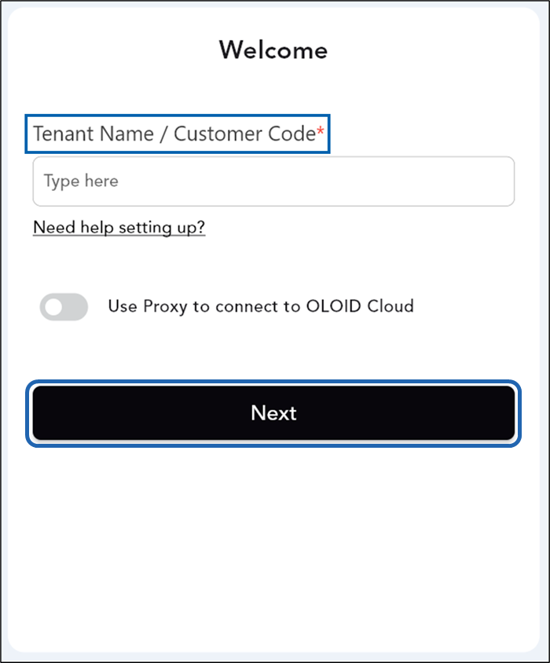
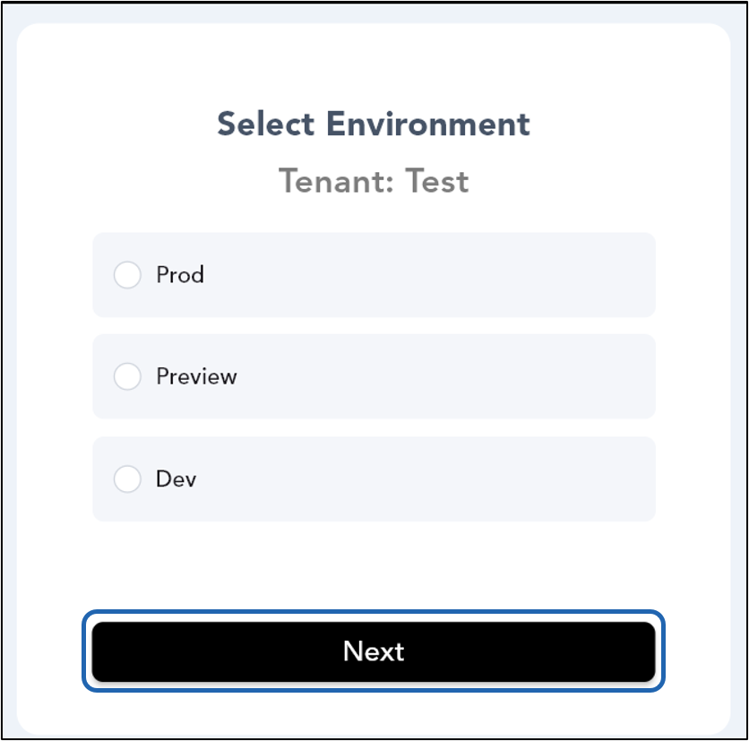
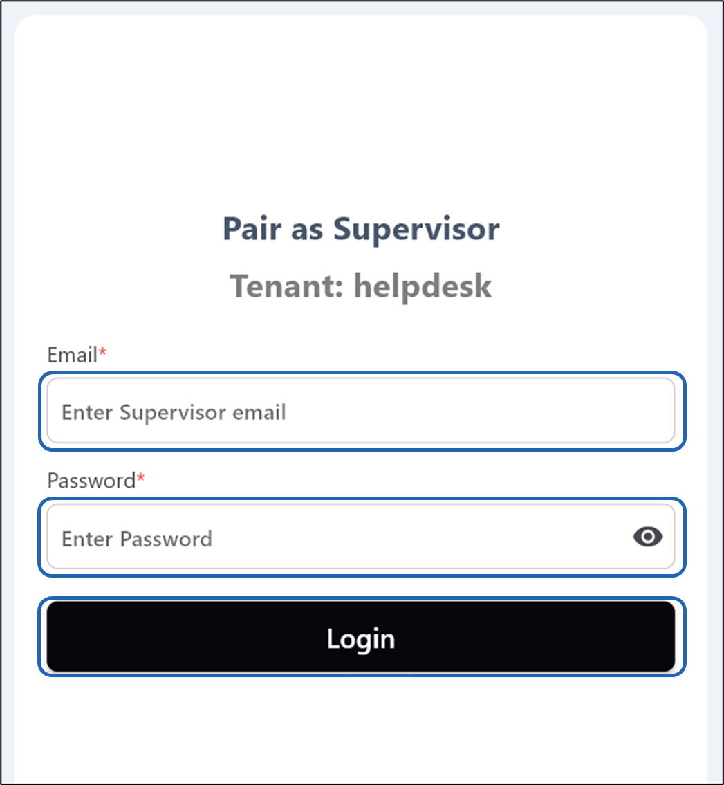
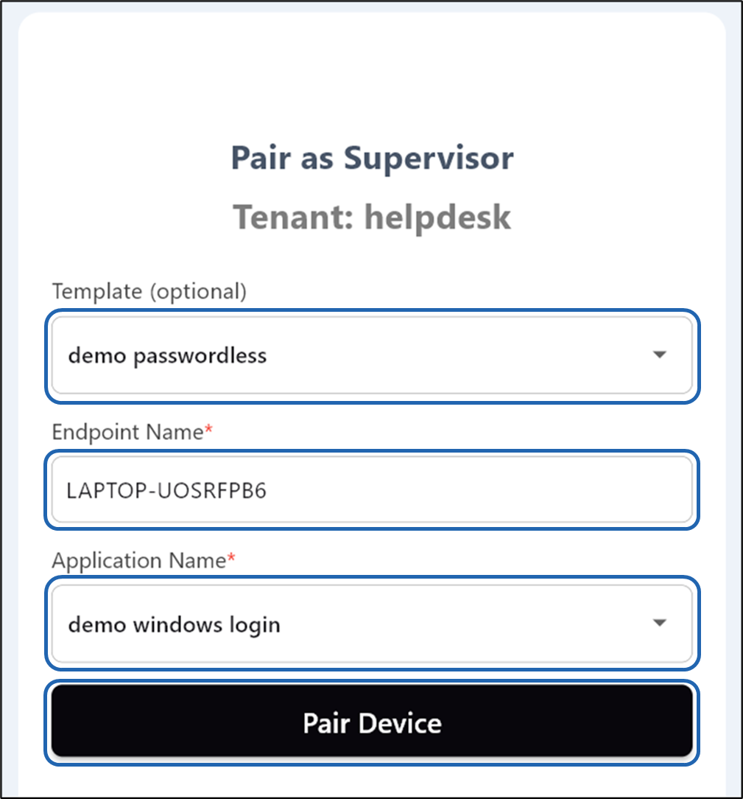
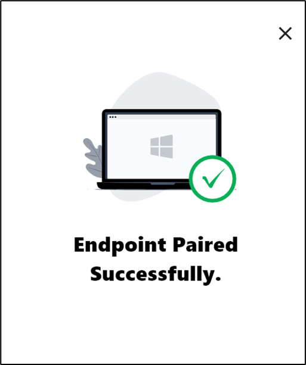

{/* Source: Intercom article 9059601 - https://oloid.help/en/articles/9059601-windows-login-how-to-manually-pair-the-supervisor-app */}
{/* Generated by intercom_to_mintlify.py - re-running overwrites this file. */}

## Introduction

The Supervisor App allows admins or supervisors to pair a Windows endpoint with a Windows Login application. During the pairing process, you can specify the endpoint name and select the required Windows Login application to associate with the endpoint.

## Prerequisites

- You must have Admin or Supervisor credentials to perform endpoint pairing.
- You must have Tenant Admin Access.
- Windows Login Application must be created in the Tenant Admin Portal. For more information, refer: [How to create and configure Windows Login application in the Tenant Admin Portal](/platforms/windows/windows-login/windows-login-how-to-create-and-configure-windows-login-application)

## Steps to Pair as Supervisor

1. Double-click on the **Supervisor App** to start.

   

   The **Welcome** screen is displayed.
2. Enter **Tenant Name / Customer Code**.
3. Click **Next**.

   

   The Select Environment screen is displayed.
4. Choose the required environment > click **Next.**

   

   The **Pair As Supervisor** login screen is displayed.
5. Enter Supervisor **Email ID** and **Password** > Click **Login**.

   

   The **Pair as Supervisor** screen is displayed.
6. Do the following
   1. Select **Template** (Optional).
   2. Enter **Endpoint Name**.

      <Note>
        **Note:** The endpoint name field is auto-populated with the machine name by default, though it can be manually edited as required.
      </Note>

   3. Select **Application Name**.

      

Click **Pair Device**.

The endpoint is successfully paired and a success message is displayed.

