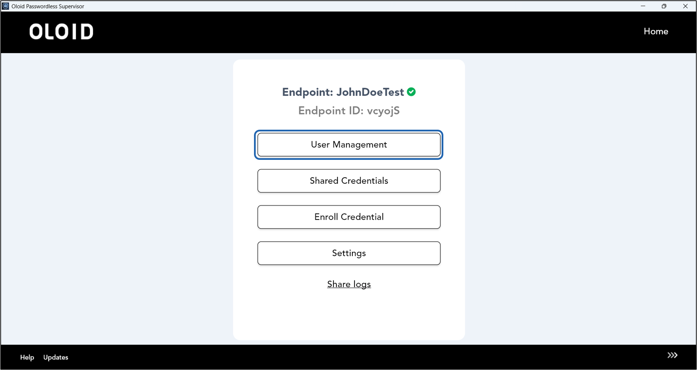
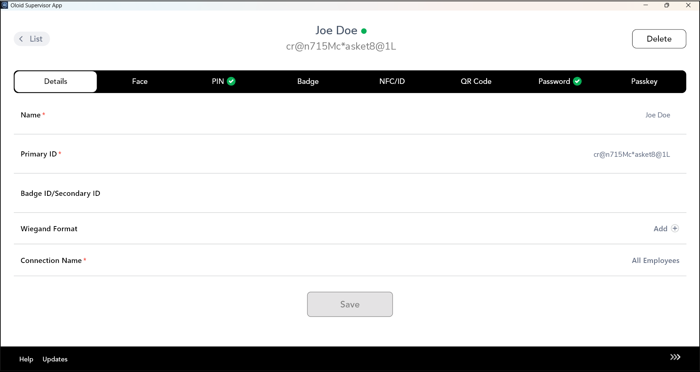
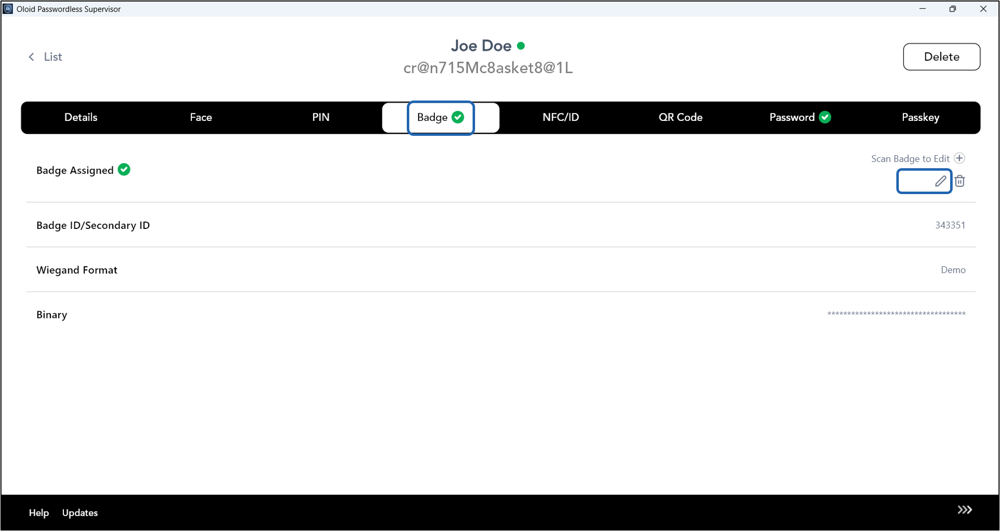
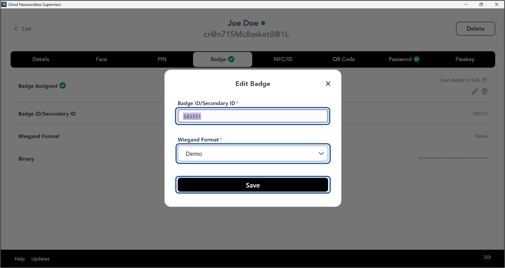
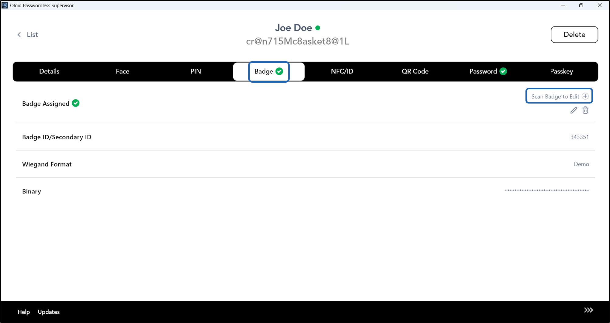
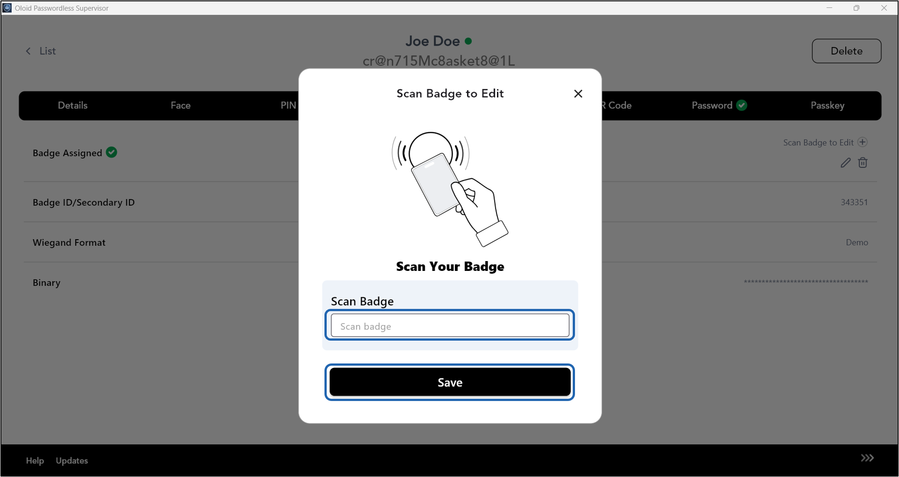
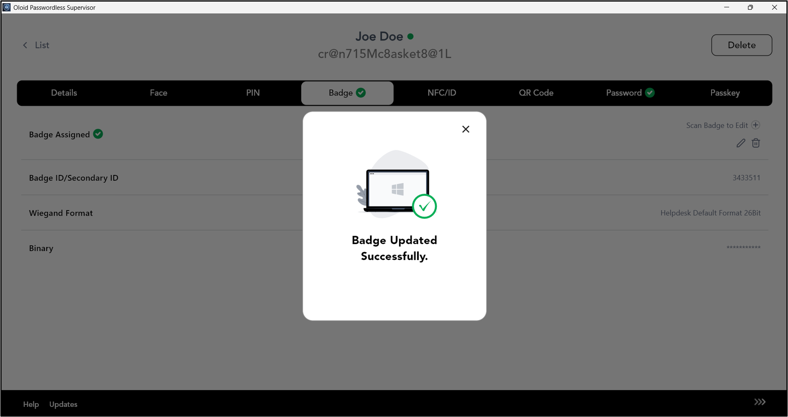

{/* Source: Intercom article 11580899 - https://oloid.help/en/articles/11580899-windows-login-how-to-update-a-badge-using-the-supervisor-app */}
{/* Generated by intercom_to_mintlify.py - re-running overwrites this file. */}

## Introduction

This document provides step-by-step instructions for updating a user's badge in the Supervisor App. You can update the badge number manually or scan a badge using a connected badge reader.

## Prerequisites

- The endpoint must be paired with the Windows Login application. For more information, refer to [Windows Login - How to manually pair the Supervisor App](/platforms/windows/supervisor-app/windows-login-how-to-manually-pair-the-supervisor-app)
- You must be logged in to the Supervisor App with an Admin or Supervisor account. For more information, refer to [How to log in to Supervisor App](/platforms/windows/supervisor-app/how-to-log-in-to-supervisor-app)
- A supported badge reader must be connected to the system.
- The user must exist in the Tenant Admin Portal. For more information, refer to [Tenant Admin Portal - How to Create User](/platform/tenant-admin-portal/tenant-admin-portal-how-to-create-user).
- The badge must be assigned to the user. For more details, refer [Supervisor App: Assign Badge](/platforms/windows/supervisor-app/windows-login-how-to-enroll-assign-badge).

## Steps to Update a Badge in the Supervisor App

1. Log in to **Supervisor App**. For more, refer [How to log in to Supervisor App](/platforms/windows/supervisor-app/how-to-log-in-to-supervisor-app)
   The **Admin Home** screen is displayed.
2. On the Admin Home screen, select **User Management**.

   

   The **Users** screen is displayed.
3. Select the user to view details.

   

   The User details screen is displayed.

   

4. Select **Badge** tab.
   The **Badge** tab is displayed.
5. Do one of the following:
   1. Click the **Edit Icon** to update badge.

      

      The Edit Badge pop-up box is displayed.
   2. Do the following:
      1. Edit or Enter the **Badge number**
      2. Select **Weigand format** from dropdown.
      3. Click **Save.**

         

         OR
   3. Click **Scan Badge to Edit.**

      

      The **Scan Badge to Edit** pop-up box is displayed.
   4. Do the following:
      1. Tap the **Badge** on the **Reader** to scan it.

         <Note>
           **Note:** Badge reader must be connected to the system.
         </Note>

      2. Click **Save.**

         

The **Badge** is updated successfully.

