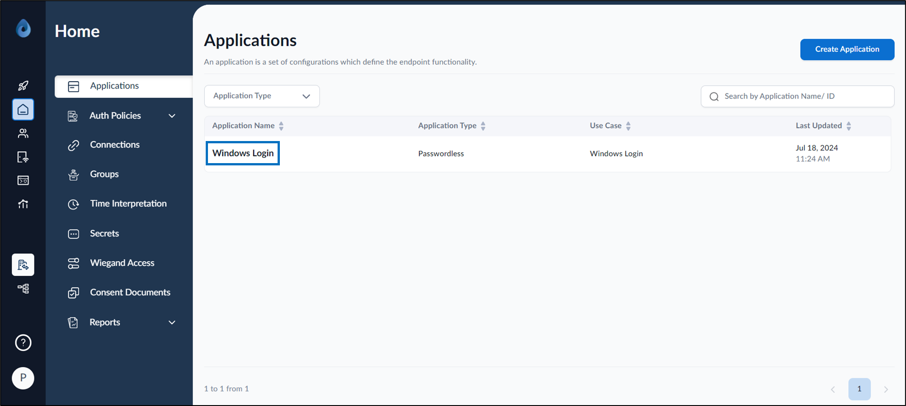
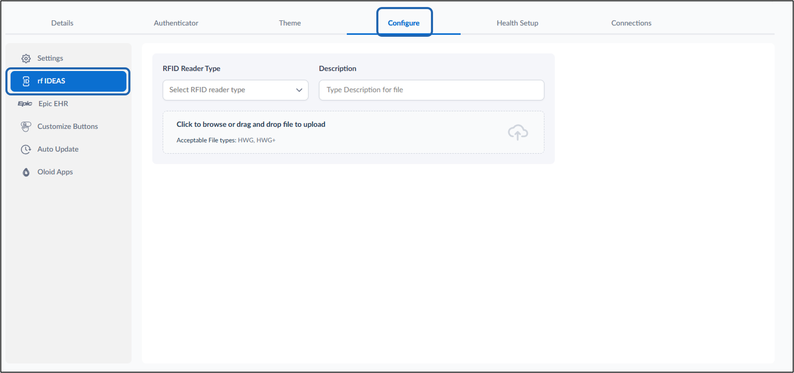
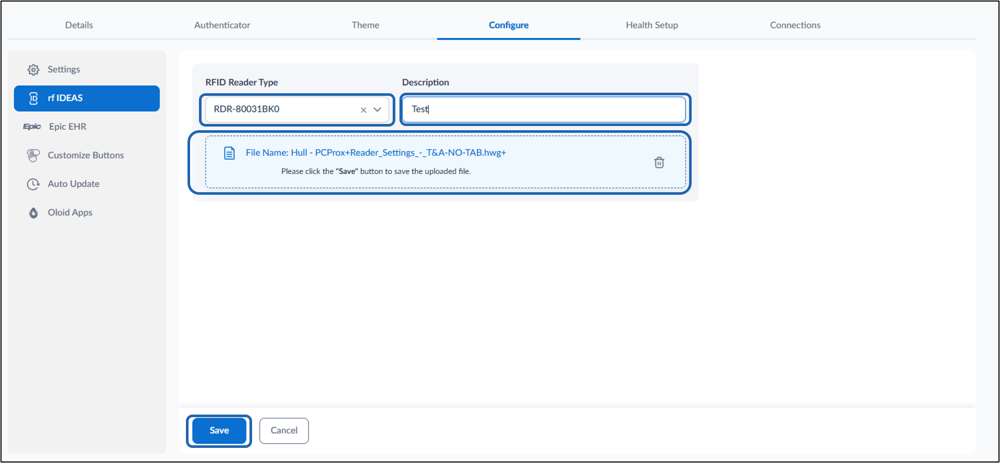
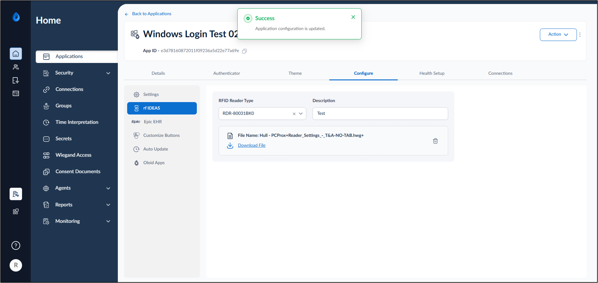
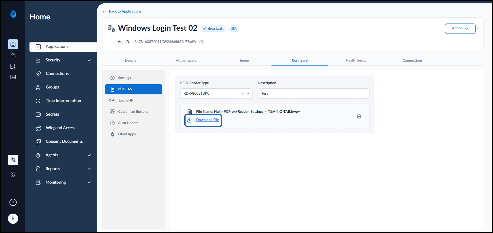

{/* Source: Intercom article 9215874 - https://oloid.help/en/articles/9215874-windows-login-how-to-upload-download-hwg-file-in-tenant-admin-portal */}
{/* Generated by intercom_to_mintlify.py - re-running overwrites this file. */}

## Introduction

This document explains how to upload and download an HWG (hardware configuration) file from the rf IDEAS settings in the Tenant Admin Portal. The HWG file configures a supported RFID reader so it works correctly with the Supervisor App for badge enrollment and authentication. You can also download the current HWG file to keep as a backup or reuse it.

[Uploading HWG file](#uploading-hwg-file)

[Downloading HWG file](#downloading-hwg-file)

## Prerequisites

- You must have admin access to the Tenant Admin Portal.
- Ensure a **Windows Login** application is created in the Tenant Admin Portal. For More Information, refer to **[Windows Login - How to create and configure Windows Login application in the Tenant Admin Portal](/platforms/windows/windows-login/windows-login-how-to-create-and-configure-windows-login-application)**
- Ensure the required HWG file is available before starting the upload.

## Uploading HWG file

### Steps to Upload HWG file

1. Log in to the Tenant Admin Portal.
   The Application Detail page is displayed.
2. Select the Windows Login application configured for the Supervisor App.

   

   The Application Details page is displayed.
3. Go to **Configure** tab > **rf IDEAS**.

   

4. Do the following:
   1. Select an **RFID reader type** from the RFID Reader Type drop-down list.
   2. Enter **Description**. (Optional)
   3. Click the upload area to browse for the HWG file, or drag and drop the file into the upload area.
   4. Click **Save**.

      

The HWG file is downloaded successfully.

## Downloading HWG file

### Steps to Download HWG file

### Log in to the Tenant Admin Portal.

1. The Application Detail page is displayed.
2. Select the Windows Login application configured for the Supervisor App.

   

   The Application Details page is displayed.
3. Go to **Configure** tab > click **rf IDEAS**.

   

4. Click **Download File** to download the HWG file to your local device.

   
