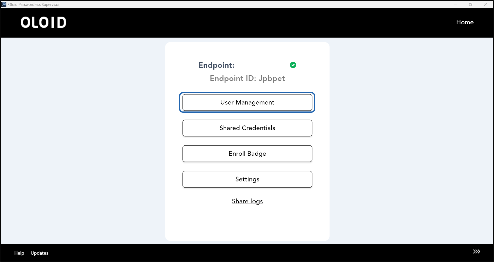
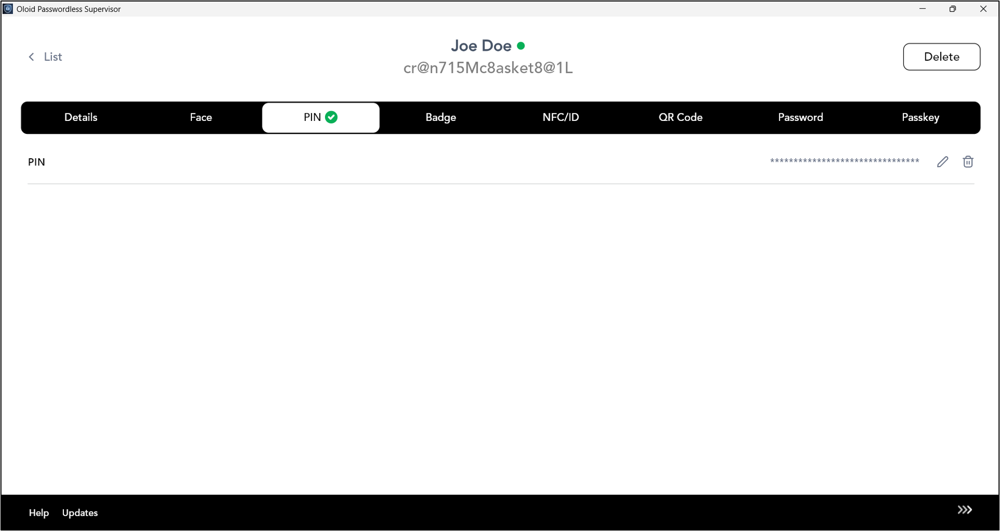
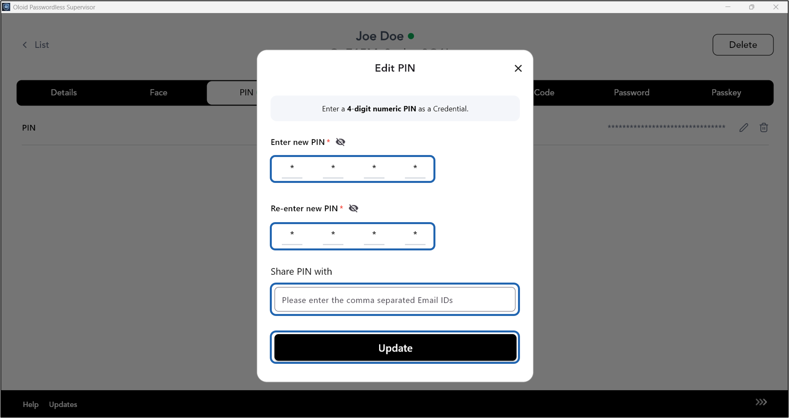
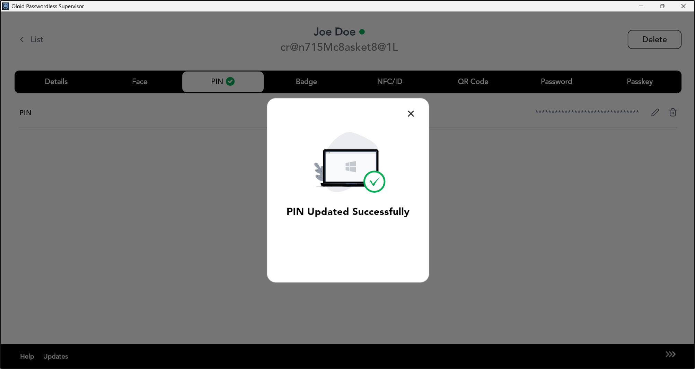

{/* Source: Intercom article 9116073 - https://oloid.help/en/articles/9116073-windows-login-how-to-view-and-edit-pin */}
{/* Generated by intercom_to_mintlify.py - re-running overwrites this file. */}

## Introduction

A user's PIN can be updated at any time to maintain security or comply with organizational policies. Admins and Supervisors can view the user's PIN details and update the PIN through the Supervisor App.

## Prerequisites

- Ensure the endpoint is paired with the Windows Login application. For more information, refer: [Windows Login - How to manually pair the Supervisor App](/platforms/windows/supervisor-app/windows-login-how-to-manually-pair-the-supervisor-app)
- Log in to the Supervisor App using an Admin or Supervisor account. For more, refer [How to log in to Supervisor App](/platforms/windows/supervisor-app/how-to-log-in-to-supervisor-app)
- Ensure at least one connection is configured for the selected application in the Tenant Admin Portal. For more information, refer: [How to Configure a Connection in the Tenant Admin Portal](/platform/tenant-admin-portal/tenant-admin-portal-how-to-configure-a-connection-in-the-tenant-admin)
- Ensure User is created. Refer: **[Windows Login - How to Add a User](/platforms/windows/supervisor-app/windows-login-how-to-add-a-user)**

## Steps to View and Edit PIN

1. Log in to **Supervisor App**. For more, refer to[How to log in to Supervisor App](/platforms/windows/supervisor-app/how-to-log-in-to-supervisor-app)
   The **Admin Home** screen is displayed.
2. On the Admin Home screen, select **User Management**.

   

   The **Users** screen is displayed.
3. Select the user whose PIN you want to view or edit.

   

   The User details screen is displayed.
4. Select **PIN** tab >click the **Edit** icon.

   

   The **Edit PIN** pop-up box is displayed.
5. Do the following:
   1. Enter your new PIN.
   2. Re-enter your new PIN.
   3. Enter one or more email addresses in the **Share PIN with** field to share the updated PIN. (Optional)
   4. Click **Update**.

The user's PIN is successfully updated.

---

##### Video Tutorial

Watch our video **[How to view and edit PIN in the Supervisor App for Windows - Video Tutorial](/platforms/windows/videos/how-to-view-and-edit-pin-in-the-supervisor-app-for-windows-video)**
