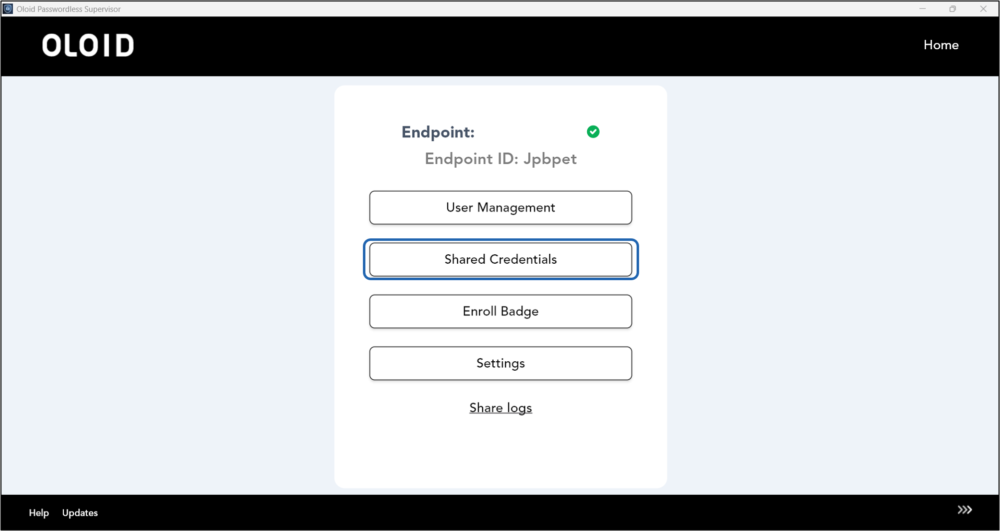
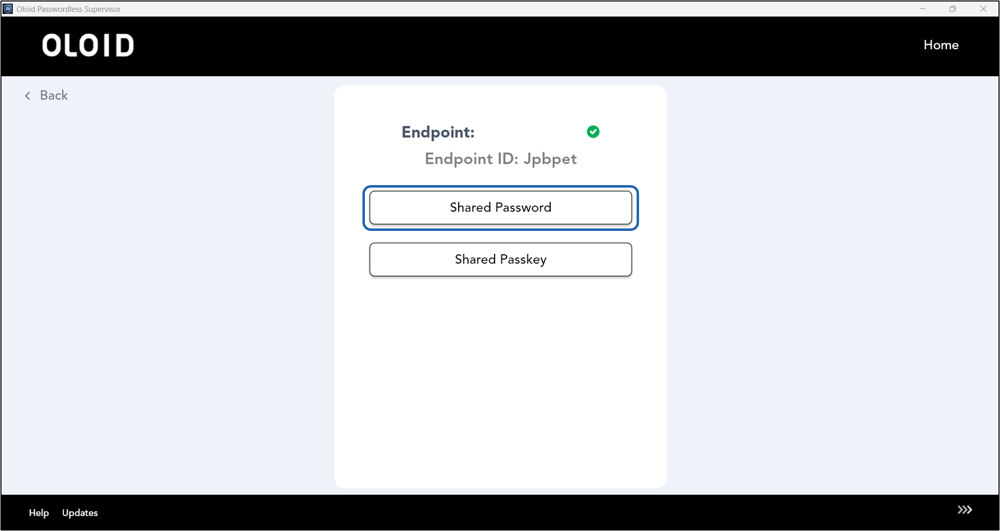
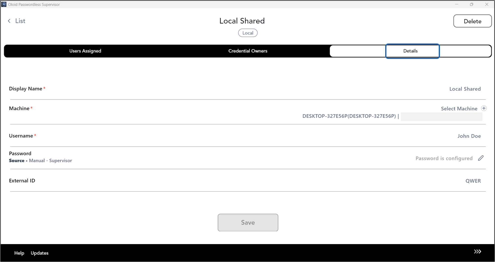
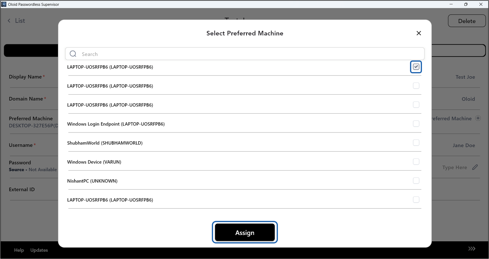
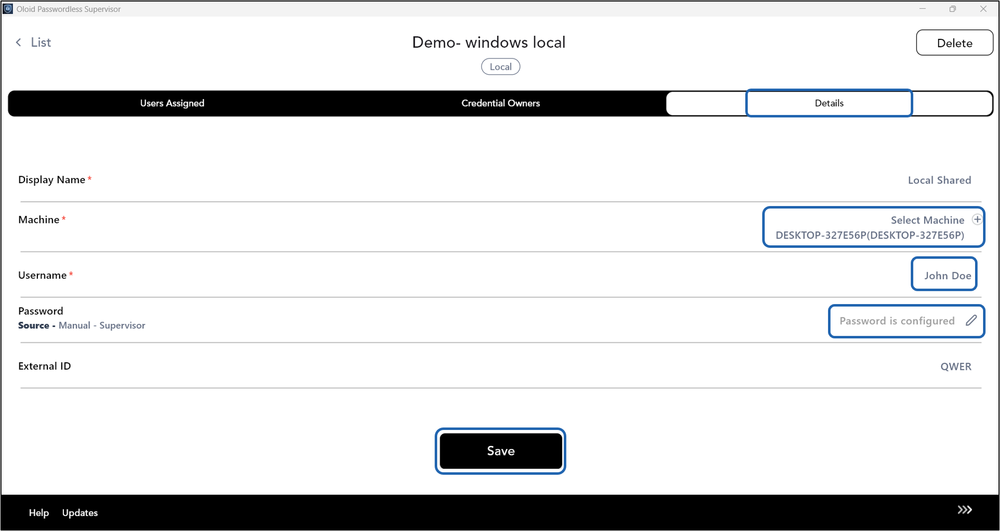
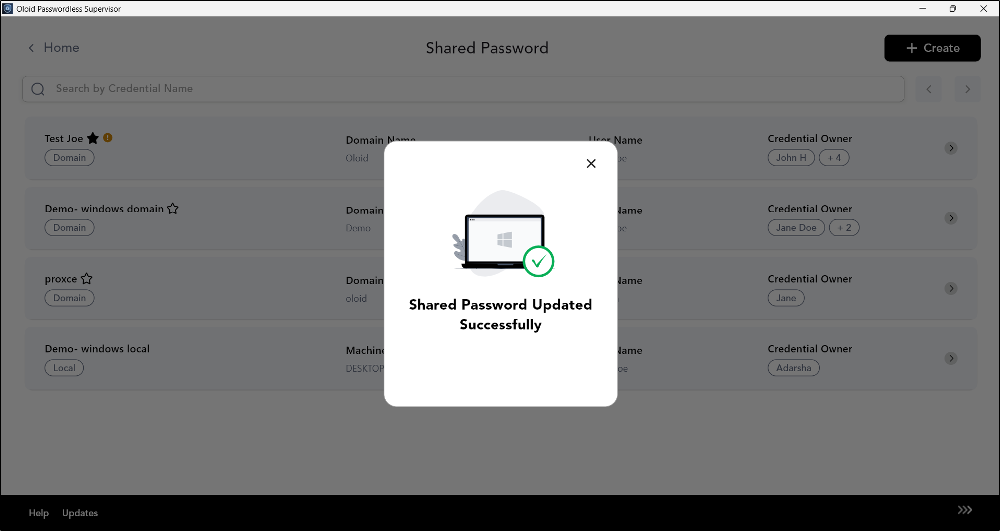
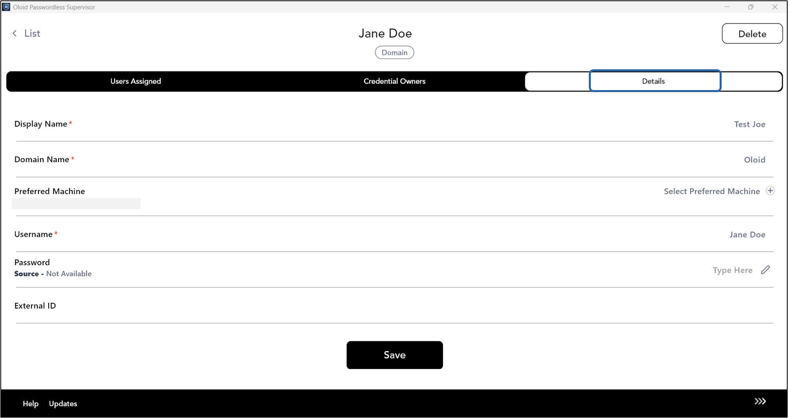
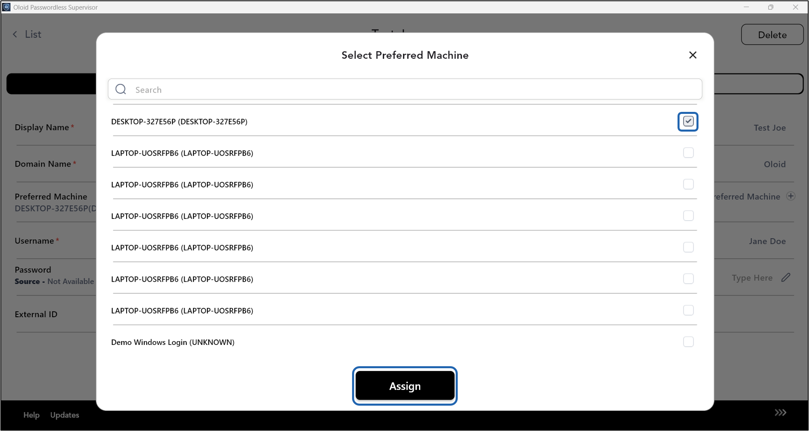
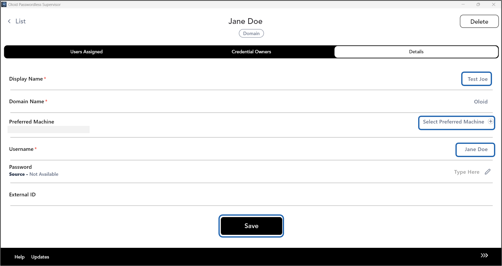
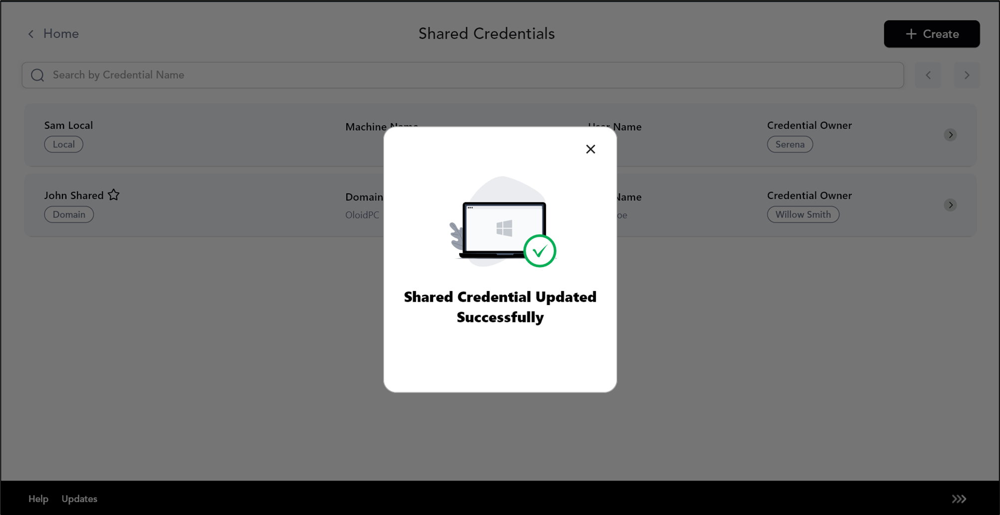

{/* Source: Intercom article 9196014 - https://oloid.help/en/articles/9196014-windows-login-how-to-view-and-edit-shared-password-details-in-supervisor-app */}
{/* Generated by intercom_to_mintlify.py - re-running overwrites this file. */}

## Introduction

Shared Credentials can be updated after they are created to reflect changes such as the display name, username, password, associated machine, preferred machines, or external ID.

## Prerequisites

- Ensure the endpoint is paired with the Windows Login application. For more information, refer: [Windows Login - How to manually pair the Supervisor App](/platforms/windows/supervisor-app/windows-login-how-to-manually-pair-the-supervisor-app)
- Log in to the Supervisor App using an Admin or Supervisor account. Refer: [How to log in to Supervisor App](/platforms/windows/supervisor-app/how-to-log-in-to-supervisor-app)
- Ensure the shared credential is created. For more information, refer: **[How to Create Shared Credentials Using the Supervisor App](/platforms/windows/supervisor-app/windows-login-how-to-create-shared-password-using-the-supervisor-app)**.

## Steps to view and edit Shared Password

1. Log in to **Supervisor App**.
   The **Admin Home** screen is displayed.
2. Select **Shared Credentials**.

   

3. Select **Shared Password**.

   

   The **Shared Password** page is displayed.
4. Select one of the following based on the type of shared credential you want to edit:
   1. View and Edit Local Shared Credential
   2. View and Edit Domain Shared Credential
      The respective (Local / Domain) Shared Credential screen is displayed.

### View and Edit a Windows Local User Shared Credential

1. Select the required Shared Password from the list.
2. Go to **Details** tab.

   

3. Edit **Display Name**.
4. Select **Machine** from the **Select Machine** list.
   1. Select a machine and then click **Assign**.

      

5. Edit **Username**.
6. Enter **Password**. (Optional)
7. Enter **External ID**. (Optional)
8. Click **Save.**

The Local Shared Credential is updated successfully.

### View and Edit a Domain User Shared Credential

1. Select the required Shared Password from the list.
2. Go to **Details** tab.

   

3. Edit **Display Name**.
4. Edit **Domain Name**.
5. Select **Preferred Machine** from the **Select Preferred Machine** list.
   1. Select machine(s) and then click **Assign**.

      

6. Edit **Username**.
7. Enter **Password**. (Optional)
8. Enter **External ID**. (Optional)
9. Click **Save.**

The Domain Shared Credential is updated successfully.

---

##### Video Tutorial

Watch the video [How to view and edit Shared Credential details in Supervisor App for Windows- Video Tutorial](/platforms/windows/videos/how-to-view-and-edit-shared-credential-details-in-supervisor-app-for)
