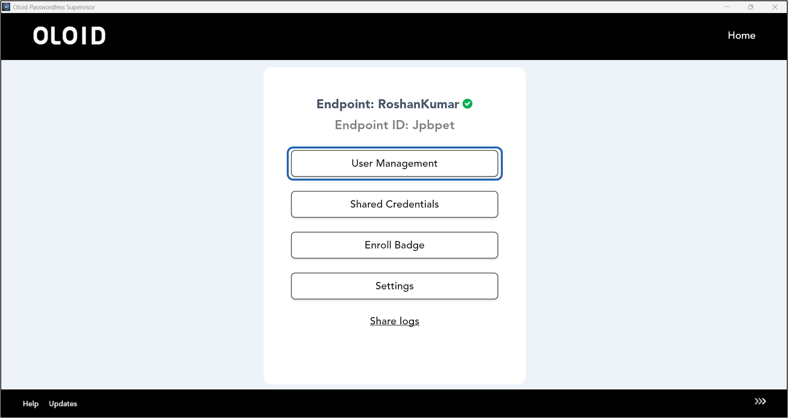
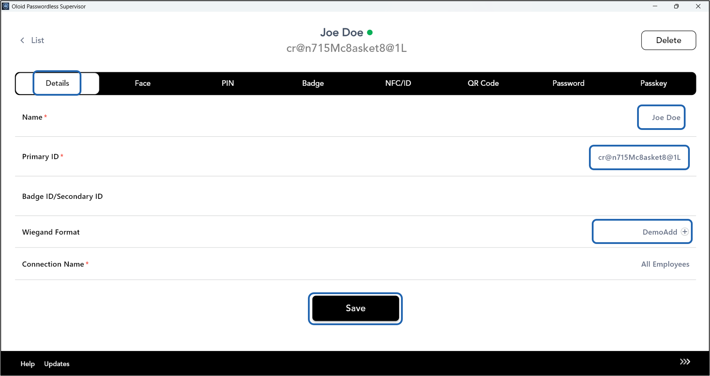
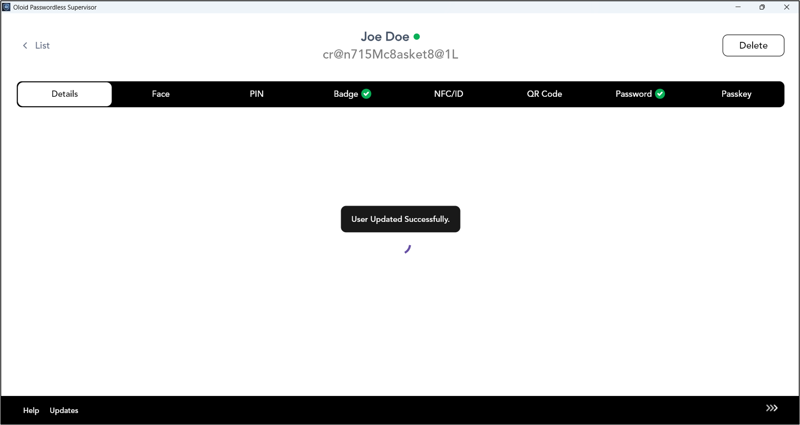

{/* Source: Intercom article 9087842 - https://oloid.help/en/articles/9087842-windows-login-how-to-view-and-edit-user-details */}
{/* Generated by intercom_to_mintlify.py - re-running overwrites this file. */}

## Introduction

The **Details** tab in the Supervisor App allows the Admin and authorized Supervisor to view and update a user's profile information, such as the user's name, Secondary ID, and Wiegand format.

## Prerequisites

- Ensure the endpoint is paired with the Windows Login application. For more information, refer: [Windows Login - How to manually pair the Supervisor App](/platforms/windows/supervisor-app/windows-login-how-to-manually-pair-the-supervisor-app)
- Log in to the Supervisor App using an Admin or Supervisor account. For more, refer [How to log in to Supervisor App](/platforms/windows/supervisor-app/how-to-log-in-to-supervisor-app)
- Ensure the required **Add User** privilege is enabled for the Supervisor. Without this privilege, Supervisors can only view users and their details.
- Ensure the **Add User** action is enabled for the application in the Tenant Admin Portal. If the **Add User** button is unavailable, contact your Tenant Admin. For more information, refer [How to Activate Add User Action on the App for Supervisor](/platforms/windows/supervisor-app/windows-login-how-to-enable-add-delete-users-in-tenant-admin-portal) guide.
- Ensure at least one connection is configured for the selected application in the Tenant Admin Portal.

## Steps to View User Details

1. Log in to **Supervisor App**. For more, refer to[How to log in to Supervisor App](/platforms/windows/supervisor-app/how-to-log-in-to-supervisor-app)
   The **Admin Home** screen is displayed.
2. Select **User Management**.

   

   The **Users** screen is displayed.
3. Select a user to view details.

   

   The **Details** tab is displayed.
4. Do the following:
   1. Edit **Name**. (Optional)
   2. Add or update the **Badge ID (Secondary ID)**. (Optional)
   3. Edit **Weigand Format**. (Optional)
   4. Click **Save.**

The user details are successfully updated.

---

##### Video Tutorial

Watch our video **[How to view and edit User Details in the Supervisor App for Windows - Video Tutorial](/platforms/windows/videos/how-to-view-and-edit-user-details-in-the-supervisor-app-for-windows)**
