{/* Source: Intercom article 8698213 - https://oloid.help/en/articles/8698213-devicelock-app-how-to-create-and-configure-devicelock-application-in-the-tenant-admin-portal */}
{/* Generated by intercom_to_mintlify.py - re-running overwrites this file. */}

## Introduction

This document provides instructions to create and configure the DeviceLock application in the Tenant Admin Portal.

## Prerequisites

- You must have admin access to the Tenant Admin Portal.
- A connection must be created to add to the application. For more refer to, [Tenant Admin Portal - How to Create Connection](/platform/tenant-admin-portal/tenant-admin-portal-how-to-create-connection)

## Steps to create and configure DeviceLock Application

1. Log in to the **Tenant Admin Portal**. For more details, refer [Tenant Admin Portal - How to Log in to the Tenant Admin Portal](/platform/tenant-admin-portal/tenant-admin-portal-how-to-log-in-to-the-tenant-admin-portal)
2. On the home page of the portal, click **Applications** on the left menu panel, and then click **Create Application** in the top-right corner.

   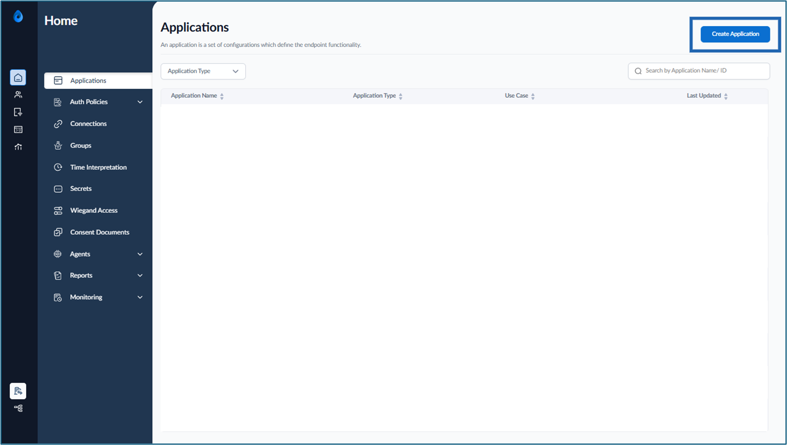

   The **Create New Application** pop-up box is displayed.
3. Do the following:
   1. Enter **Application Name**.
   2. Select **Application Type** as **Passwordless**.
   3. Click **Next**.

      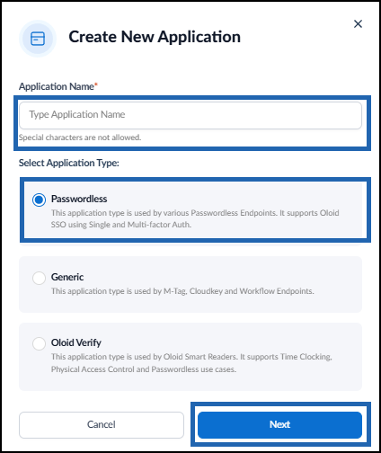

      The **Select Passwordless Use Case** page is displayed.
   4. Select **Device Lock.**
   5. Click **Create**.

      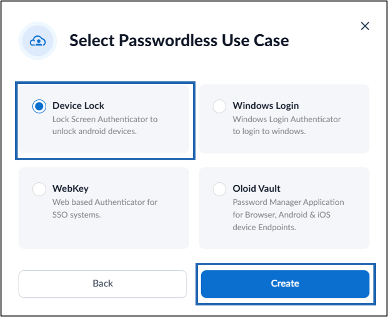

      The Application is successfully created and listed in the applications list.

      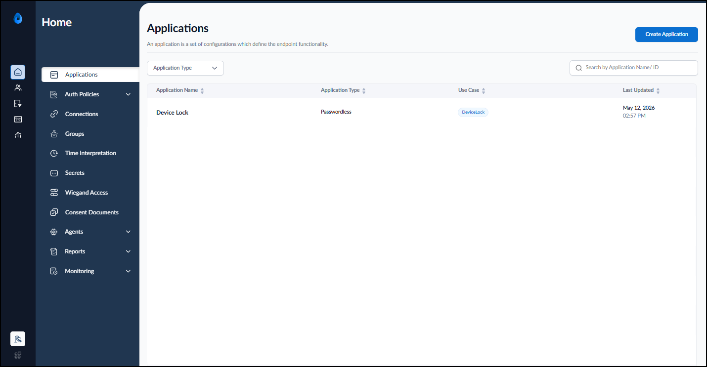

4. Configure the following:
   1. [Configure Details tab](#configure-details-tab)
   2. [Configure Authenticator tab](#configure-authenticator-tab)
   3. [Configure Theme tab](#configure-theme-tab)
   4. [Setup Configure tab](#setup-configure-tab)
   5. [Configure Health Setup tab](#configure-health-setup-tab)
   6. Configure Connection tab
   7. Configure Integration tab

<Note>
  **Note:** These are one-time settings, and all the default settings are recommended.
</Note>

### Configure Details Tab

Go to **Details** tab and do the following:

1. Update **Application Name** (if required).
2. Add **Description**. (Optional)
3. Set **Time Zone** from the drop-down list. (Optional)
4. Click **Save**.

   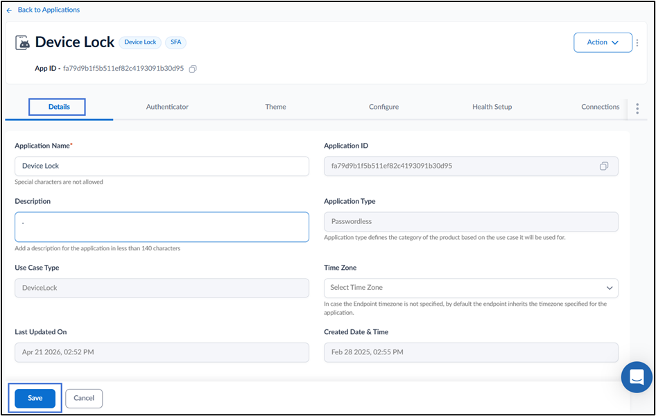

   The Details tab is successfully configured.

   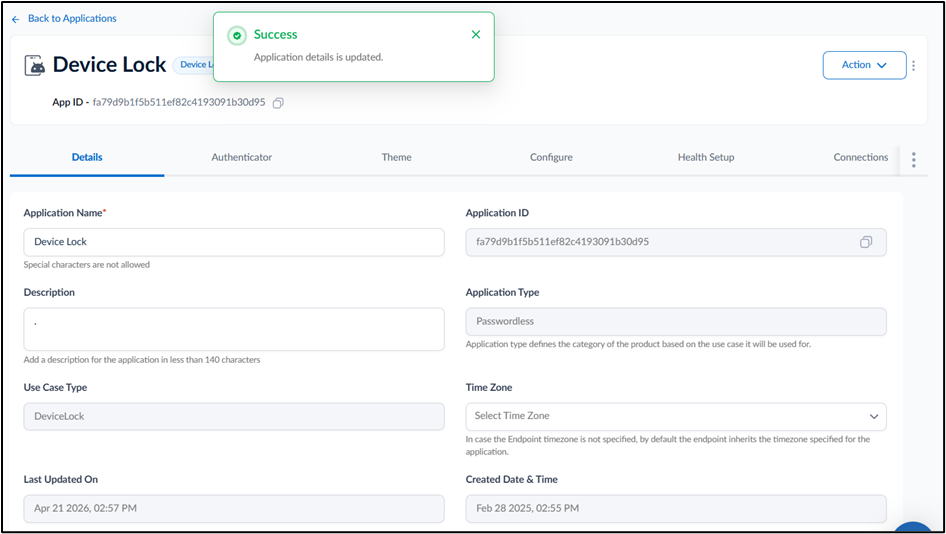

### Configure Authenticator Tab

Go to **Authenticator** tab and do the following:

#### Enable username

The **Enable Username** section allows you to choose how users identify themselves on the DeviceLock application, using either their Employee ID/Primary ID or Email ID.

1. **Emp ID/Primary ID:** Enable this option to allow users to authenticate using their Employee ID or Primary ID.
2. (Optional) In the **Custom Label** field, enter a label that appears on the login screen instead of **Emp ID / Primary ID**.

   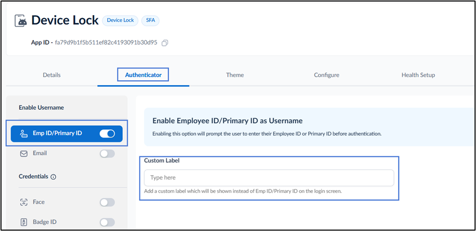

3. **Email:** Enable this option to allow users to authenticate using their Email ID.

   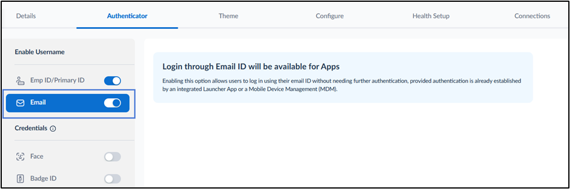

#### Face

The **Face** section allows you to enable Face as a credential and configure the face recognition mode, face match, and liveness check settings used to authenticate on the DeviceLock application.

1. Turn on **Face** toggle, to use face as credential.
2. Select the **FR Mode** from the dropdown list to choose the preferred authentication mode.
   select the preferred face recognition mode:(if required)
   - **Hybrid**: Combines cloud and on-device facial recognition.
   - **Cloud**: Uses cloud-based facial recognition.
   - **On Device**: Uses on-device facial recognition. (if required)

     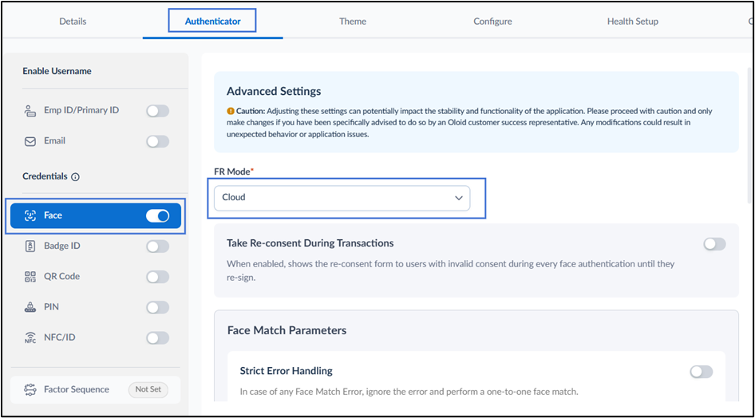

3. Configure the **Face Match Parameters** and **Liveness Check Parameters** on the Advanced Settings page.

   <Note>
     **Note:** The parameters are pre-configured. This is done by Oloid admin.
   </Note>

   1. Turn on **Strict Error Handing** toggle to ignore the face match error and perform one-to-one face match.

      <Note>
        **Note:** If a Face Match error occurs, it will be ignored, and a one-to-one facial comparison will still be performed.
      </Note>

   2. Turn on **Additional face Match** toggle to perform a one-to-one face match in addition to the regular Face Match.
   3. Adjust the slider or enter a value directly into the input box to set the **Face Match Threshold** value. **(for Oloid internal use)**

      <Note>
        **Note:** It defines the required level of similarity between two facial images within the same connection. A higher threshold ensures stricter matching accuracy.
      </Note>

      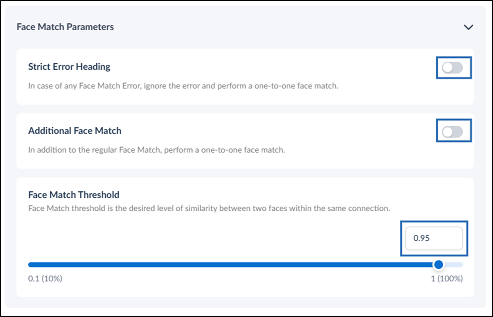

4. Configure the **Liveness Check Parameter** section.
   1. Turn on the **Liveness Check Parameters** toggle.

      <Note>
        **Note:** The liveness parameters can be adjusted only when the **Liveness Check Parameters** toggle is turned on. When the toggle is off, the parameters are disabled.
      </Note>

   2. Adjust the slider or enter a value directly into the input box to set the **Min. Liveness Probability**. **(for Oloid internal use).**

      <Note>
        **Note:** This is the factor to decide if the image is live or spoofed. The threshold for the image to be considered live is 0.5.
      </Note>

   3. Adjust the slider or enter a value directly into the input box to set the **Min. Liveness Quality**. **(for Oloid internal use).**

      <Note>
        **Note:** It defines how "appropriate" the image is for the liveness check. The threshold for good image 0.1.
      </Note>

      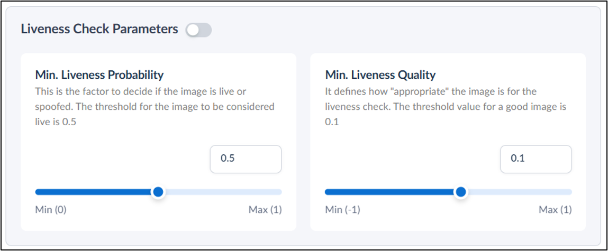

5. Click **Save**.

   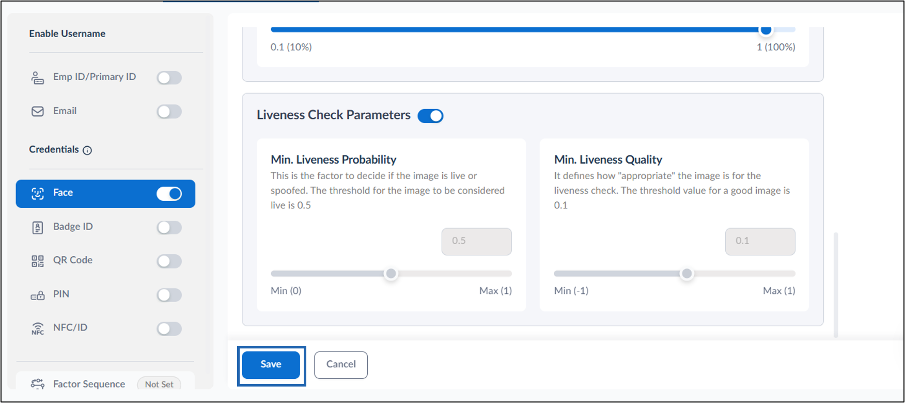

   The Face credential is successfully configured.

   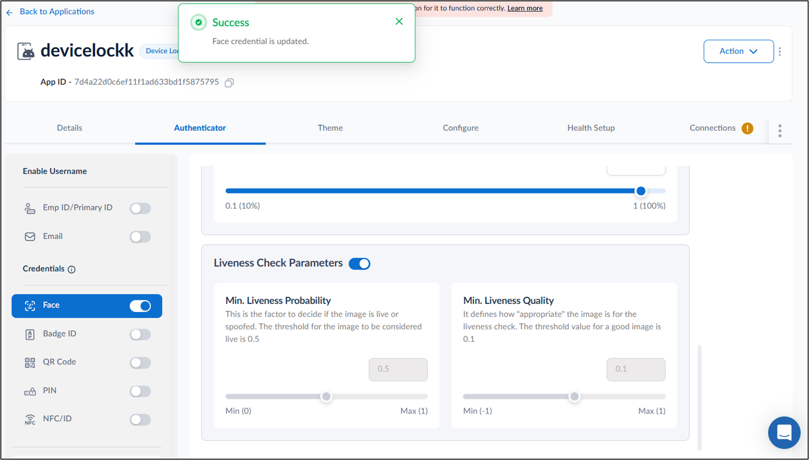

#### Badge ID

The **Badge ID** section allows you to enable Badge ID as a credential and select the badge type used to authenticate on the DeviceLock application.

1. Turn on **Badge ID** toggle, to use **Badge ID** as credential.
2. Select a **Badge Type** from the dropdown list (Optional).

   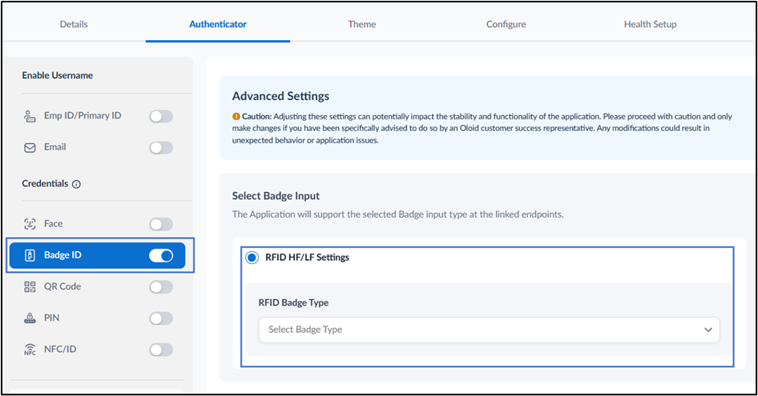

3. Click **Save**.

   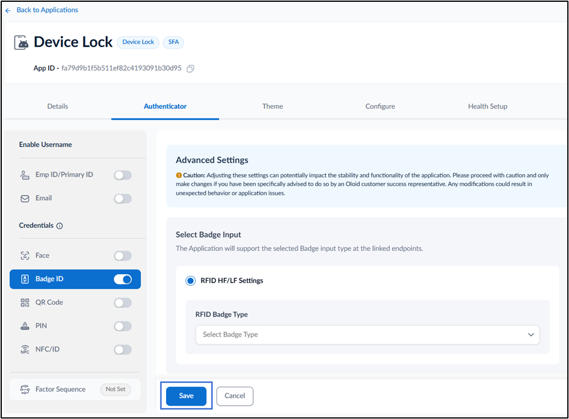

   The Badge ID credential is successfully configured.

   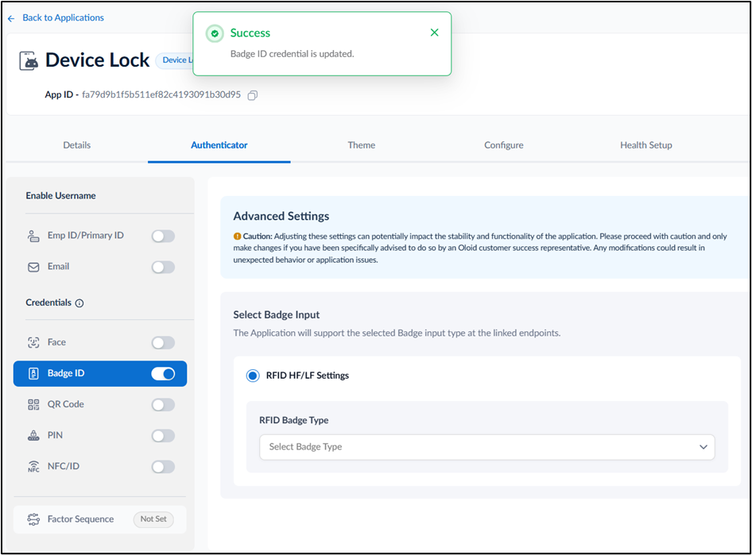

#### QR Code

The **QR Code** section allows you to enable QR Code as a credential and configure how users scan their QR Code on the DeviceLock application.

1. Turn on **QR Code** toggle, to use QR Code as credential.
2. Turn on the **Show Camera Flip Button** toggle to allow users to switch between the front and rear cameras of the endpoint device.
3. Select the **Default camera selection** from the drop-down list.

   <Note>
     **Note:** You can select **Front Camera** or **Rear Camera**.
   </Note>

4. (Optional) Turn on the **Enable QR Code Scanner** toggle to scan QR Codes using a scanner device instead of the camera.

   <Note>
     **Note:** By default, QR Codes are scanned using the camera.
   </Note>

5. Click **Save**.

   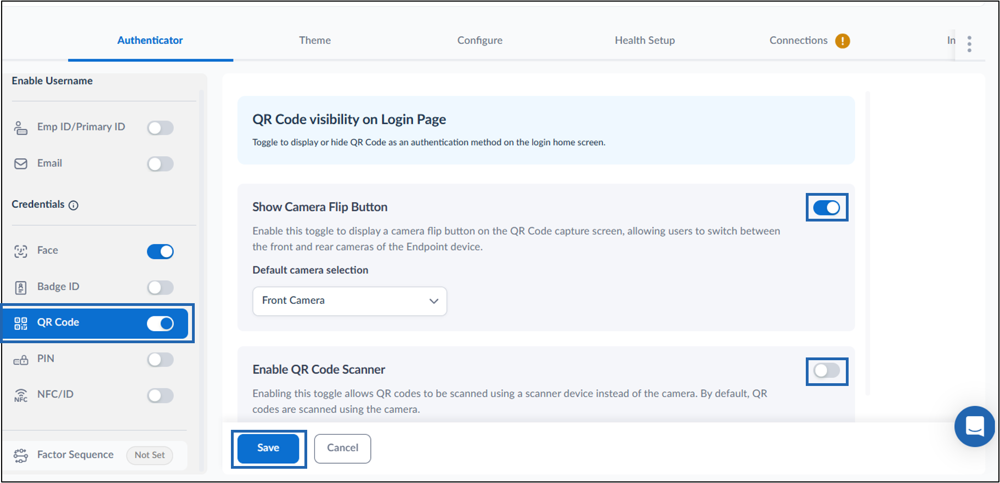

The QR Code credential is successfully configured.

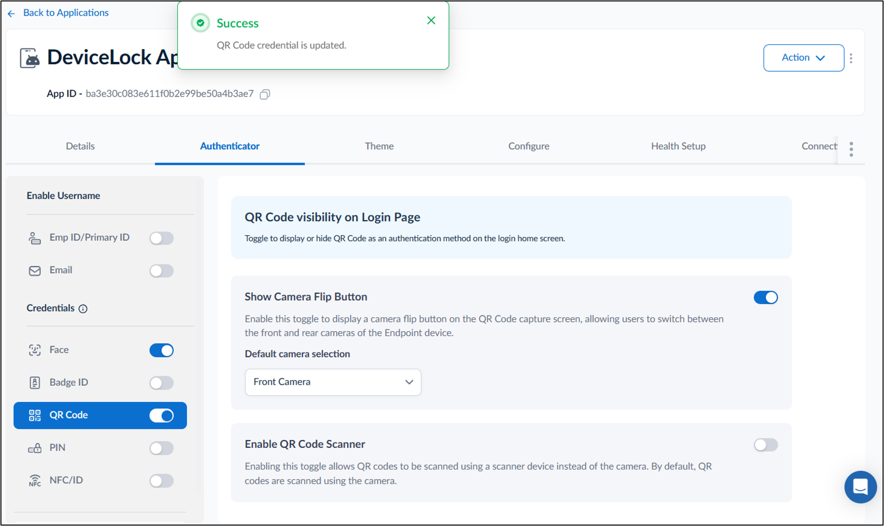

#### PIN

The **PIN** section allows you to enable PIN as a credential for users to authenticate on the DeviceLock application.

Turn on **PIN** toggle, to use PIN as credential.

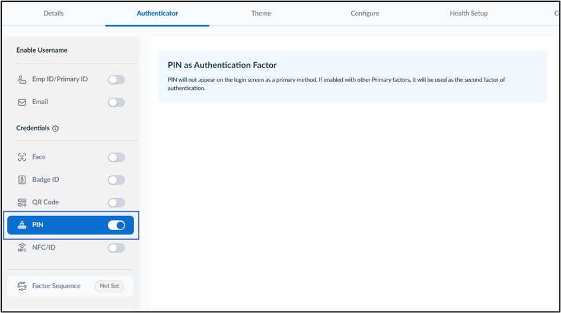

The PIN credential is successfully enabled.

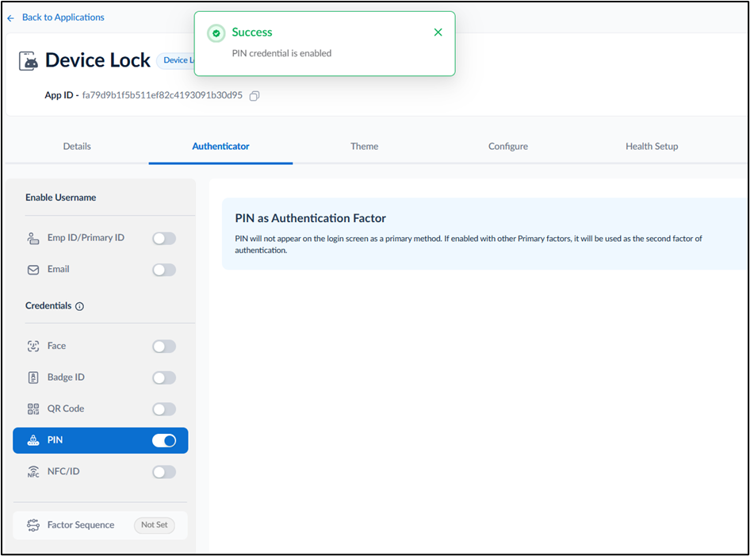

#### NFC/ID

The **NFC/ID** section allows you to enable NFC/ID as a credential for users to authenticate on the DeviceLock application.

Turn on **NFC/ID** toggle, to use **NFC/ID** as credential.

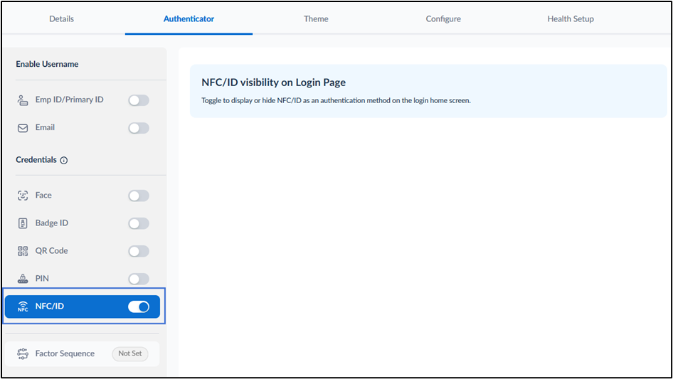

The **NFC/ID** credential is successfully enabled.

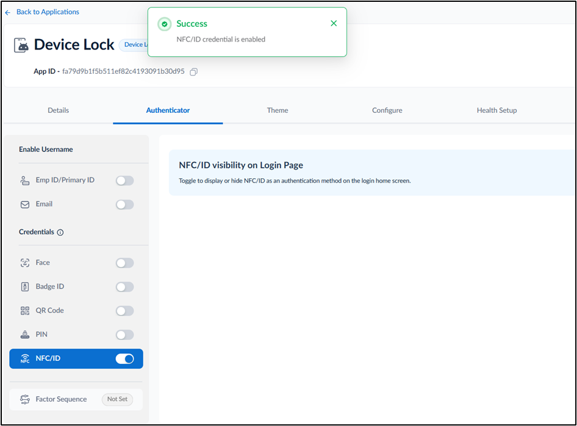

<Note>
  **Note:** You can enable one or more credential options based on your requirements.
</Note>

#### Configure Factor Sequence

The **Factor Sequence** section allows to define the order of authentication factors used for multi-factor authentication (MFA).

In the **Factor Sequence** section, do the following:

1. Enable **Factor Sequence** toggle.
2. Select **Factor Sequence** from the drop-down list. To create and configure Factor Sequence refer to [How to create and configure Factor Sequence](/platform/tenant-admin-portal/how-to-create-and-configure-factor-sequence).

   <Note>
     **Note:** The Factor Sequence feature is applicable only when using multi-factor authentication (MFA).
   </Note>

3. Click **Save**.

   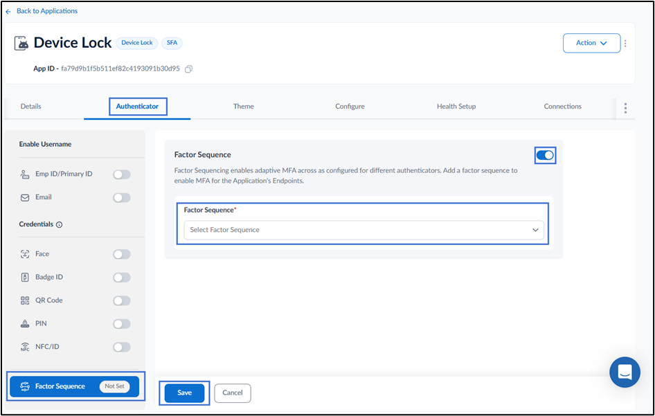

### Configure Theme Tab

The **Theme** tab allows you to customize the appearance of the DeviceLock application by following the onscreen instructions. For more details, see [How to configure theme in Device Lock App](/platforms/windows/windows-login/tenant-admin-portal-how-to-configure-theme-tab-for-devicelock-app).

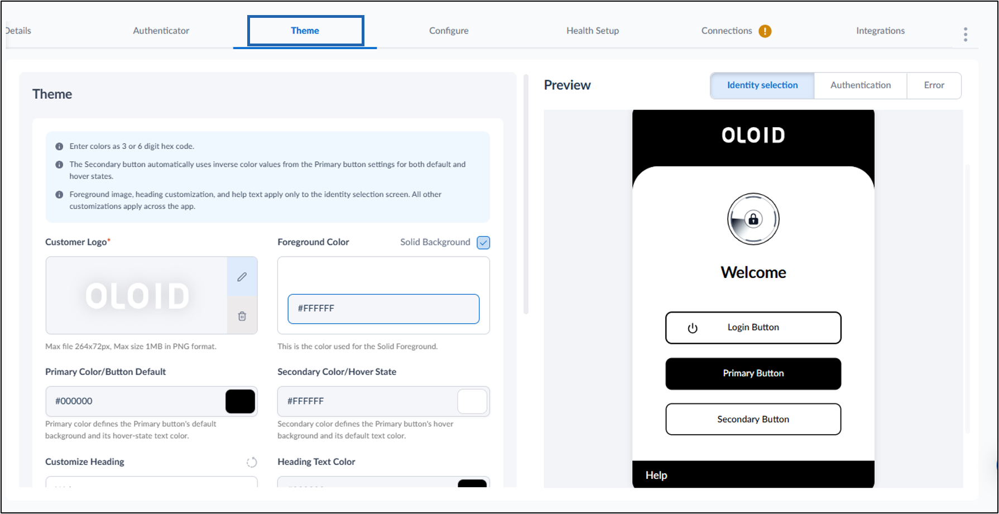

### Setup Configure Tab

Go to Configure tab and do the following:

1. [Configure Settings](#configure-settings-tab)
2. [Configure Online Intent Screen](#configure-online-intent-screen)
3. [Configure Offline Intent Screen](#configure-offline-intent-screen)
4. [Customize Messages](#customize-messages)
5. [Configure Passwordless](#configure-passwordless)
6. [Customize Buttons](#customize-buttons-tab)

#### Configure Settings Tab

The **Settings** tab is used to configure general endpoint behavior and authentication settings for the application.

1. Click on Settings tab, the settings tab is displayed.

   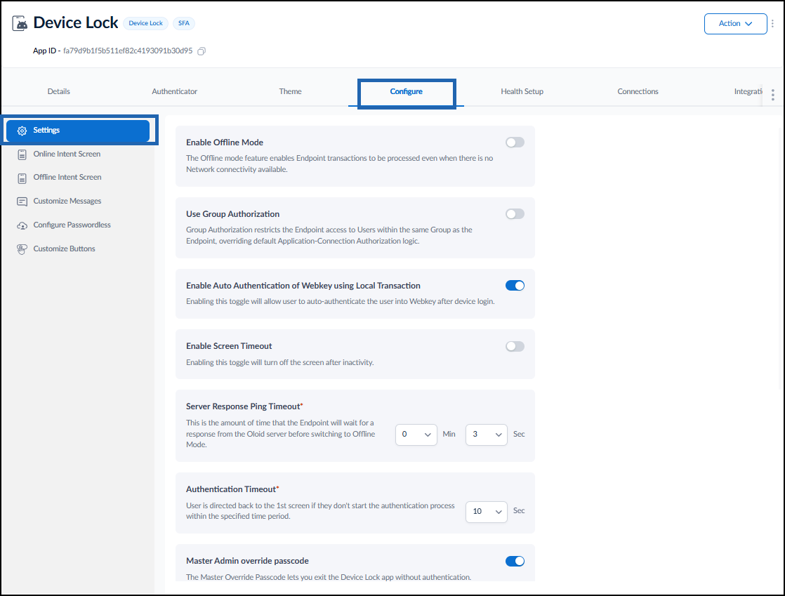

2. Do the following:
   1. Turn on **Enable Offline Mode** toggle to allow endpoint transactions to be processed even when there is no network connectivity.
   2. Turn on **Use Group Authorization** toggleto restrict endpoint access to users within the same group associated with the endpoint connected to the application. This ensures that only users in the specified group can authenticate, both online and offline.
   3. Turn on **Enable Auto Authentication of Webkey using Local Transaction** toggle to allow user to auto-authenticate the user into Webkey after device login.
   4. Turn on **Enable Screen Timeout** toggle to turn off the screen after inactivity.
   5. Set **Server Response Ping Timeout** to define how long the Endpoint should wait for a reply from the server before switching to Offline Mode if no response is received.

      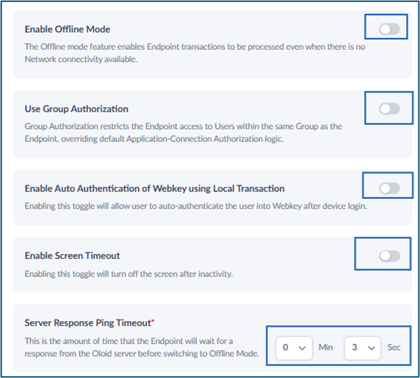

   6. Set **Authentication Timeout** to define how long the system will wait for the user to begin the authentication process before redirecting them back to the first screen.

      <Note>
        **Note:** The default authentication timeout is **10 seconds**.
      </Note>

   7. Set the **Master Admin Override Passcode** to exit the Device Lock app when the device is in Kiosk mode and/or no internet connection is available.
   8. Select **Endpoint Template** from dropdown list to apply during the endpoint pairing process.
   9. Turn on **Show Clock on Intent/Auth Screens** toggle to display clock on all the Intent, Authentication selection and Identity screens.
   10. Click **Save**.

       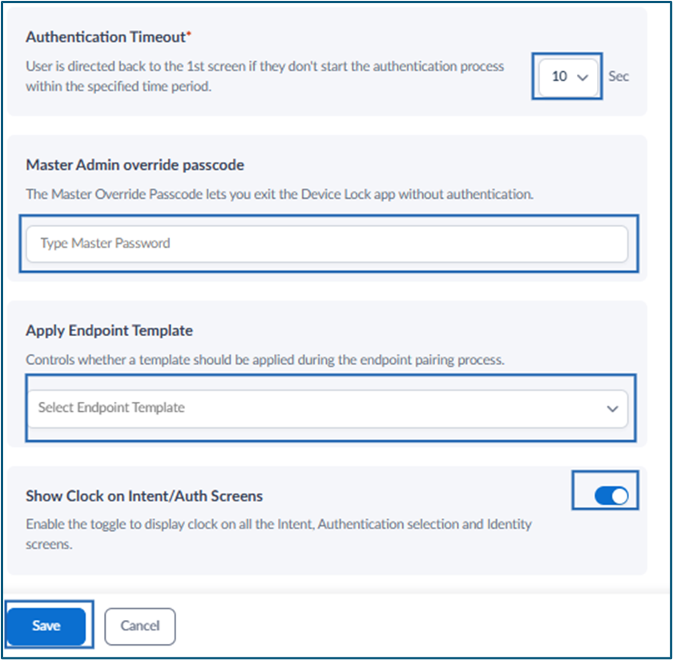

       The **Settings** menu is successfully configured.

#### Configure Online Intent Screen

Use the **Online Intent Screen** to define how intent options are displayed to users.

1. Click on **Online Intent screen**, the **Online Intent screen** is displayed.
2. Do the following:
   1. Enable the **Show Intent Screen** toggle to allow endpoint transactions.
   2. Configure the **Multi-button Intent screen** options.
   3. Click **Save.**

      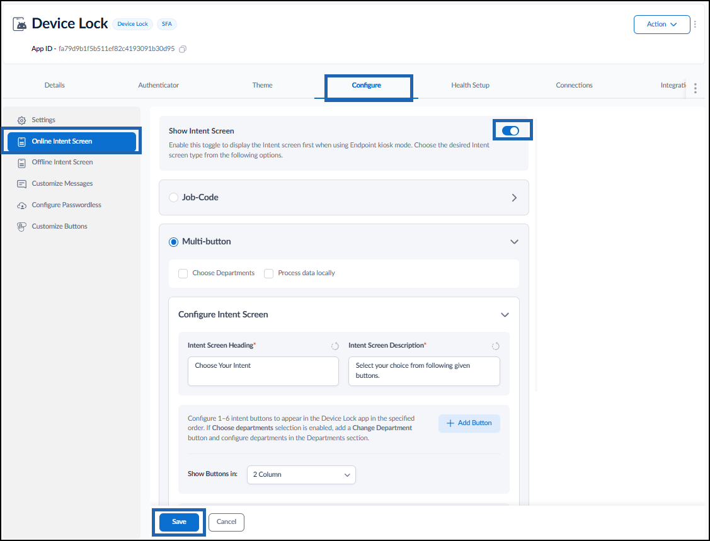

      For Detailed instruction on how to configure Online Intent screen, please refer: **[Oloid Device lock - How to Configure Online Intent Screen in Tenant Admin Portal](/platforms/android/devicelock/device-lock-how-to-configure-online-intent-screen-for-oloid)**

#### Configure Offline Intent Screen

Use the **Offline Intent Screen** to define how intent options are displayed to users when the device is not connected with internet.

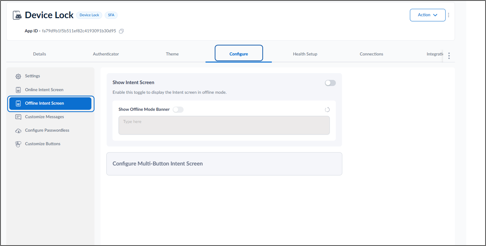

1. Click on **Offline Intent screen**, the **Offline Intent screen** is displayed.
2. Do the following:
   1. Enable the **Show Intent Screen** toggle to allow endpoint transactions to be processed even when there is no network connectivity
   2. Enable the **Show Offline Mode Banner** toggle to display a custom message banner to inform the user that the device is offline.
   3. Click **Save.**

      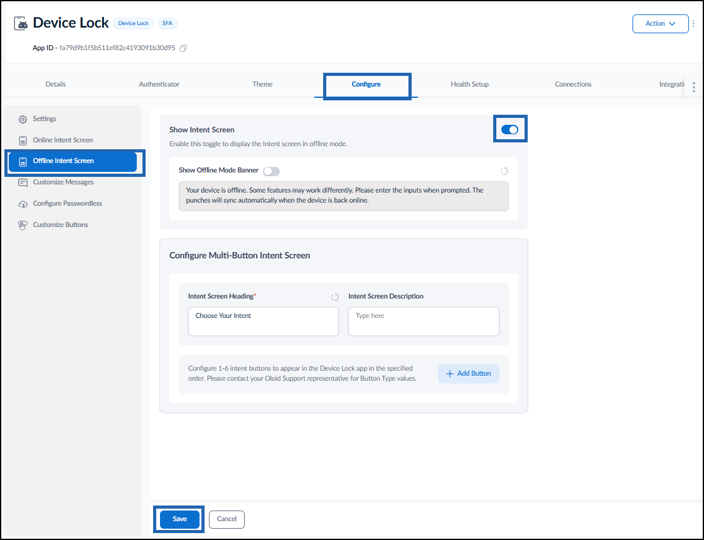

      For Detailed instruction on how to configure Offline Intent screen, refer **[Oloid Device lock - How to Configure Offline Intent Screen in Tenant Admin Portal](/platforms/android/devicelock/devicelock-app-how-to-configure-offline-intent-screen-in-tenant-admin)**

#### Customize Messages

The Customize Messages tab is used to configure the messages displayed to users on the endpoint during authentication. It allows admin to define action initialization, success, and failure messages, and control how status messages appear after authentication.

1. Click on Customize Messages, the Customize messages screen is displayed.

   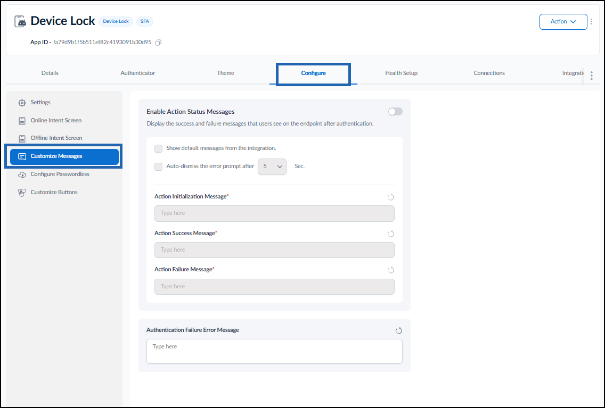

2. Turn on **Enable Action Status Messages** toggle to display the action status of the user's authentication. You can customize the messages your user sees on the DeviceLock app.

   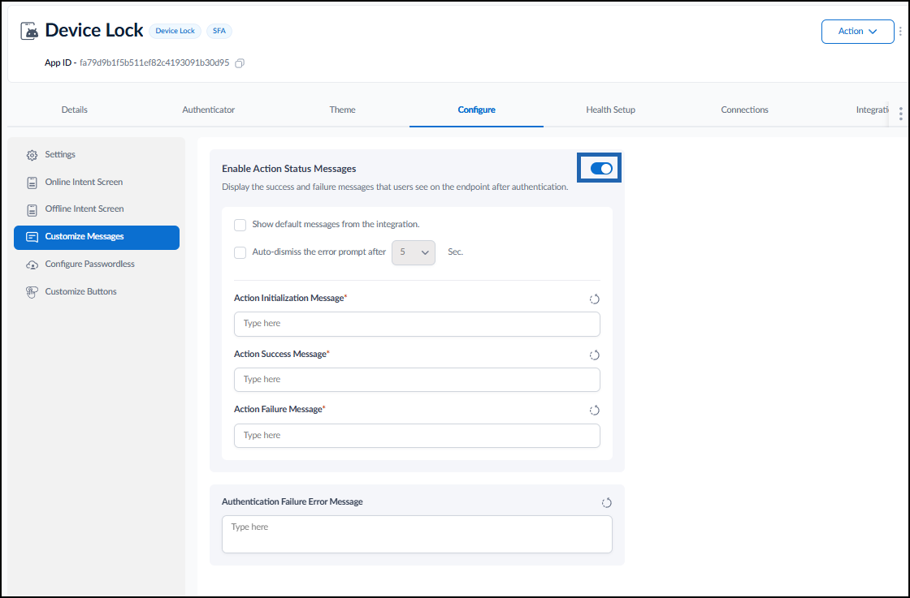

3. Do the following:
   1. Select **Show default messages from the integration** to display the integration's predefined messages. (Optional)
   2. Select **Auto-dismiss the error prompt after** and set the preferred time (in seconds).

      <Note>
        **Note:** The default auto-dismiss time is 5 seconds.
      </Note>

      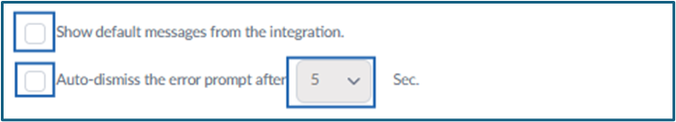

   3. Enter the **Action Initialization Message** in the text field.
   4. Enter **Action Success Message** in the text field.
   5. Enter **Action Failure Message** in the text field.

      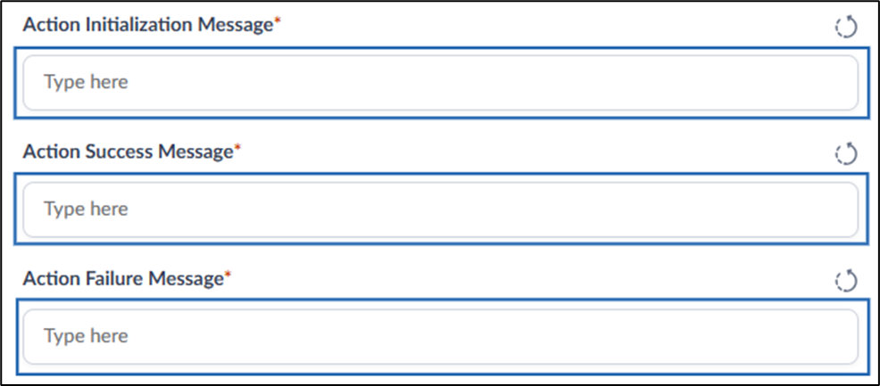

   6. Edit **Authentication Failure Error Message** field (Optional).
   7. Click **Save**.

      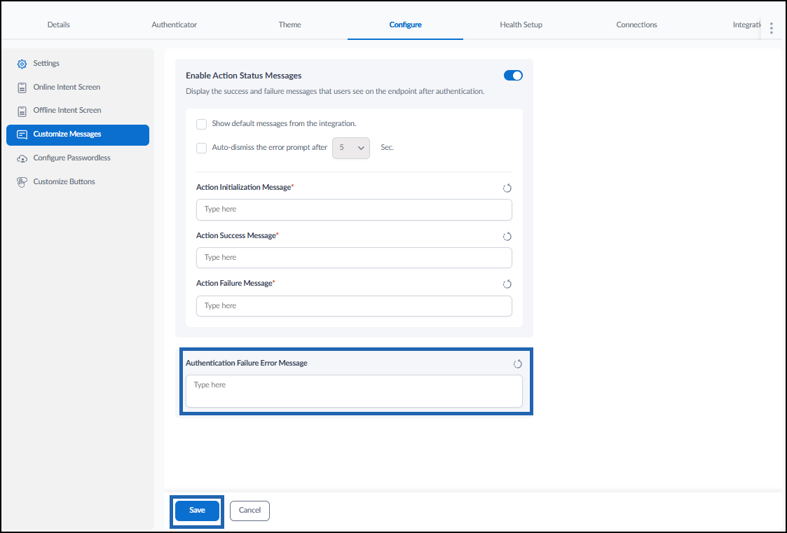

      The **Customize Message** menu is successfully configured.

#### Configure Passwordless

The **Configure Passwordless** tab is used to enable and configure passwordless authentication for the application. It allows administrators to select the authentication mode, such as **Device Lock Mode** or **Passwordless Login**, and define related settings such as SSO URL, logout URL, and browser type.

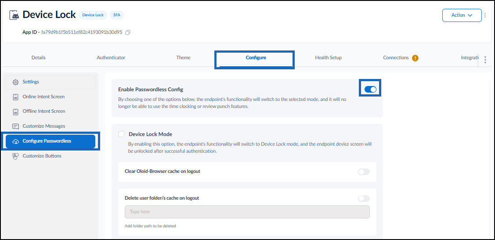

1. Turn on **Enable Passwordless Config** toggle to switch the endpoint's functionality to **Device Lock Mode** or **Passwordless Login**.

   <Note>
     **Note:** Once enabled, the endpoint will no longer support features like time clocking or review punch data.
   </Note>

2. Do one of the following:
   1. **Device Lock Mode:** Select this option to enable Device Lock mode on the endpoint. After successful authentication, the device unlocks and displays the home screen.
      1. (Optional) To remove cached browser user data on logout, select **Clear Oloid-Browser cache on logout**.
      2. To delete cached user file on logout, select **Delete user folders/cache on logout**.
      3. In the **Folder Path** field, enter the folder path to be deleted.

         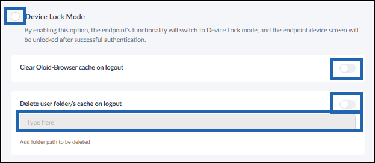

   2. **Passwordless Login:** Select this option to enable Passwordless login on the endpoint. After successful authentication, the user is redirected to the configured URL.

      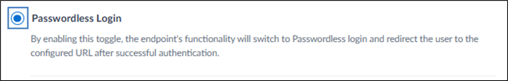

Do one of the following:

1. **Passwordless SSO URL:**
   1. Turn on **Passwordless SSO URL** toggle.
   2. Enter all the URLs in the **Logout URL** field that should be logged out automatically before a new user logs in.
   3. Select the required **Browser or Web-view Type** to open the configured URL.

      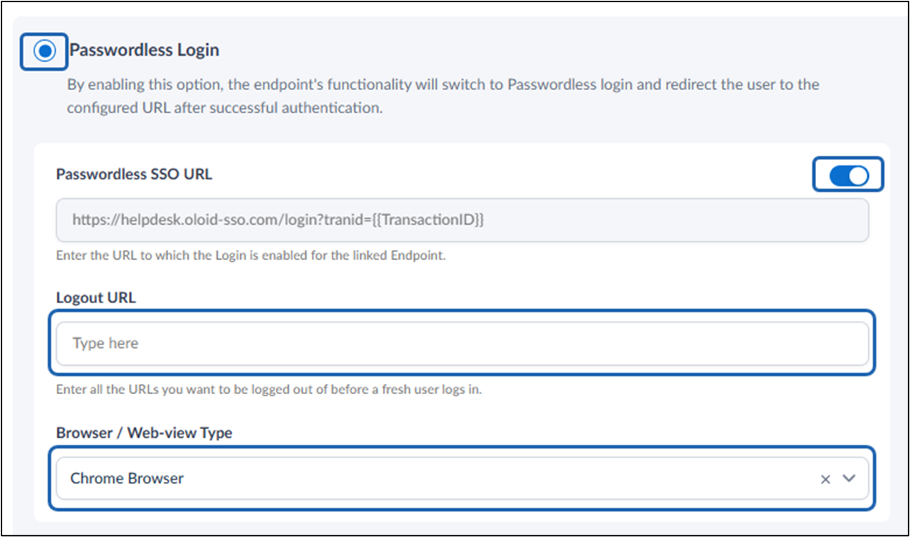

2. **Workday Punch Integration:**
   1. Enable **Workday Punch Integration** toggle.
   2. Enter the URL to which the Login is enabled for the linked Endpoint.
   3. Select the required **Browser or Web-view Type**

      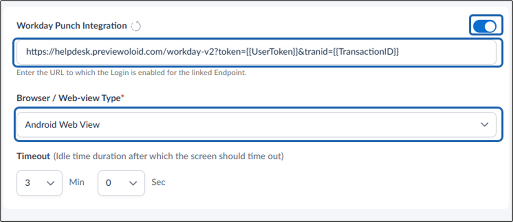

3. Set the desired **Timeout** duration (in minutes and seconds) after which the screen automatically times out.
4. Click **Save**.

   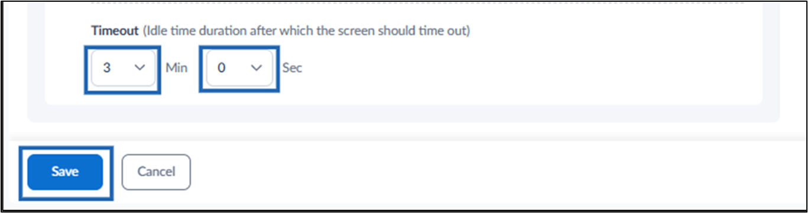

   The **Configure Passwordless** menu is successfully configured.

#### Customize Buttons Tab

1. On **Customize Authentication Button Labels** section, edit the **Button Label** in the text field.

   <Note>
     **Note:** The default is 'Verify with &lt;Credential Name>'.
   </Note>

   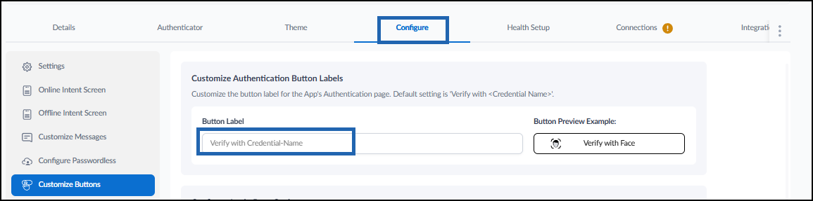

2. On **Configure Login Page Options** section, do the following:
   1. Select **Enable Enrollment** option to add it on the welcome screen of the DeviceLock application.
   2. Edit the **Button Label**. (Optional)
   3. Do any one of the following:
      1. Select **URL for Web-HR picture verification**.
         OR
      2. Select **URL for User Portal**.
         OR
      3. Select **Custom Redirect URL** > enter **URL** in the text field.
         OR
      4. Select **Native Config**.
      5. Select **Enable Custom Button** option to add a button with customized button label and add redirect URL on the welcome screen of DeviceLock application.
      6. Enter **Button Label**. (Optional)
      7. Enter **Redirect URL**. (Optional)
3. Click **Save**.

   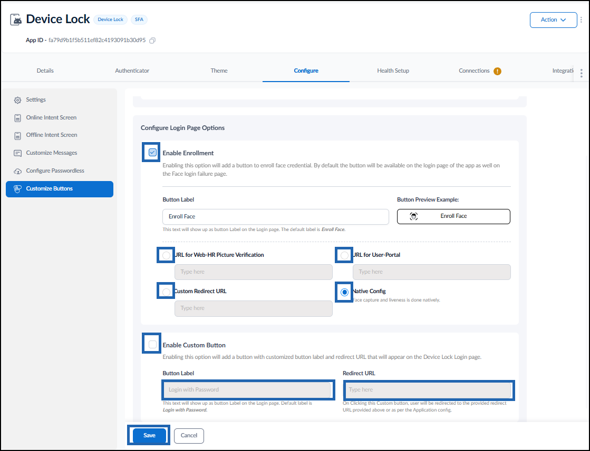

Application configuration is updated successfully.

### Configure Health Setup Tab

Go to **Health Setup** tab and do the following:

1. Enter **Server Name** in the text field.
2. Enter URL in **Add URL that needs to be monitored** in the text field.
3. Click **Add**.

   <Note>
     **Note:** By default, when you create the application, two servers i.e., **Amazon AWS** and **Platform Portal** are added automatically.
   </Note>

   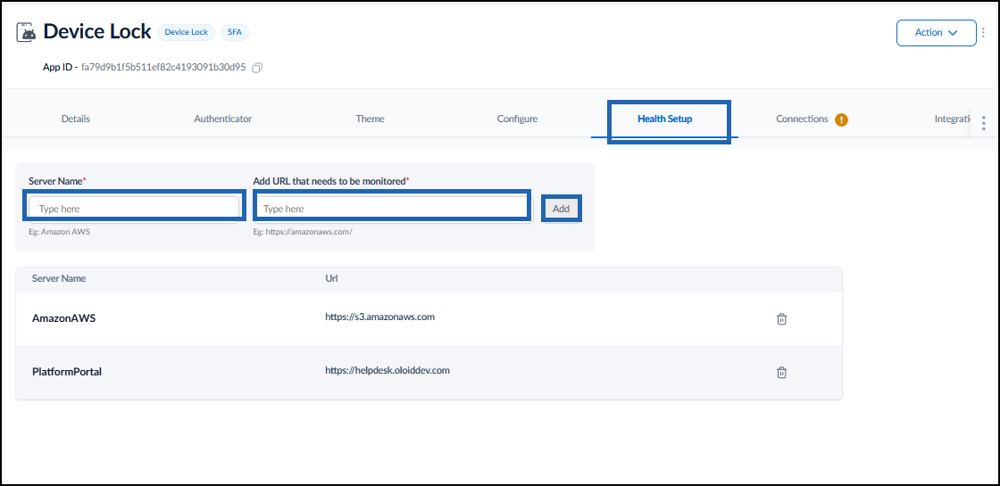

### Configure Connections Tab

Connection is a collection of multiple users. Go to **Connection** tab and do the following:

1. Click **+ Add Connections** to add a connection to the application.

   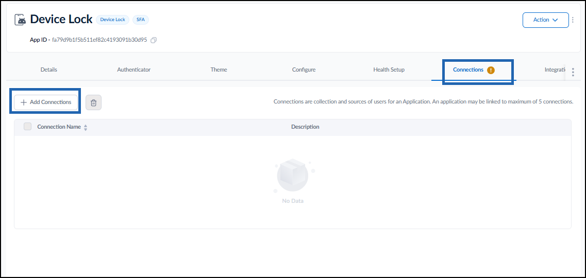

   The **Add Connections** pop-up box is displayed.
2. Select connection(s) from the **Select Connection** dropdown list.

   <Note>
     **Note:** An application can have a maximum of 5 connections.
   </Note>

3. Click **Add**.

   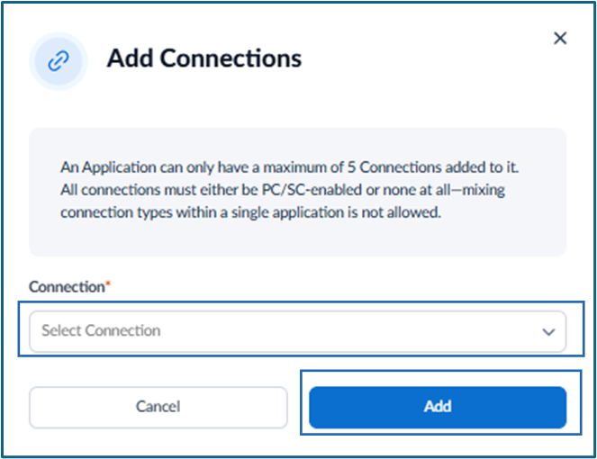

   The Connection is successfully added to the application.

### Configure Integrations Tab

1. Go to integrations tab and turn on **Enable Integrations to perform cloud-based actions** toggle.
2. Enable the applicable Integration.

   <Note>
     **Note:** Click **Save** after each action to save your configuration.
   </Note>

   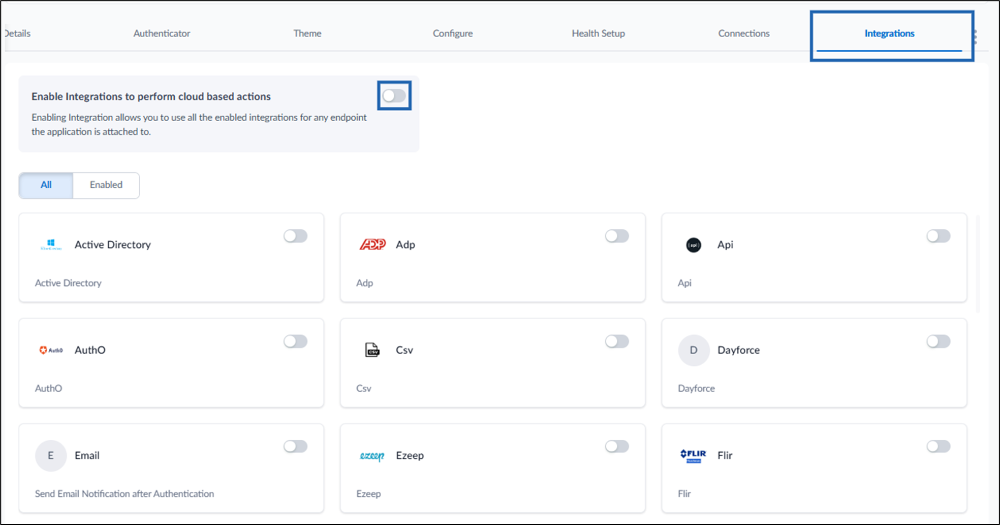

   The **Integrations** tab is successfully configured.
   The **DeviceLock** application is configured and listed on the Application page.
