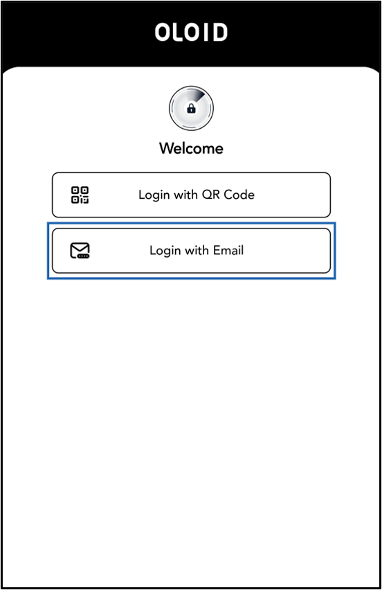
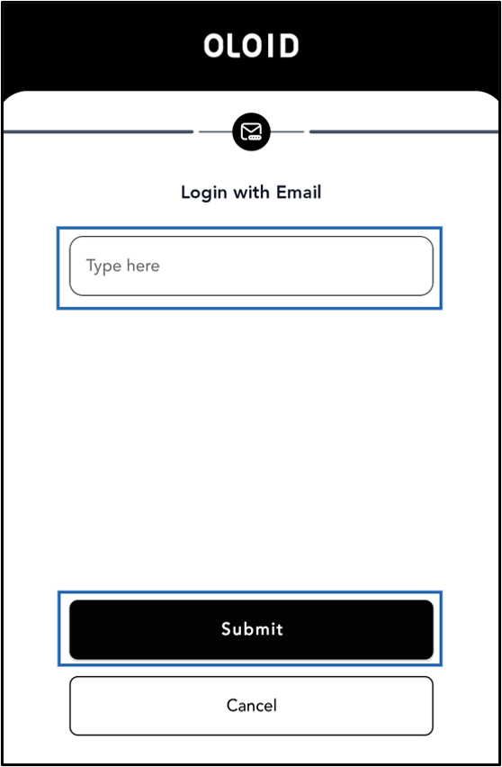
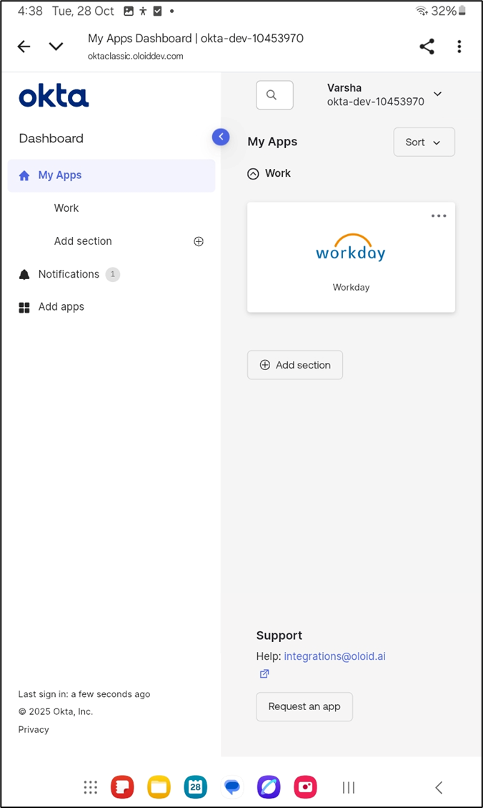

{/* Source: Intercom article 16527090 - https://oloid.help/en/articles/16527090-devicelock-app-how-to-log-into-workforce-hrms-platforms-using-email-id-credential */}
{/* Generated by intercom_to_mintlify.py - re-running overwrites this file. */}

## Introduction

This document provides instructions to log in to the configured Workforce/HRMS application using Email ID on the DeviceLock app.

## Prerequisite

You must have a valid Okta Email account.

## Steps to Log in with Email ID

1. Press the **Power** button or tap the device screen.

   <Note>
     **Note:** The Device Lock app is displayed automatically, as it always runs in Kiosk Mode.
   </Note>

   The **Welcome** screen is displayed.
2. Tap **Login with Email ID**.

   <Note>
     **Note:** You will only see the authentication methods (Face, Badge, PIN, QR Code and NFC/ID) enabled for you. The button names may vary based on configuration. Contact [Support](mailto:Support@oloid.ai) if no authentication method appears.
   </Note>

   

   The **Email ID** screen is displayed.
3. Enter your Email ID and then tap **Submit**.

   

   After successful authentication, you are signed in to the Okta system.

   
