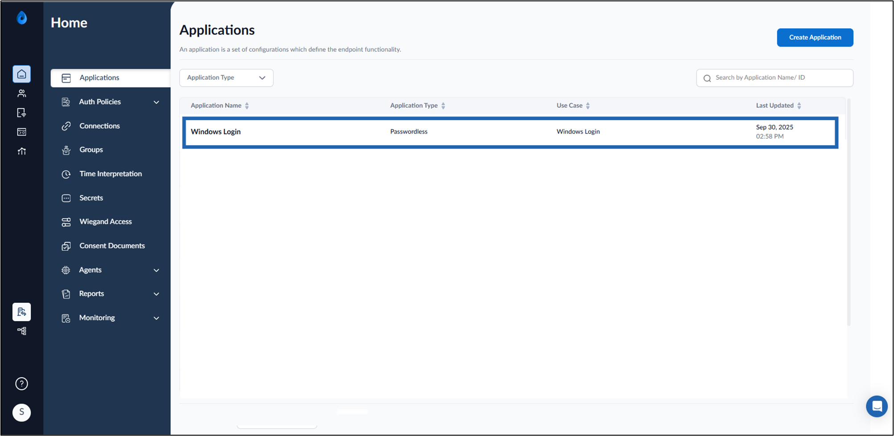
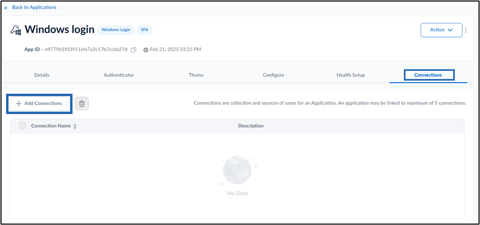
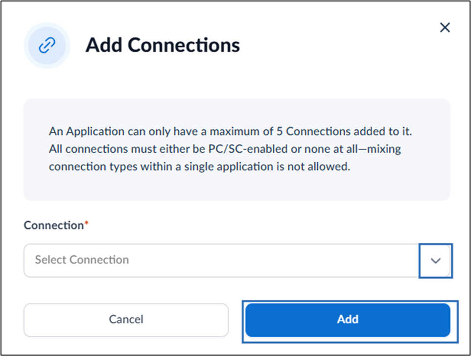
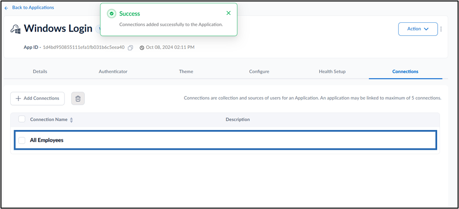

{/* Source: Intercom article 10756940 - https://oloid.help/en/articles/10756940-how-to-add-connections-in-windows-login-application */}
{/* Generated by intercom_to_mintlify.py - re-running overwrites this file. */}

## Introduction

Connections are collections of users associated with an application. Adding connections allows administrators to define which users can access the application using passwordless login.

## Prerequisites

- A **Passwordless application** of type **Windows Login** has been created. For further details, refer [How to create a Windows Login Application](/platforms/windows/windows-login/windows-login-how-to-create-and-configure-windows-login-application).
- At least one connection is created. For further details, refer [How to Create a Connection.](/platform/tenant-admin-portal/tenant-admin-portal-how-to-create-connection)

## Steps to add Connections

1. Log in to the **Tenant Admin Portal**.
2. On the **Applications** page, click the **Windows Login application** you want to edit.

   

   The application details page is displayed.
3. Go to **Connections** tab > select **+Add Connections**.

   

   The **Add Connections** pop-up box is displayed.
4. Do the following:
   1. Select **Connection**(s) from Connection drop-down list.
   2. Click **Add**.

      <Note>
        **Note:** An application can have up to 5 connections, all of which must be either PC/SC-enabled or none at all-mixing connection types is not allowed.
      </Note>

      

      The Connection is successfully added to the application and listed in the connections list.

      
