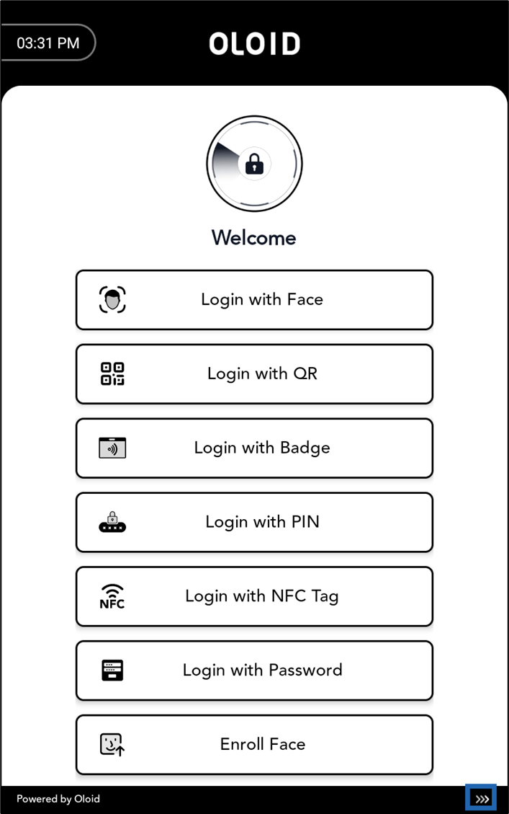
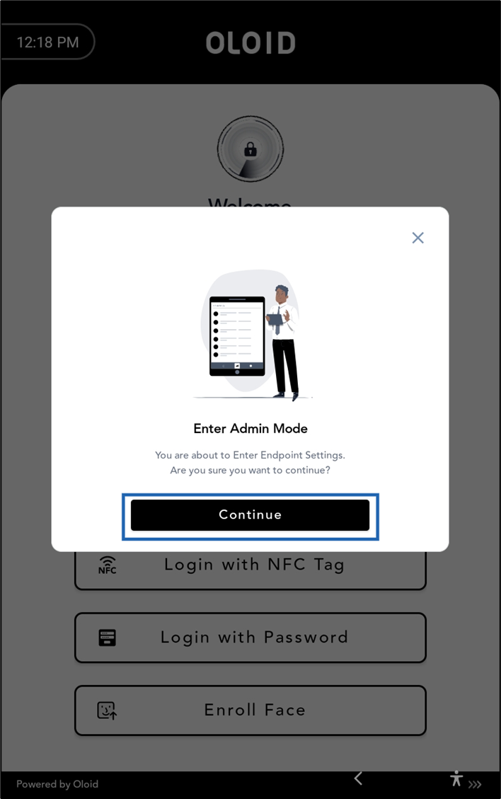
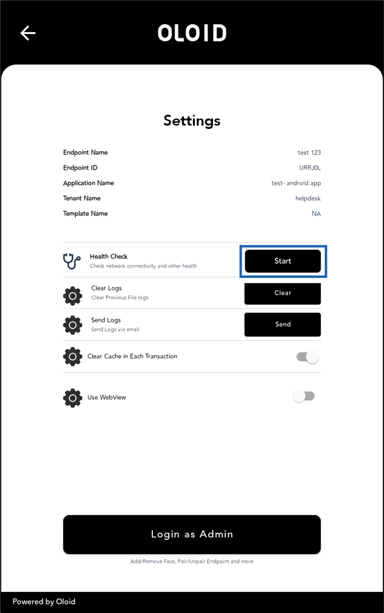
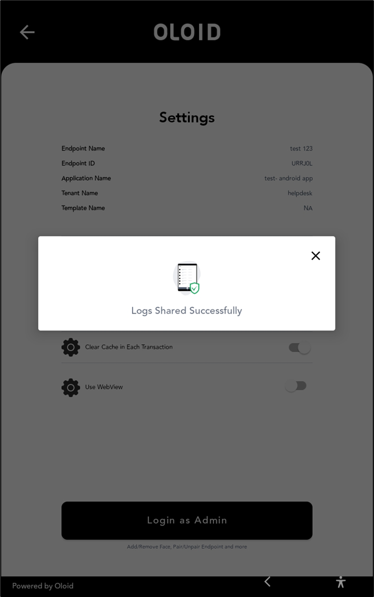

{/* Source: Intercom article 11508048 - https://oloid.help/en/articles/11508048-how-to-check-health-of-oloid-devicelock-app */}
{/* Generated by intercom_to_mintlify.py - re-running overwrites this file. */}

**Steps to check health:**

1. Launch **Oloid DeviceLock App** on your device.

   

2. Do any one of the following:
   1. Select **More Option** icon () on bottom-right side of the screen.
      OR
   2. Double tap on the screen.

      

      The Enter Admin Mode pop-up box is displayed.
3. Select **Continue**.

   

4. Select **Start** to initiate the **health check**.

   

   Logs are successfully shared with Firebase.

   
