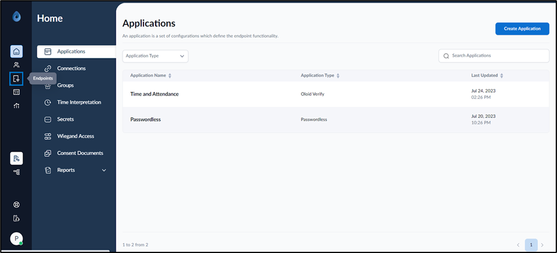
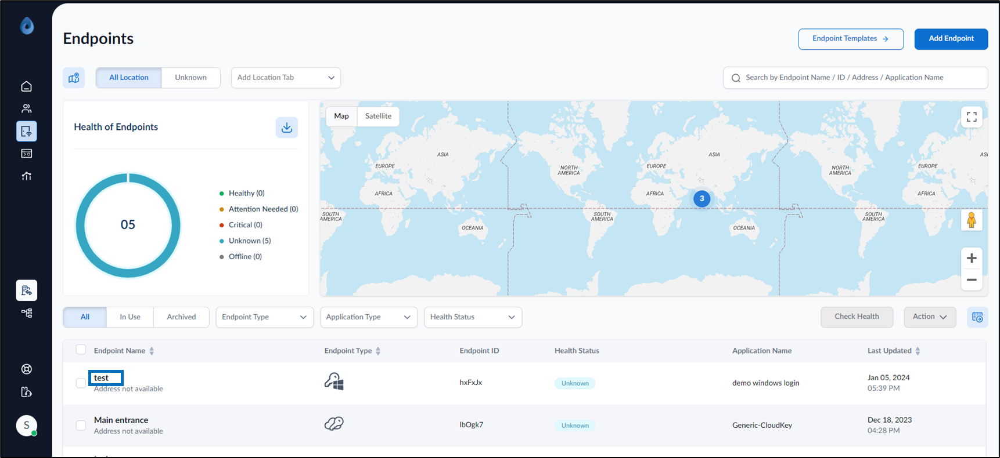
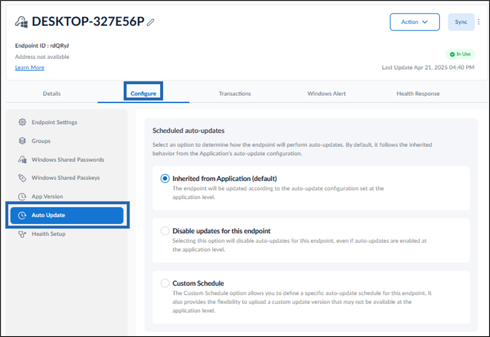
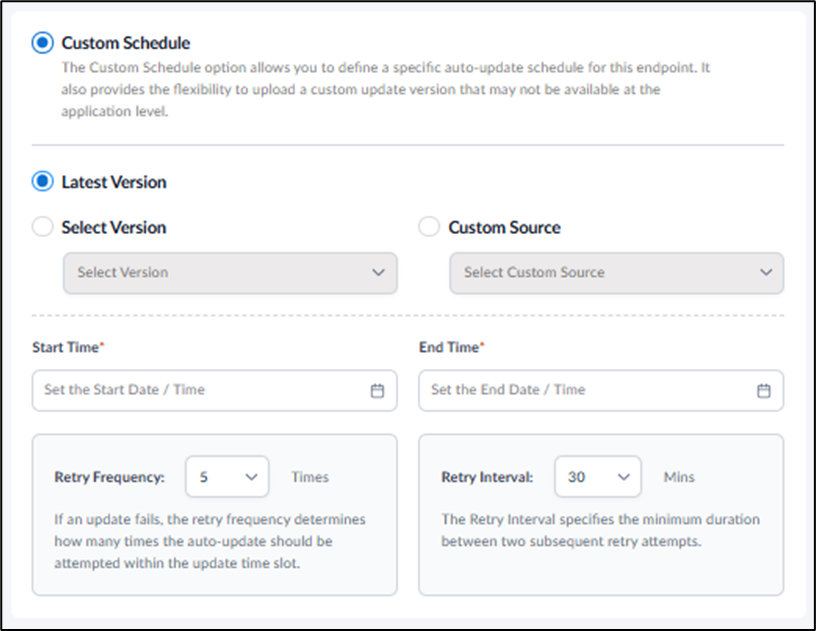
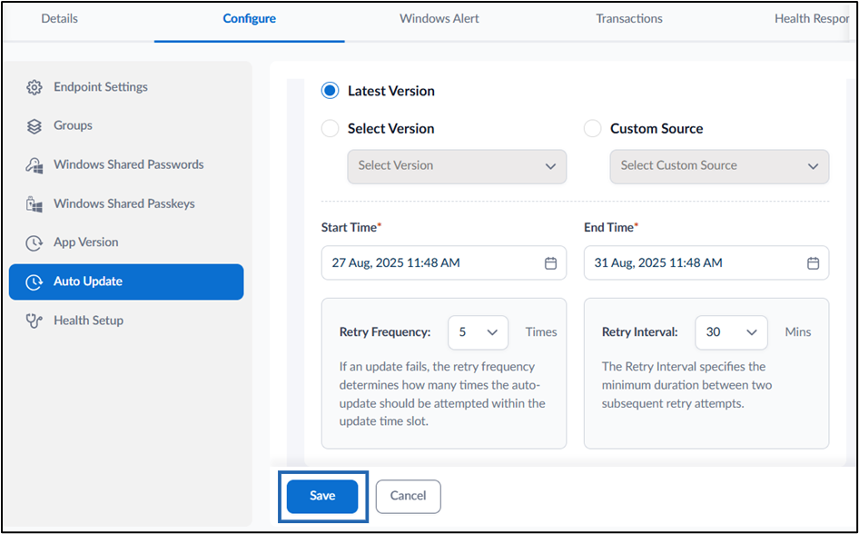
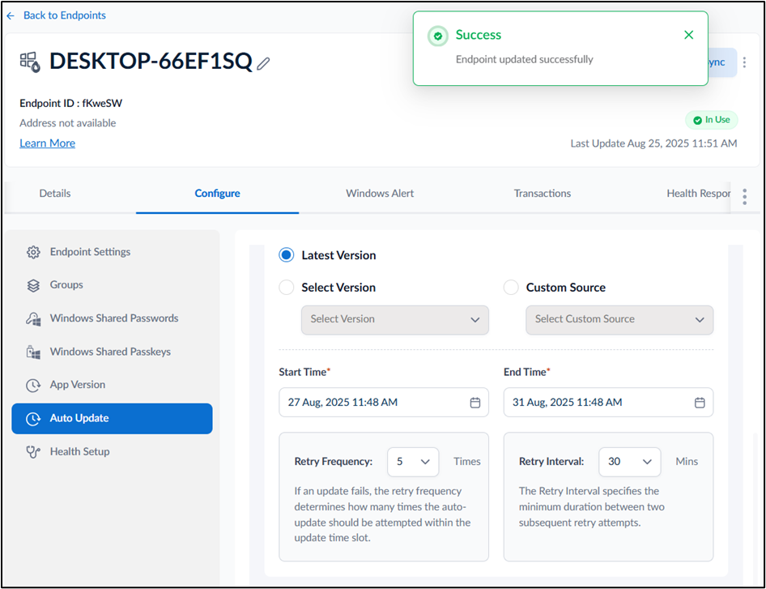

{/* Source: Intercom article 11196020 - https://oloid.help/en/articles/11196020-how-to-configure-auto-update-feature-in-windows-login-endpoint-in-tenant-admin-portal */}
{/* Generated by intercom_to_mintlify.py - re-running overwrites this file. */}

## Introduction

You can configure the auto-update feature in Windows application endpoint from the Auto Update tab. This feature allows you to override the default auto-update configuration inherited from the application level.

Based on your requirement, you can disable auto-updates entirely for a specific endpoint or define a custom update schedule.

## Steps to Configure Auto Update

1. Log in to the **Tenant Admin Portal**.
2. On the homepage of the portal, click **Endpoints** on the left panel menu.

   

   The **Endpoints** page is displayed.
3. Click **Endpoint Name** to edit.

   

   The Endpoint detail page is displayed.
4. Go to **Configure** tab > **Auto Update** section.

   

   The **Scheduled auto-updates** section is displayed.
5. Select one of the following options:
   - **Inherited from Application (default)**: Select this option to use the application's auto-update configuration.
   - **Disable updates for this endpoint**: Select this option to stop automatic updates on the endpoint, even if automatic updates are enabled at the application level.
   - **Custom Schedule**: Select this option to define a specific update schedule and select the latest or specific version.

     

     To configure a custom update schedule, select one of the following:
   - Select **Latest Version** to install the latest available version.
   - **Select Version**: Select this option to choose a specific version that differs from the custom source version.
   - Select **Custom Source** option only if at least one custom source file is listed in the dropdown. If no file is available on the backend, the option remains disabled.
   - Set the **Start Time** and **End Time** to define the auto update window.
     - Configure retry settings:
     - **Retry Frequency**: Number of retry attempts if an update fails.
     - **Retry Interval**: Time interval between each retry attempt.

       <Note>
         **Note:** The endpoint will attempt to update only within the defined time window. If an update fails, the retry logic is applied based on the frequency and interval specified.
       </Note>

6. Click **Save** to apply the configuration.

   

   The auto-update configuration is saved successfully.

   

   <Note>
     **Note:** Make sure to sync the configuration in the Supervisor App to apply the changes. For more, refer to [How to sync configuration in Supervisor App](/platforms/windows/supervisor-app/how-to-sync-configuration-in-supervisor-app)
   </Note>
