{/* Source: Intercom article 10766296 - https://oloid.help/en/articles/10766296-how-to-edit-configure-tab-in-windows-login-application */}
{/* Generated by intercom_to_mintlify.py - re-running overwrites this file. */}

**Pre-requisite:**

You must create a Passwordless application of type Windows Login. For further details, refer [How to create a Windows Login Application](/platforms/windows/windows-login/windows-login-how-to-create-and-configure-windows-login-application)

Steps to edit Configure tab:

1. Log in to the **Oloid Portal**.
2. On the **Applications** page, click on an Windows application to edit.

   

   The application page is displayed.
3. Click the **Configure** tab.

   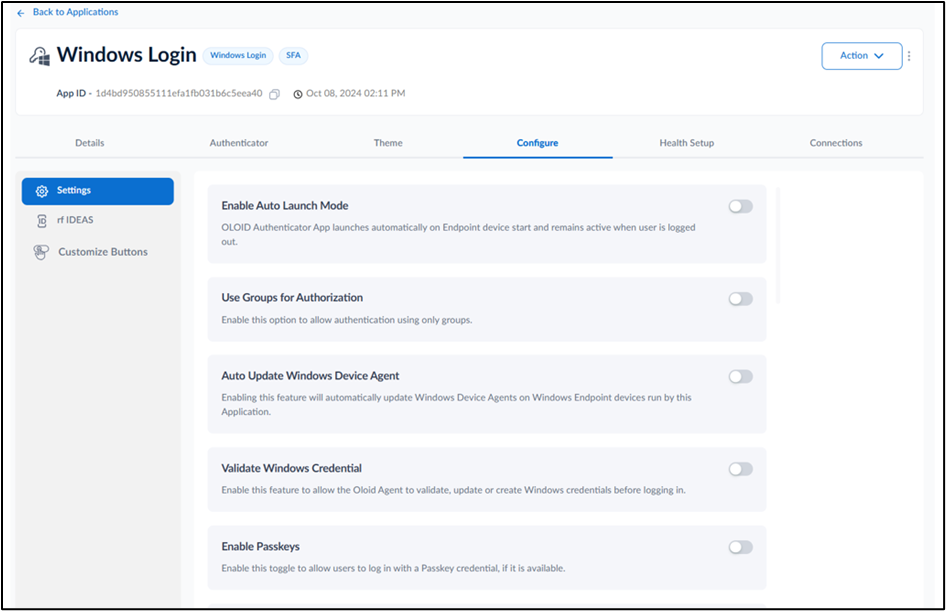

4. Do the following:

[Configure Settings tab](#configure-settings-tab)

[Configure rf IDEAS tab](#configure-rf-ideas-tab)

[Customize Buttons tab](#customize-buttons-tab)

## Configure Settings Tab

- **Enable Auto Launch Mode:** Select this option to auto-launch the Windows Login app in the login screen.

  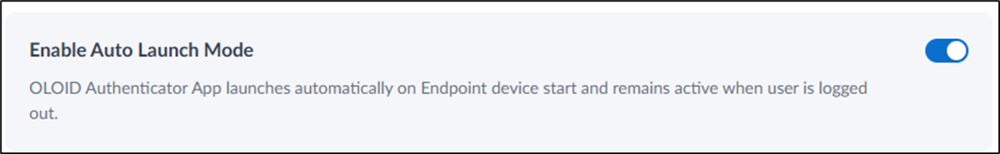

- **Use Groups for Authorization:** *Coming Soon*
- **Auto Update Windows Device Agent:** Select this option to auto-update the Windows device agents on Windows endpoints run by this application.

  <Note>
    **Note:** Select the **Sync** option in the Supervisor App and then close the app. Wait for one hour before restarting. For details, see **[How to sync configuration in Supervisor App](/platforms/windows/supervisor-app/how-to-sync-configuration-in-supervisor-app)**.
  </Note>

  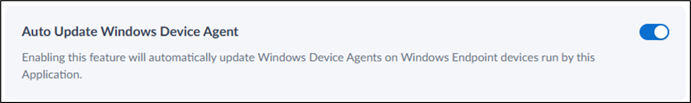

- **Validate Windows Credential:** Select this option to ensure Oloid Agent checks the validity of the user’s Windows credentials before logging in.

  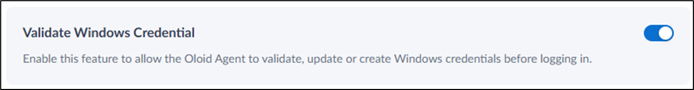

- **Allow Credential Updates and Enrollment:** Select this option to allow users to self-enroll or update their credentials.

  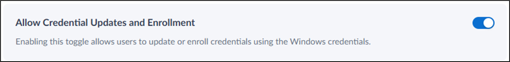

- **Capture Windows User Events:** Select this option to capture Windows events for user logins, logouts, locks, unlocks, and credential provider details. All captured data is stored in the transaction tab.

  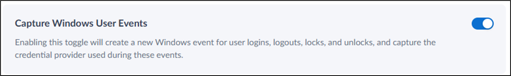

- **Enable Manual Capture Accessibility:** Turn on this option to allow users to manually capture their face during face authentication.

  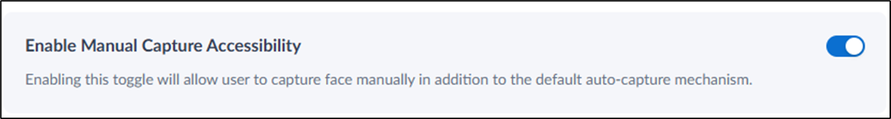

- **Enable Badge Out:** Select **Badge out using Windows Service** option to allow users to log out of their Windows system using their badge. For details, refer to [Windows Login - How to configure Enable Badge Out option](/platforms/windows/windows-login/windows-login-how-to-configure-badge-out-option)

  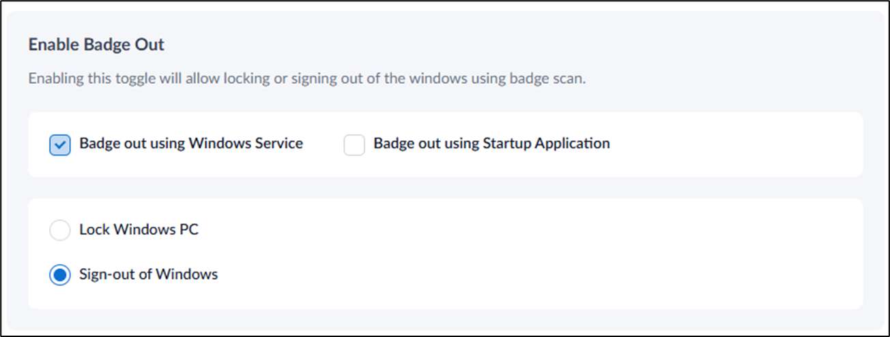

- **Set Time-Out for Login Screen:** Select this option to allow users to configure the maximum time the system will wait on the login screen before timing out.

  

- **Master Admin override passcode:** Follow the onscreen instruction to create master admin override passcode. For details, refer [How to create device-admin passcode for Supervisor App](/platforms/windows/supervisor-app/windows-login-how-to-create-device-admin-passcode-for-supervisor-app)

  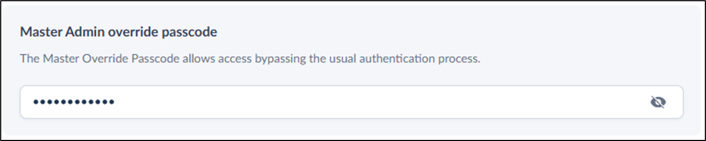

**Apply Endpoint Template**: Select a Windows Login endpoint template that is applied during the endpoint pairing process.

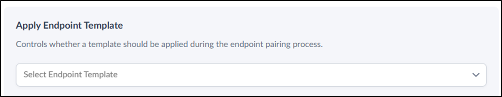

## Configure rf IDEAS Tab

1. Do the following:
   1. Select **RFID Reader Type** from the **Select RFID reader type** dropdown .
   2. Enter **Description**. (Optional)
   3. Click to browse the file or drag the file to upload/download.
   4. Click **Save**.
      The application is updated successfully. For more details, refer [How to upload/download HWG file in Oloid Portal](/platforms/windows/supervisor-app/windows-login-how-to-upload-download-hwg-file-in-tenant-admin-portal)

      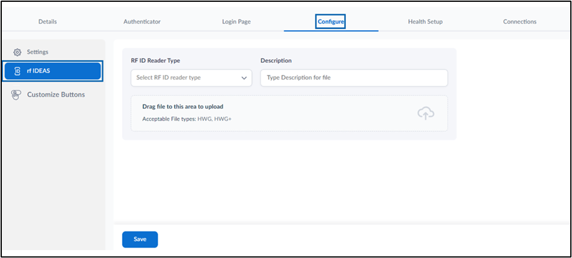

## Customize Buttons Tab

- **Customize Authentication Button Labels**: Enter customized **Button Label** to display on the Windows application.
- Select **Enable Badge Options** to display on the Windows Login app.
  - Do one of the following:
    - Select **Enroll Badge Only** to enable Badge login
    - Select **Enroll Badge + Pin** to enable Badge and Pin login.

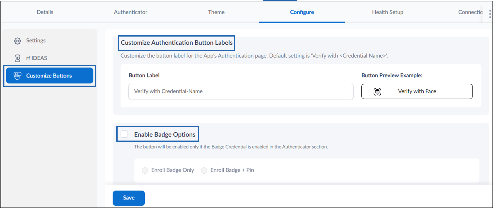
