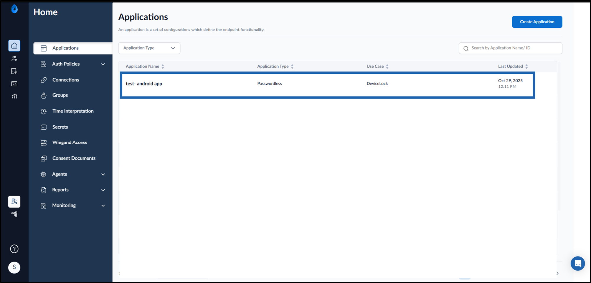
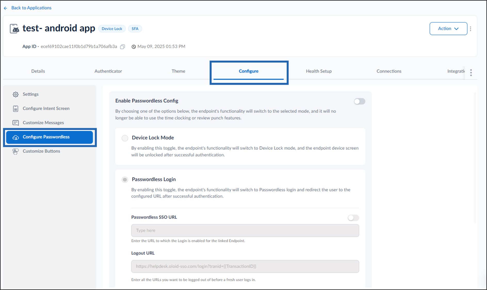
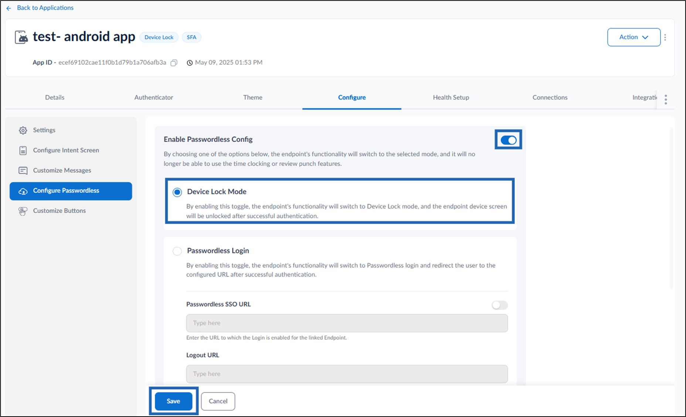
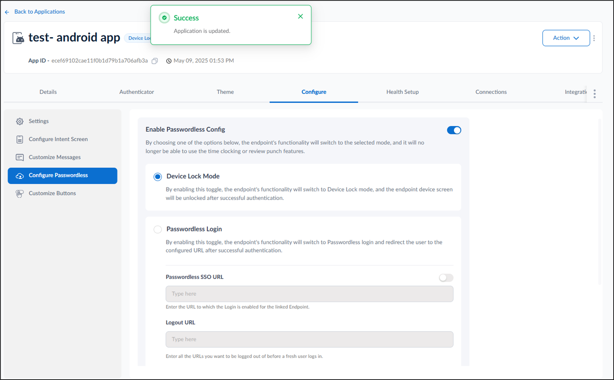

{/* Source: Intercom article 11508439 - https://oloid.help/en/articles/11508439-how-to-enable-device-lock-mode-for-devicelock-app-in-the-tenant-admin-portal */}
{/* Generated by intercom_to_mintlify.py - re-running overwrites this file. */}

## Introduction

Device Lock Mode in the Oloid Tenant Admin Portal allows users to authenticate through the Device Lock app. After successful authentication, the device unlocks and displays the device home screen.

## Prerequisite

You must have **Tenant Admin access** to the **Oloid Tenant Admin Portal**.

## Steps to Enable Device Lock Mode

1. Log in to the **Tenant Admin Portal**.
2. On the homepage of the portal, click the preferred application from the application list.

   

   The application details page is displayed.
3. Go to **Configure** tab > click **Configure Passwordless** from the left menu panel.

   

4. Turn on **Enable Passwordless Config** toggle > select **Device Lock Mode** > click **Save**.

   <Note>
     **Note:** Turning on this toggle will disable **Clock In / Clock Out** mode.
   </Note>

   

   The Device Lock mode is successfully enabled.

   
