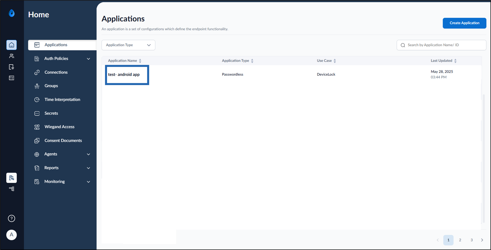
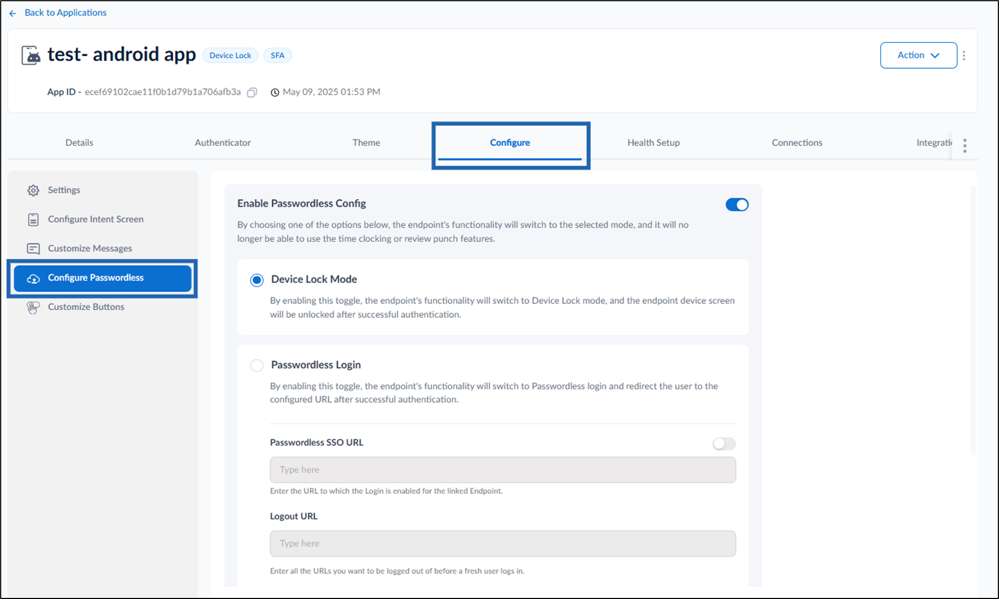
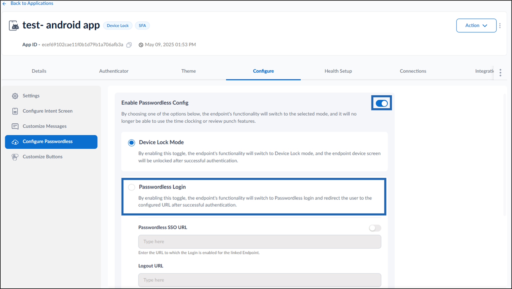
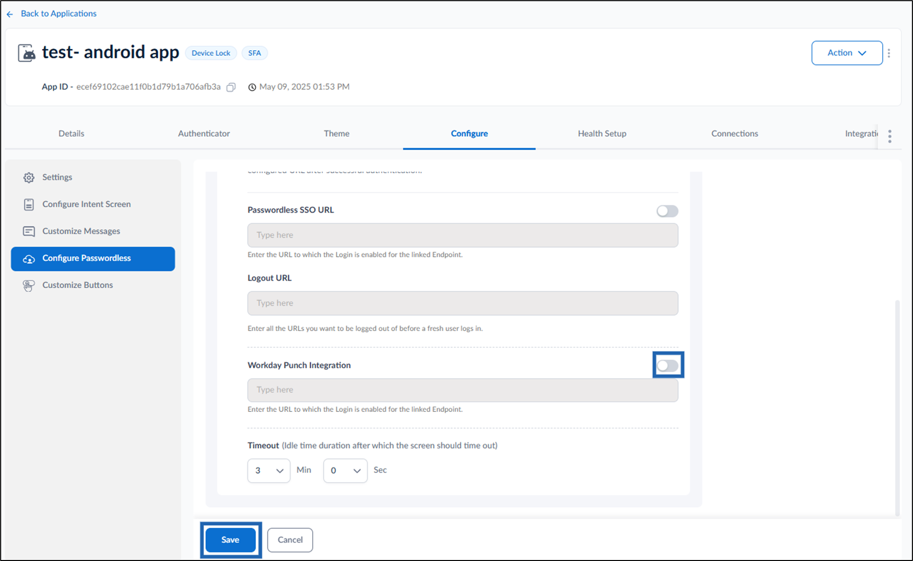
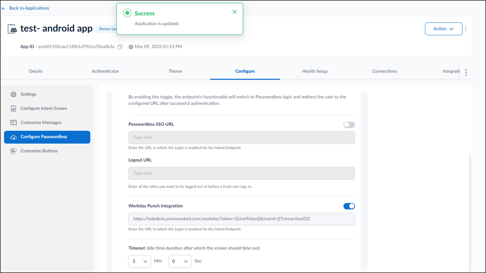

{/* Source: Intercom article 11532508 - https://oloid.help/en/articles/11532508-how-to-enable-devicelock-workday-punch-integration-in-tenant-admin-portal */}
{/* Generated by intercom_to_mintlify.py - re-running overwrites this file. */}

**Steps to enable Workday Punch Integration:**

1. Log in to the **Tenant Admin Portal**. For more details refer [How to log in to the Tenant Admin Portal](/platform/tenant-admin-portal/tenant-admin-portal-how-to-log-in-to-the-tenant-admin-portal).
2. On the homepage of the portal, click the preferred application from the application list.

   

3. Go to **Configure** tab > click **Configure Passwordless** from the left menu panel.

   

4. Turn on **Enable Passwordless Config** toggle > select **Passwordless Login**

   

5. Turn on **Workday Punch Integration** toggle > click **Save**.

   

   The Workday punch integration is enabled successfully.

   
