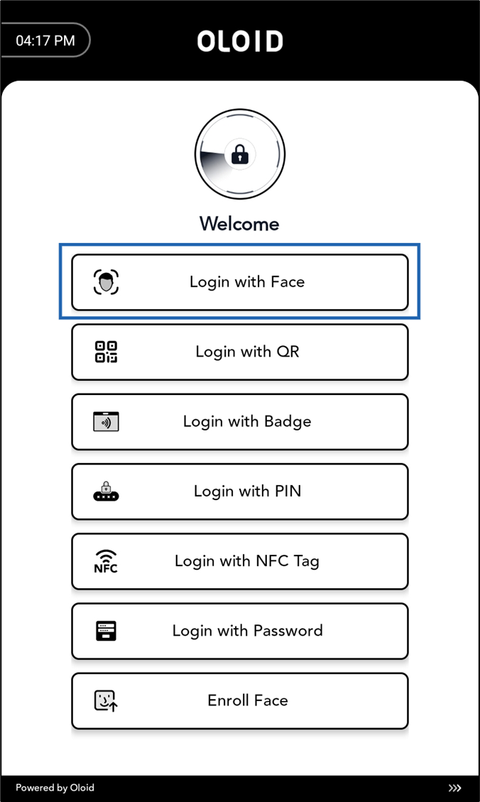
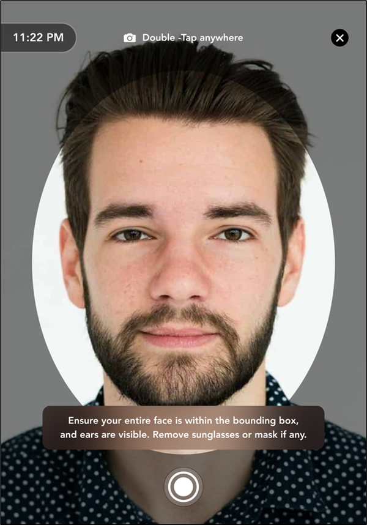
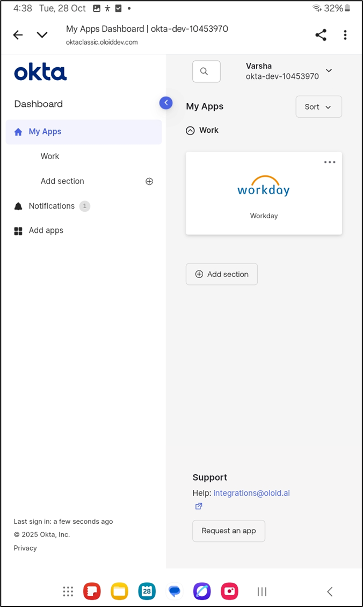

{/* Source: Intercom article 8702335 - https://oloid.help/en/articles/8702335-how-to-log-into-workforce-hrms-platforms-using-face-credential-through-oloid-devicelock-app */}
{/* Generated by intercom_to_mintlify.py - re-running overwrites this file. */}

## Introduction

The Oloid DeviceLock App allows users to log in securely using facial recognition. With Face credentials, users can access their Workforce/HRMS account quickly, ensuring a secure and contactless login experience.

## Prerequisite

You must have a valid Okta account.

## Steps to Log in with Face

1. Press the **Power** button or tap the screen on your device.

   <Note>
     **Note:** The Device Lock app is displayed automatically, as it always runs in Kiosk Mode.
   </Note>

   The Welcome screen is displayed.
2. Tap **Login with Face**.

   <Note>
     **Note:** You will only see the authentication methods (Face, Badge, PIN, QR Code, Password and NFC/ID) enabled for you. Button names may vary based on configuration. Contact [Support](mailto:Support@oloid.ai) if no authentication method appears.
   </Note>

   

   The camera turns on.
3. Position your face in front of the camera and tap the **Capture** button to complete the authentication process.

   <Note>
     **Note:** If you do not tap the **Capture** button, the app automatically captures your face after a few seconds.
   </Note>

   

   After successful authentication, you are signed in to the Okta system.

   
