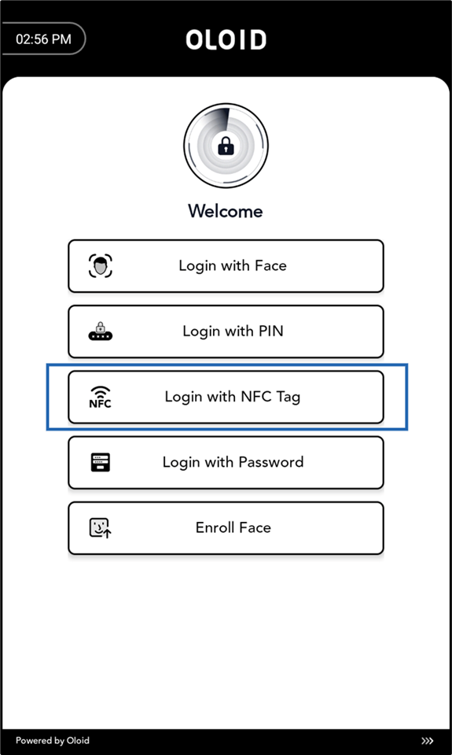
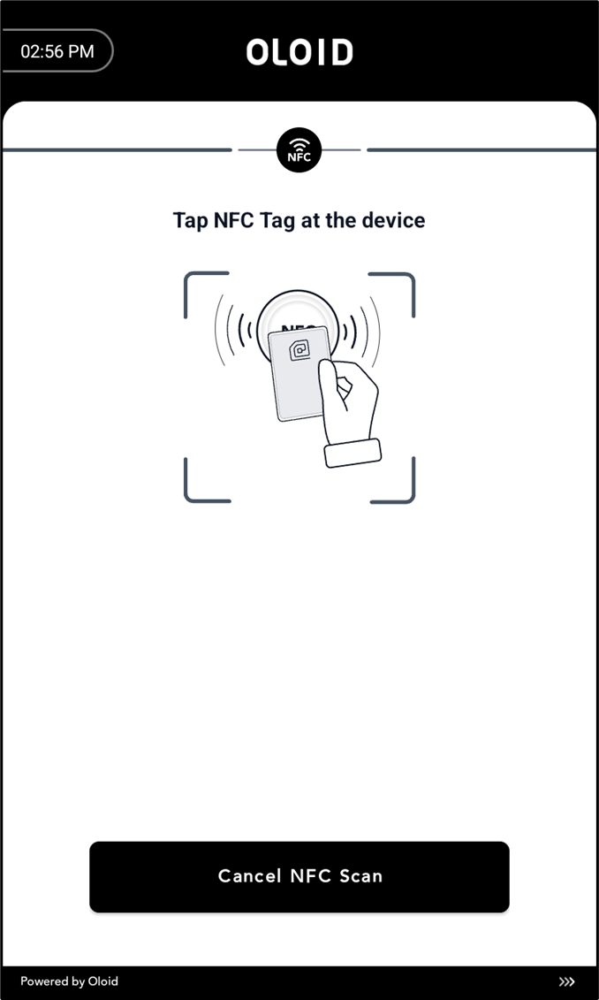
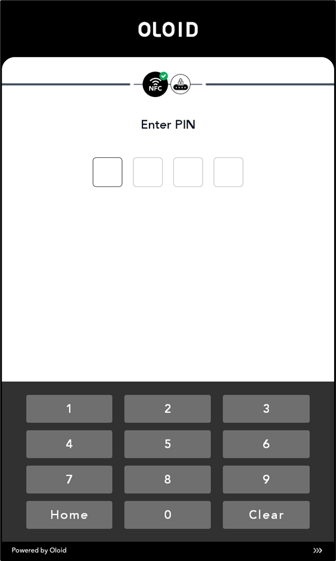
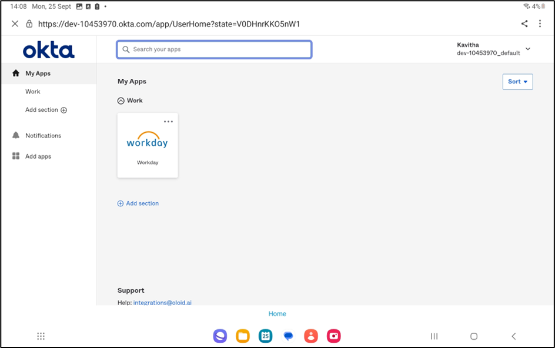

{/* Source: Intercom article 8707192 - https://oloid.help/en/articles/8707192-how-to-log-into-workforce-hrms-platforms-using-nfc-id-and-pin-through-the-oloid-devicelock-app */}
{/* Generated by intercom_to_mintlify.py - re-running overwrites this file. */}

## Introduction

The **Login with NFC and PIN** feature in the **Oloid DeviceLock App** allows users to securely access their **Workforce/HRMS platform** through a two-step authentication process. Users first tap their **NFC tag** on the device to verify their identity, followed by entering their **PIN** to complete the login.

## Prerequisites

- Android device must be connected to an external NFC reader/card reader.

  <Note>
    **Note:** If the Android device has a **built-in NFC reader**, you can scan the tag directly on the device.
  </Note>

- You must have a valid Okta account.
- You must have your assigned NFC ID.
- You must have your assigned PIN.

## Steps to Log in with NFC and PIN

1. Press the **Power** button or tap the screen on your device.

   <Note>
     **Note:** The Device Lock app is displayed automatically, as it always runs in Kiosk Mode.
   </Note>

   The Welcome screen is displayed.
2. Tap **Login with NFC Tag**.

   <Note>
     **Note:** You will only see the authentication methods (Face, Badge, PIN, QR Code, Password and NFC/ID) enabled for you. Button names may vary based on configuration. Contact [Support](mailto:Support@oloid.ai) if no authentication method appears.
   </Note>

   

   **Tap NFC Tag at the device** pageis displayed.
3. Scan the NFC Tag.

   

   After successful NFC authentication, the **Enter PIN** page is displayed.
4. Enter the **PIN**.

After successful PIN authentication, you are signed in to the Okta system.

