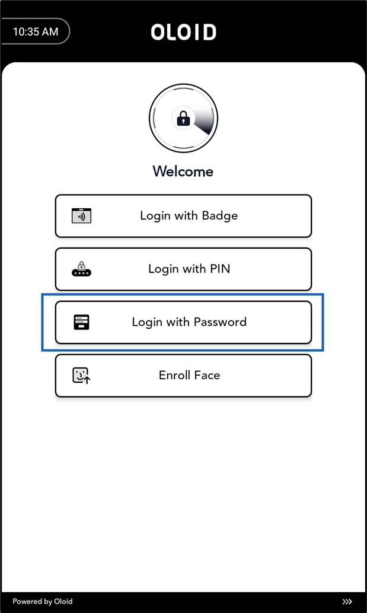
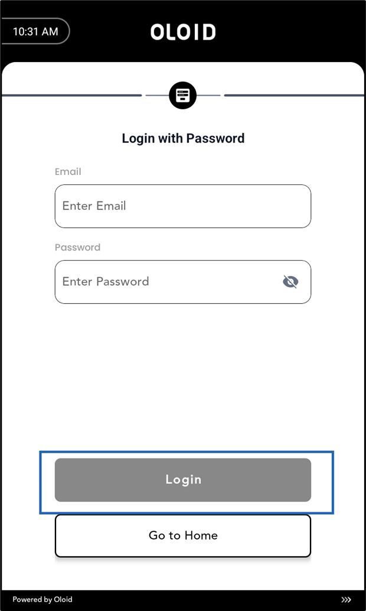
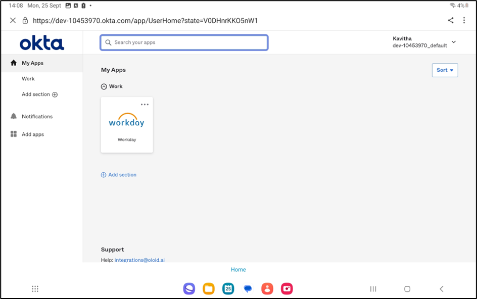

{/* Source: Intercom article 8707338 - https://oloid.help/en/articles/8707338-how-to-log-into-workforce-hrms-platforms-using-password-through-oloid-device-lock-app */}
{/* Generated by intercom_to_mintlify.py - re-running overwrites this file. */}

## Introduction

The **Login with Password** feature in the Oloid DeviceLock App allows users to securely access their **Workforce/HRMS platform** using their credentials.

### Prerequisite

- You must have a valid Okta account.
- You must have your DeviceLock credentials.

### Steps to Log in with Password

1. Press the **Power** button or tap the screen on your device.

   <Note>
     **Note:** The Device Lock app is displayed automatically, as it always runs in Kiosk Mode.
   </Note>

   The Welcome screen is displayed.
2. Tap **Login with Password**.

   <Note>
     **Note:** You will only see the authentication methods (Face, Badge, PIN, QR Code and NFC/ID) enabled for you. Button names may vary based on configuration. Contact [Support](mailto:Support@oloid.ai) if no authentication method appears.
   </Note>

   

   The Login with Password screen is displayed.
3. Enter your login credentials in the respective fields and tap on **Login**.

   

   You are successfully signed in to the Okta system.

   
