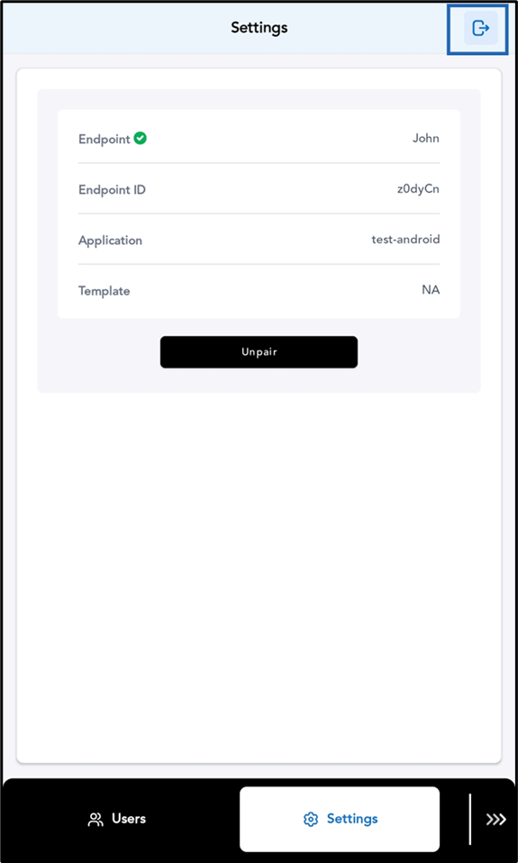
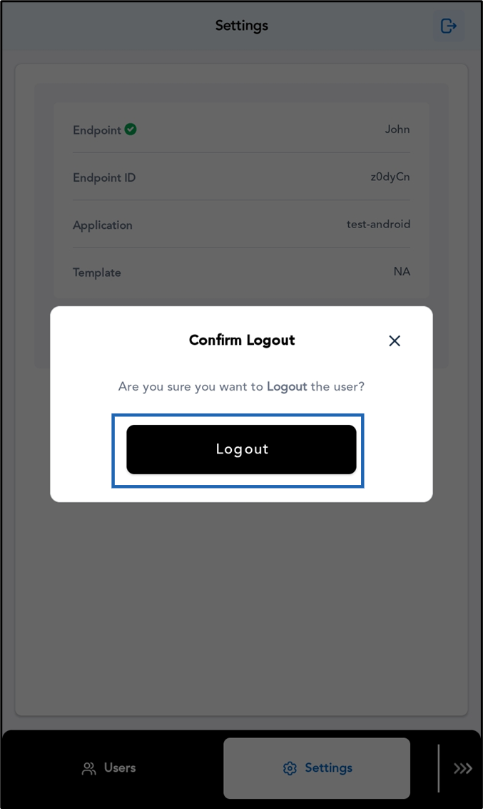
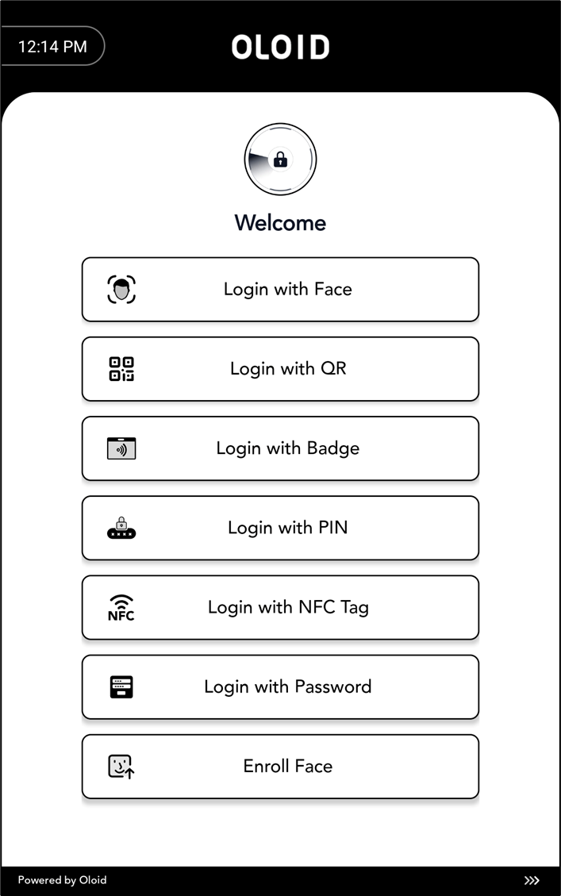

{/* Source: Intercom article 11501456 - https://oloid.help/en/articles/11501456-how-to-log-out-of-the-oloid-devicelock-app */}
{/* Generated by intercom_to_mintlify.py - re-running overwrites this file. */}

## Introduction

The **Logout** feature in the **Oloid DeviceLock app** allows administrators and supervisors to securely exit Admin Mode after completing configurations or management tasks. Logging out ensures that unauthorized users cannot access administrative settings on the device.

## Prerequisite

You must have **Admin access** to the **DeviceLock app**.

## Steps to log out of Oloid Devicelock App

1. Launch **Oloid DeviceLock App** on your device.

   

   The welcome screen is displayed.
2. Log in to the **admin mode** in **DeviceLock** App. For more details, refer [How to log in to admin mode in DeviceLock App](/platforms/android/devicelock/devicelock-app-how-to-log-in-to-admin-mode).
3. Tap **Logout icon** () on the top-right side of the screen.

   <Note>
     **Note:** You can exit **Admin Mode** from any screen, as the top header with the Logout icon remains fixed and always accessible.
   </Note>

   

   The **Confirm Logout** pop-up box is displayed.

Tap **Logout**.

You will be redirected to the **Welcome screen**.

You have successfully logged out from the DeviceLock application.
