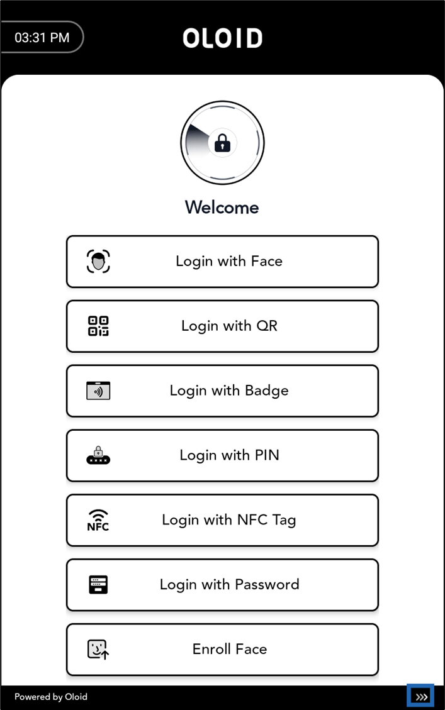
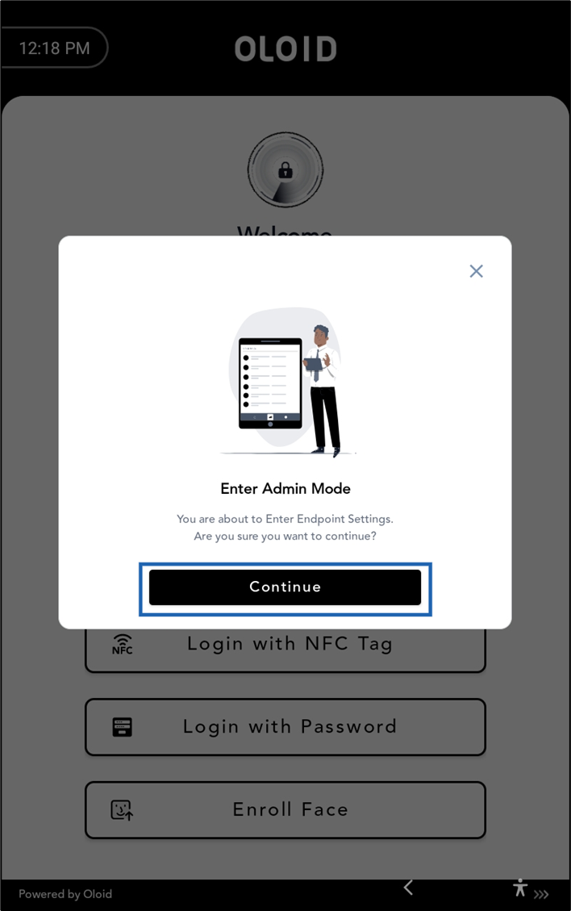
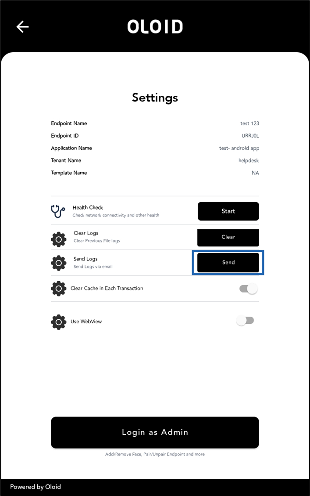
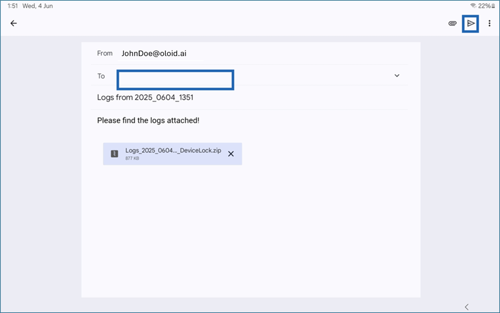

{/* Source: Intercom article 11507892 - https://oloid.help/en/articles/11507892-how-to-share-logs-in-devicelock-app */}
{/* Generated by intercom_to_mintlify.py - re-running overwrites this file. */}

**Steps to share logs:**

1. Launch **Oloid DeviceLock App** on your device.

   

2. Do any one of the following:
   1. Select **More Option** icon () on bottom-right side of the screen.
      OR
   2. Double tap on the screen.

      

      The **Enter Admin Mode** pop-up box is displayed.
3. Select **Continue**.

   

4. Select **Send**.

   

5. Enter the recipient email address > click **Send** icon () on the top-right side of the screen.

   

   The DeviceLock logs file is successfully sent to the recipient's email address.
