{/* Source: Intercom article 9790398 - https://oloid.help/en/articles/9790398-how-to-unblock-a-user-s-blocked-screen */}
{/* Generated by intercom_to_mintlify.py - re-running overwrites this file. */}

The Tenant Admin / Supervisor can unblock the user's blocked screen in one of the following ways:

- [Using transaction tab](#using-transaction-tab)
- [Using Windows endpoint](#using-windows-endpoint)

## Using Transaction Tab

1. Log in to Oloid Portal.
2. On the home page of the portal, select **Transactions** on the left menu panel.

   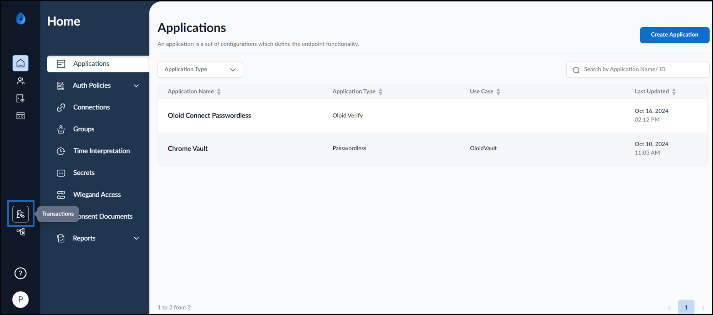

   The User Transaction Through Your Device page is displayed.

   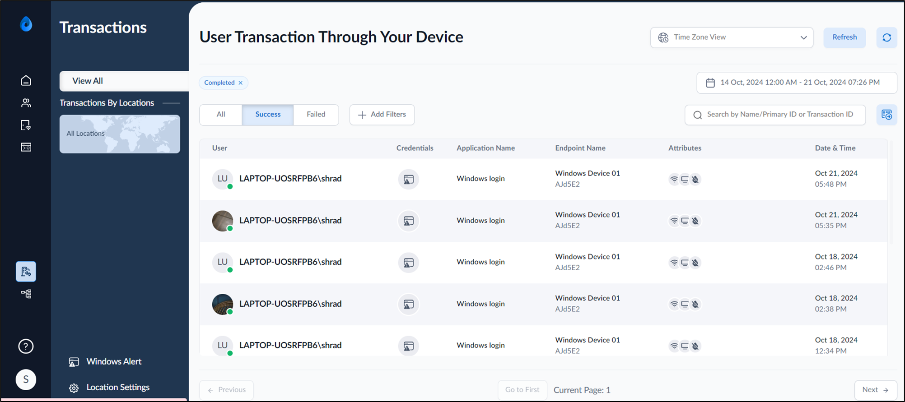

3. Select **Windows Alert**.

   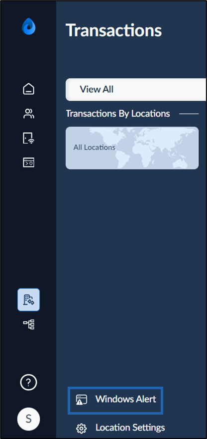

   The Windows Alert page is displayed.
4. Do one of the following:
   1. Go to the **Alert ID** and click **Unblock**.

      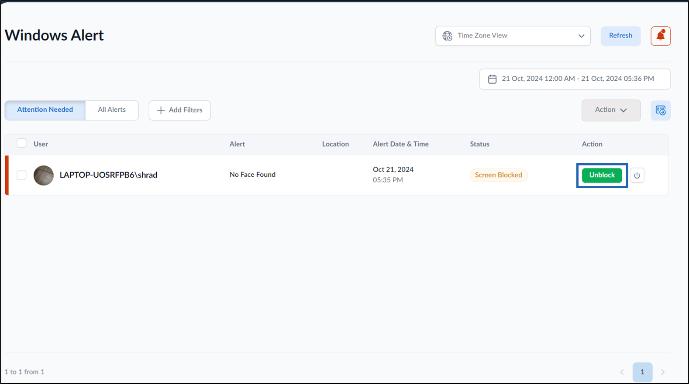

      Or
   2. Go to the user endpoint detail page and select **Unblock**.

      <Note>
        **Note:** You can also navigate to the user detail page from the Transactions (**User Transaction Through your Device)** page.
      </Note>

      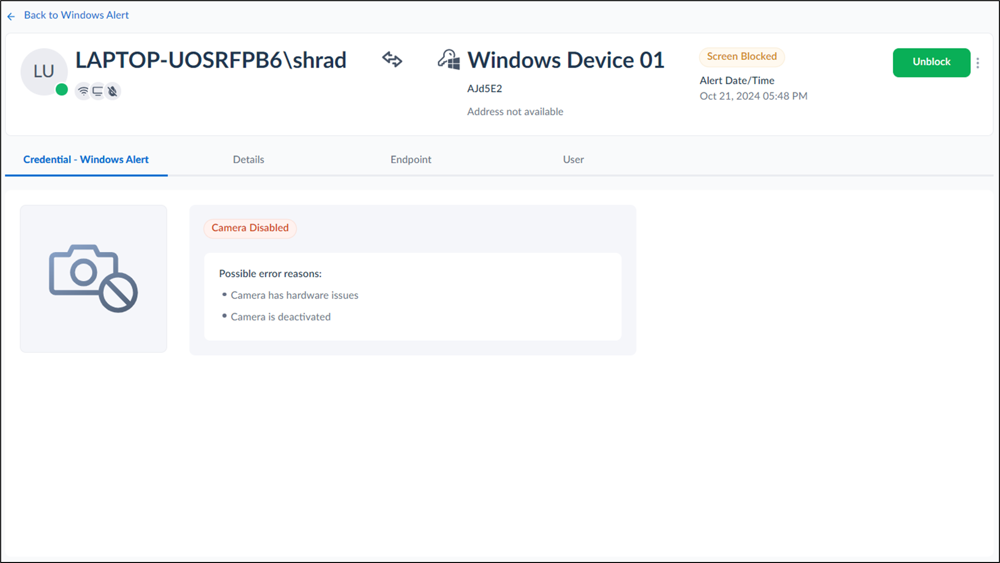

      The user's screen is unblocked successfully.

      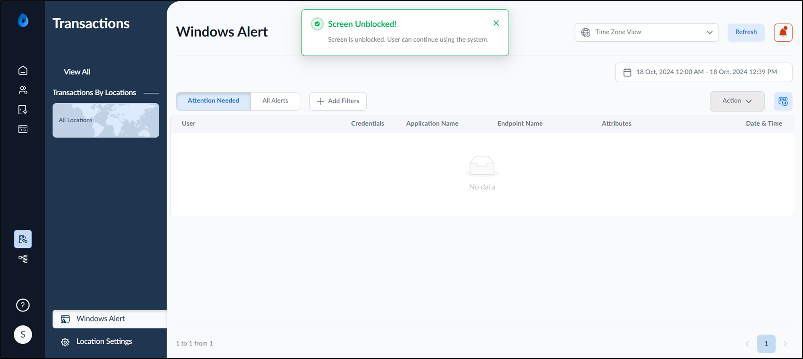

      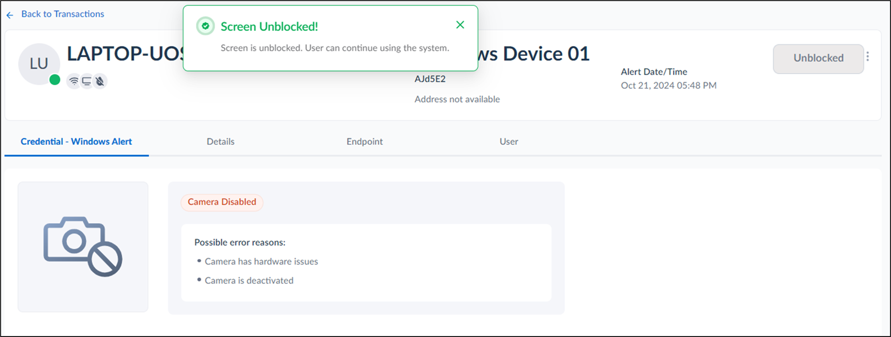

## Using Windows endpoint

1. Log in to Oloid Portal.
2. Navigate to **Endpoints** > select preferred **Endpoint Name**.

   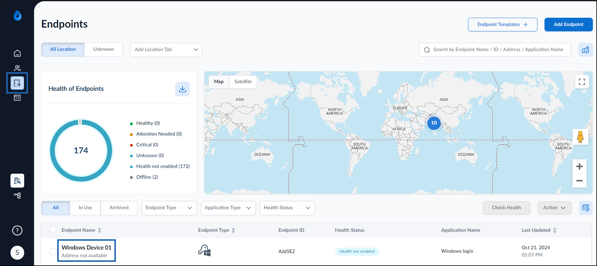

   The endpoint details page is displayed.

   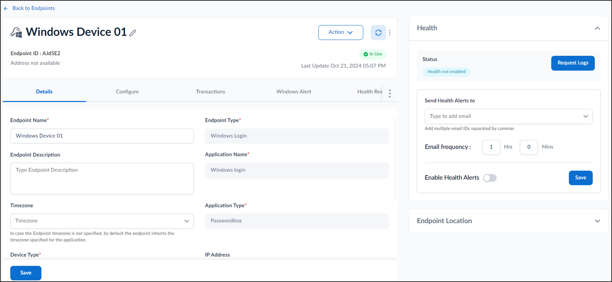

3. Select **Unblock** to unblock the user's screen.

   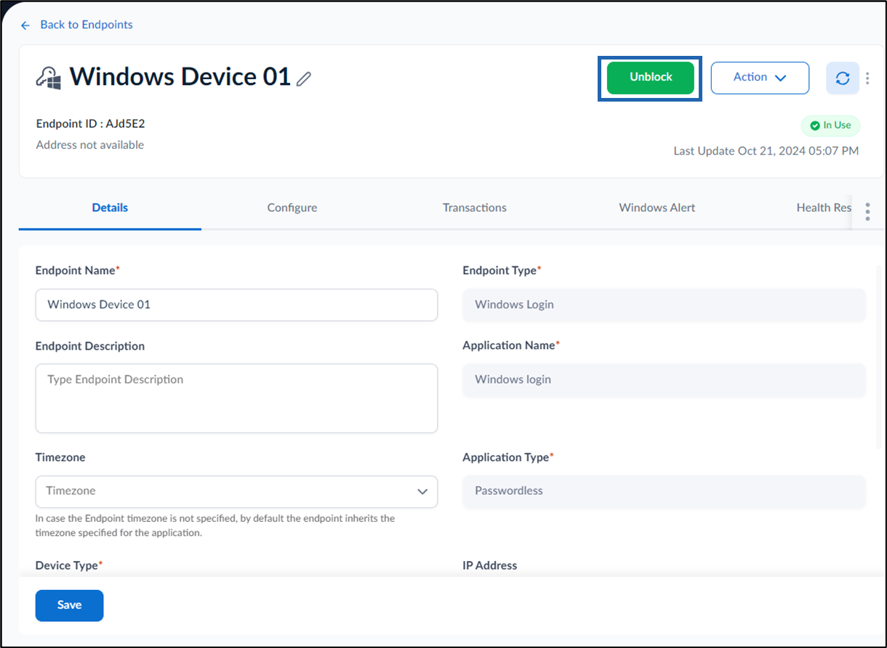

   The endpoint is unblocked successfully and the user can continue using the system.

   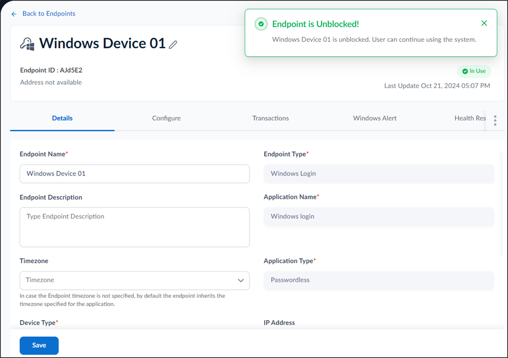

## Video Tutorial

Watch the video [How to unblock a user's blocked screen](/platforms/windows/videos/how-to-unblock-a-user-s-blocked-screen-video-tutorial)
