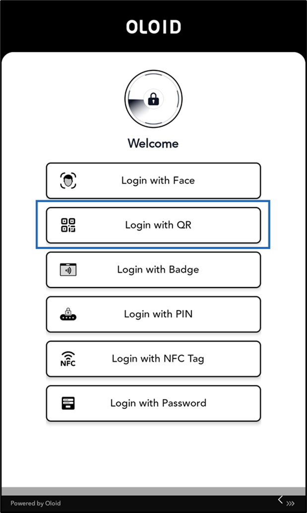
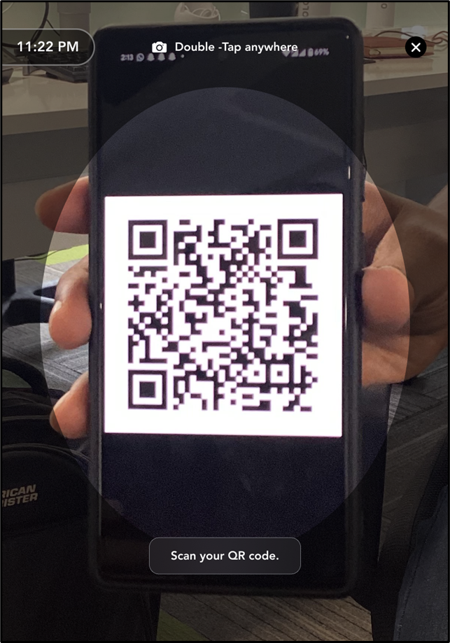
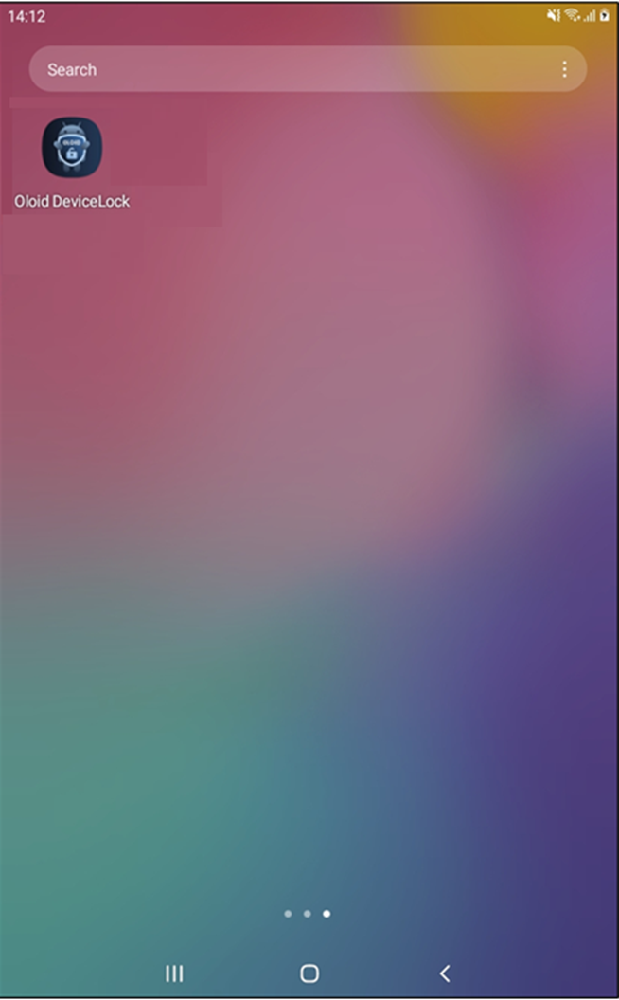

{/* Source: Intercom article 12779710 - https://oloid.help/en/articles/12779710-how-to-unlock-the-device-screen-using-the-oloid-devicelock-app-with-qr-credential */}
{/* Generated by intercom_to_mintlify.py - re-running overwrites this file. */}

## Introduction

The **Oloid DeviceLock app** enables users to securely unlock their Android devices using **QR credential**. After successful authentication, the device unlocks and redirects to the device **home screen**.

## Prerequisite

A valid QR code must be assigned to you.

## Steps to Unlock the Device

1. Press the **Power** button or tap the screen on your device.

   <Note>
     **Note:** The Device Lock app is displayed automatically, as it always runs in Kiosk Mode.
   </Note>

   The Welcome screen is displayed.
2. Tap **Login with QR**.

   <Note>
     **Note:** You will only see the authentication methods (Face, Badge, PIN, QR Code and NFC/ID) enabled for you. Button names may vary based on configuration. Contact [Support](mailto:Support@oloid.ai) if no authentication method appears.
   </Note>

   

   The camera turns on.

Show your QR Code in front of the camera to capture the QR code.

After successful authentication, the device unlocks and displays the **home screen**.

