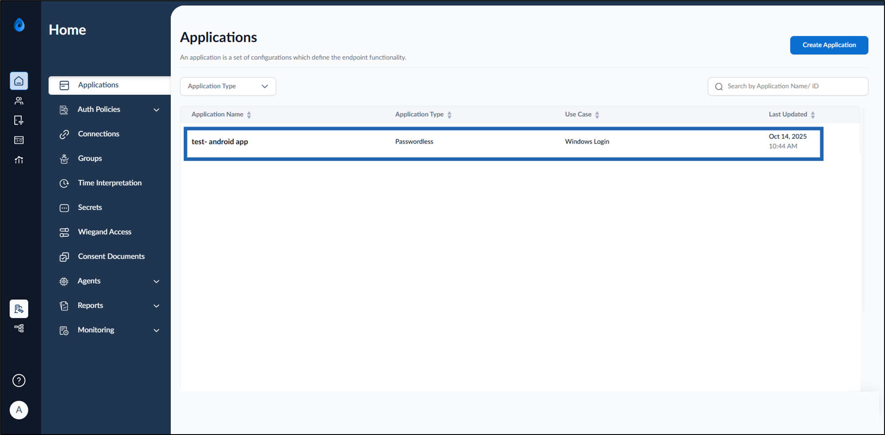
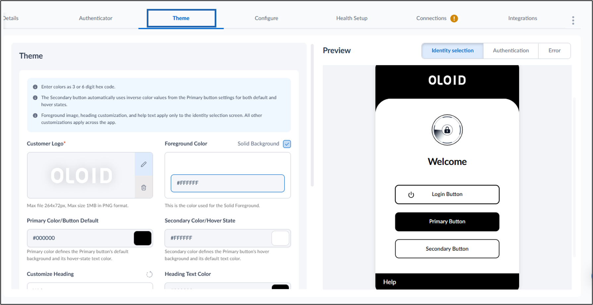
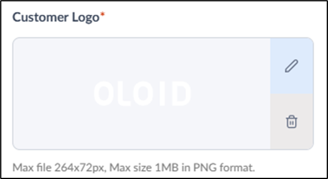
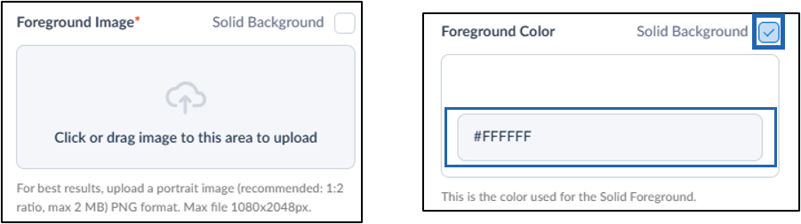
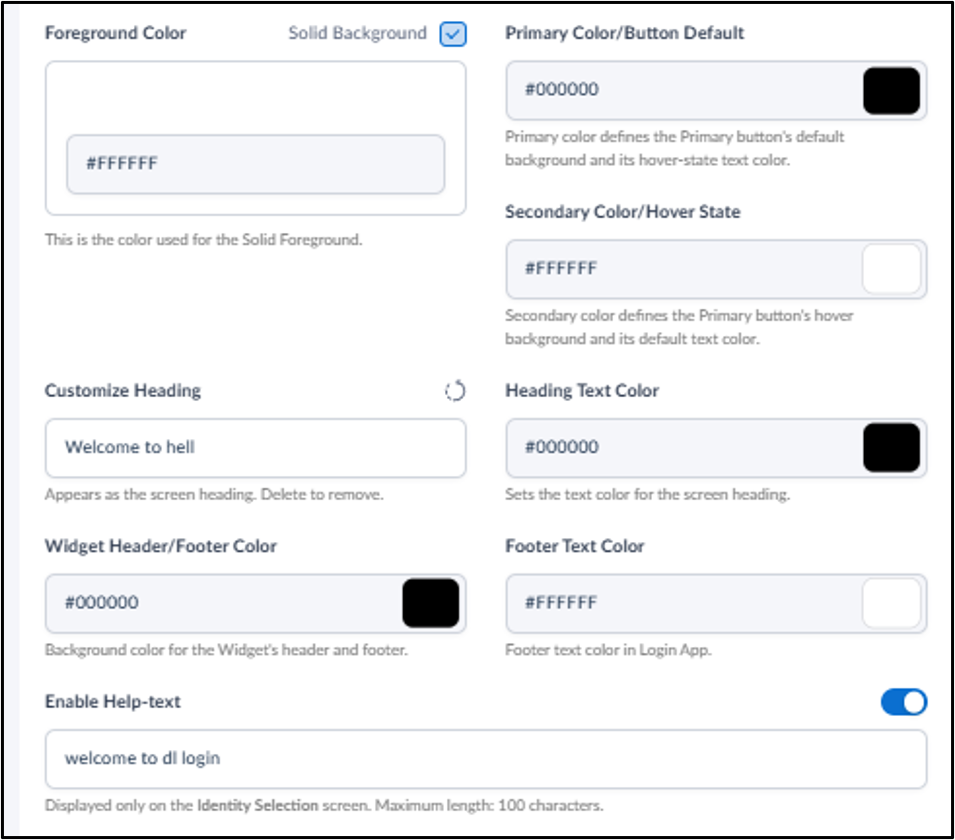
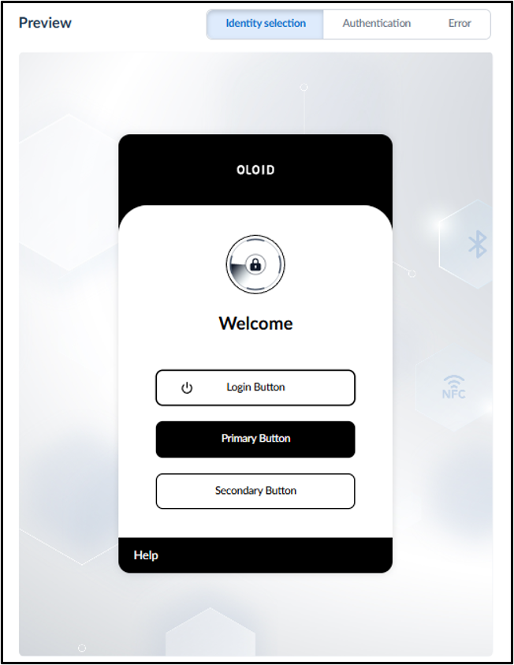
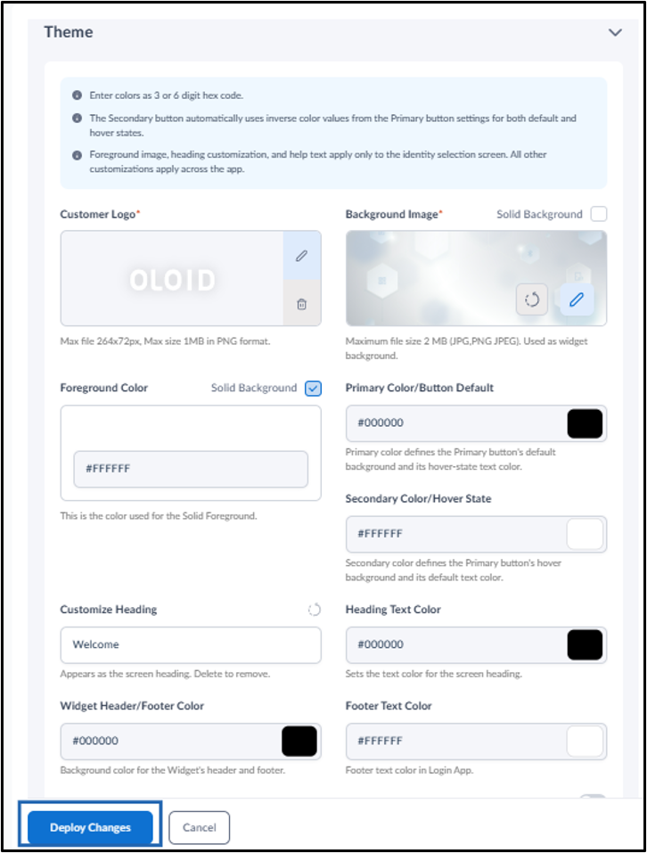
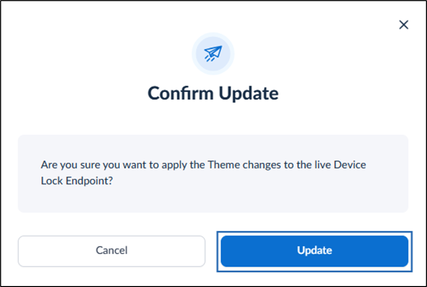

{/* Source: Intercom article 10009894 - https://oloid.help/en/articles/10009894-tenant-admin-portal-how-to-configure-theme-tab-for-devicelock-app */}
{/* Generated by intercom_to_mintlify.py - re-running overwrites this file. */}

## Introduction

The **Theme** tab in the Tenant Admin Portal for **DeviceLock App** allows admin to customize the app’s appearance to match their organization’s branding.

## Prerequisites

- You must have admin access to the Tenant Admin Portal.
- You must create DeviceLock Application. To create, refer [How to create and configure Device Lock application](/platforms/windows/windows-login/devicelock-app-how-to-create-and-configure-devicelock-application-in).

## Steps to configure Theme Tab

1. Log in to the **Tenant Admin Portal**.
2. On the homepage, click the **Device Lock Application** to be configured.

   

   The **Device Lock Application details** page is displayed.
3. Go to **Theme** tab.

   

   The **Theme tab** is displayed.
4. Do the following:
   1. Edit Customer logo.

      <Note>
        **Note:** The maximum file dimensions for the logo are **264x72 px**, with a maximum size of **1 MB** in **PNG** format.
      </Note>

      

   2. **Foreground:** Do one of the following:
      1. Click or drag an image to the **Foreground Image** area to upload it.

         <Note>
           **Note:** For best results, upload a portrait PNG image with a 1:2 ratio. The maximum file size is 2 MB, and the maximum resolution is 1080 x 2048 px.
         </Note>

      2. Select the **Solid Background** checkbox and then enter the color code in the **Foreground Color** field.

         <Note>
           **Note:** When the **Solid Background** checkbox is selected, the **Foreground Image** field changes to **Foreground Color**.
         </Note>

         

   3. **Primary Color/Button Default:** Update the primary color code to define the primary button's default background and its hover-state text color.
   4. **Secondary Color/Hover State:** Update the secondary color code to define the primary button's hover background and its default text color.
   5. **Customize Heading:** Update the heading that appears at the top of the screen.
   6. **Heading Text Color:** Update the text color code of the screen heading.
   7. **Widget Header/Footer Color:** Update the background color for the Widget's header and footer.
   8. **Footer Text Color:** Update the footer text color code in Login App.
   9. **Enable Help-text:** Turn on **Enable Help-text** toggle and then enter the help text to display on the **Identity Selection** screen.

      <Note>
        **Note:** The help text is displayed only on the **Identity Selection** screen and must not exceed **100 characters**.
      </Note>

      

5. (Optional) In the **Preview** section, select one of the following tabs to preview the theme configuration:
   1. **Identity Selection:** Preview the appearance of the identity selection screen displayed before user authentication.
   2. **Authentication:** Preview the authentication screen displayed when users authenticate using their configured credentials.
   3. **Error:** Preview how error messages and error screens are displayed to users during authentication failures.

      

6. Click **Deploy**.

   

   The **Confirm Update** pop-up box is displayed.
7. Click **Update**.

   

   The DeviceLock theme tab is **updated** successfully.
