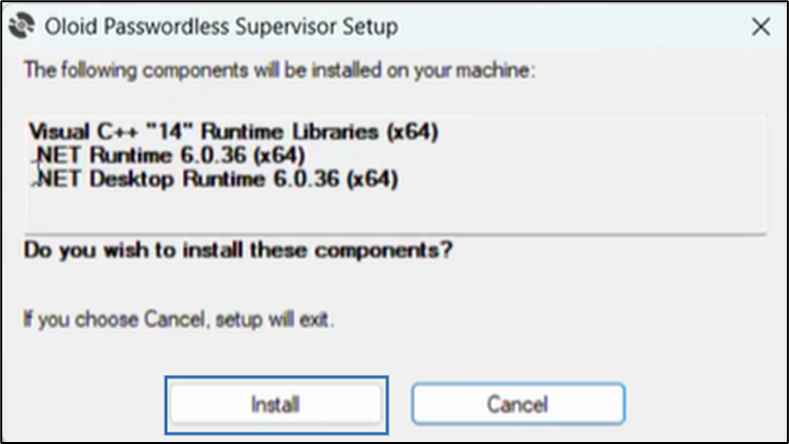
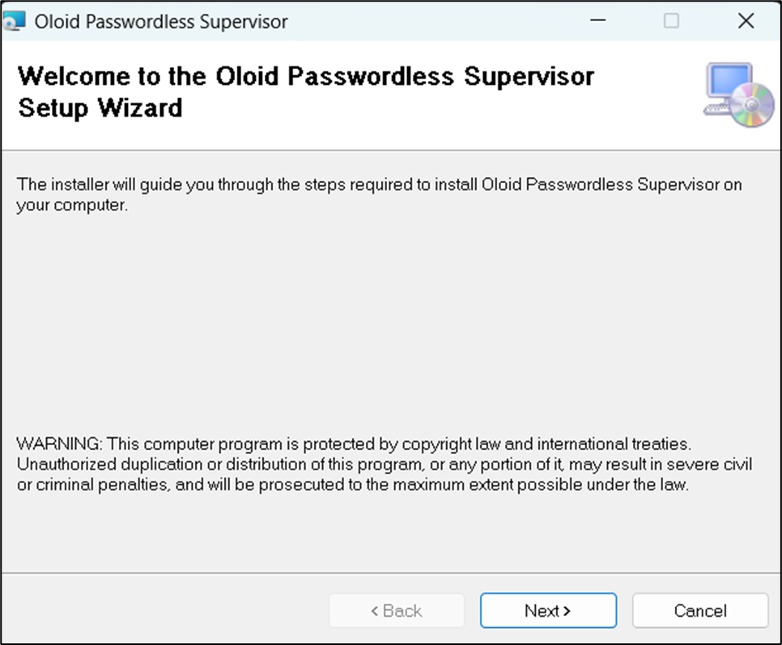
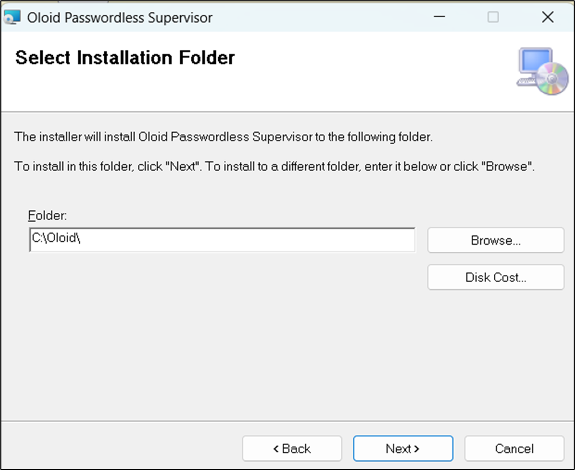
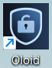
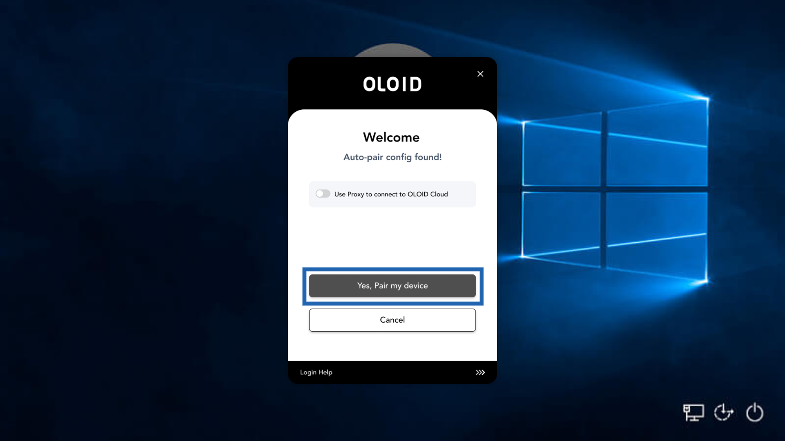
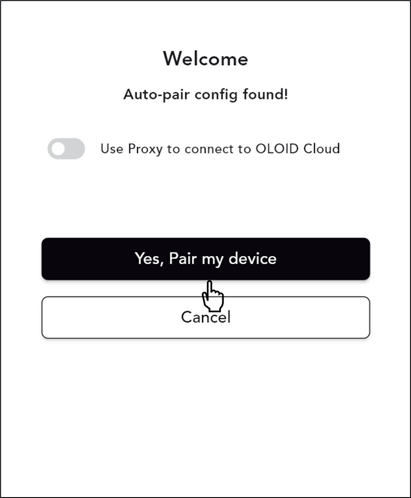

{/* Source: Intercom article 10568115 - https://oloid.help/en/articles/10568115-how-to-download-install-and-configure-windows-authenticator-app */}
{/* Generated by intercom_to_mintlify.py - re-running overwrites this file. */}

The Windows Authenticator App provides secure, passwordless access to your Windows machine, making it easy to log in without the need for traditional passwords. This guide provides step-by-step instructions on downloading, installing, and configuring the app using the Oloid Portal.

## Steps to download Windows Authenticator App

1. Log in to **Oloid Portal**.
2. On the home page of the Oloid Portal, do one of the following to download the Windows Authenticator App:
   - Using File Sharing tab
     Navigate to **User Profile Menu** > **Tenant Setting** > **Oloid Apps** tab > download **Windows Authenticator App**.For more details, see [Download from File Sharing](/platforms/windows/supervisor-app/how-to-download-supervisor-app)
   - Using Tenant Settings tab
     Navigate to **User Profile Menu** > **File Sharing**. For more details, see [Download from Tenant Setting](/platforms/windows/supervisor-app/how-to-download-supervisor-app)

After the download is complete, you can proceed with installing Windows Authenticator App.

## Steps to install Windows Authenticator App

1. Download **Windows Authenticator App** file on your system.

   <Note>
     **Note:** Select the version as advised by your Oloid Rep.
   </Note>

   

   The **OloidPasswordlessSupervisor.Setup.zip** file is downloaded in your system.
2. Right-click and select **Extract All** > **OloidPasswordlessSupervisor.Setup.zip** file.
   The extracted files will be saved in the same folder as the original zipped file.
3. Double-click on **setup.exe** file.
   The **Oloid Passwordless Supervisor Setup** window is displayed.

   

4. Review the listed components and click **Install** to proceed.

   <Note>
     **Note:** If any of the files are missing, the application prompts to install the missing component.
   </Note>

5. On the **Oloid Passwordless Supervisor** Setup wizard, click **Next**.

   

6. Use the default path to install the application and click **Next**.

   

7. Click **Next** to confirm the installation.

   

8. Click **Close** after the installation is complete.

   

   After successful installation, you can find the app icon  on your desktop. For first-time installation, it is recommended to restart your system.

## Steps to auto-pair the Windows Authenticator App

1. On the Windows lock screen, do the following:
   1. Click **Sign-in options**.

      

      The Windows login app is displayed.
   2. Select **Windows login app**.

      

   3. Select **Login with OLOID**.

      

      The Windows Login app is displayed.
2. Select **Yes, pair my device** to auto-pair the device.

   

   The Windows machine has been successfully paired and is now ready for use.

**OR**

After installing the Windows Authenticator app, unlock your Windows machine using a credential other than the Oloid login method.

1. On the desktop, double-click on the **Windows Authenticator App**  icon to start.
   The **Welcome** screen is displayed. You can see the **"Auto-pair config found!"** message.

   <Note>
     **Note:** The auto-pair config file is present in your installer file (Installer path\Oloid\Oloid\config). Reach out to [Oloid Support](mailto:support@oloid.ai)if you do not see auto-pair option.
   </Note>

   You can also [manually pair](/platforms/windows/supervisor-app/windows-login-how-to-pair-supervisor-app-using-auto-pair-config-file)your Supervisor app incase auto pair fails.
2. Select **Yes, Pair my device** to auto-pair the device.

   

   The Windows machine is paired successfully.
