{/* Source: Intercom article 15373659 - https://oloid.help/en/articles/15373659-windows-login-v1-0-how-to-deploy-windows-login-v1-0-using-microsoft-intune-mdm */}
{/* Generated by intercom_to_mintlify.py - re-running overwrites this file. */}

## Introduction

This document provides step-by-step instructions to deploy the Windows Passwordless v1.0 application to managed Windows devices using Microsoft Intune (MDM).

## Prerequisites

- You must have admin access to the Microsoft Intune Admin Account.
- You must download the **Windows Login v1.0 installer file**. For more information, refer to [How to download Supervisor App](/platforms/windows/supervisor-app/how-to-download-supervisor-app)

## Steps to Deploy Windows Passwordless v1.0 using Microsoft Intune (MDM)

1. Log in to **Microsoft Intune Admin Account**.
   The Microsoft Intune home screen is displayed.
2. Navigate to **Apps > Windows.**

   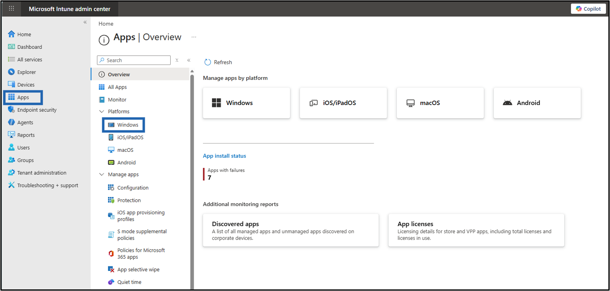

   The **Windows apps** screen is displayed.
3. Click **+ Create**.

   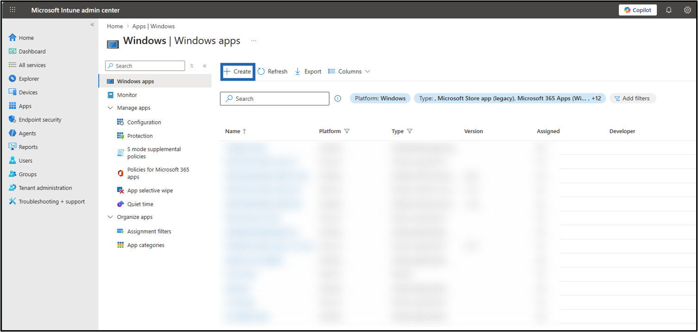

   The **Select app type** screen is displayed.
4. In the app type dropdown, select **Line-of-business app** and click **Select**.

   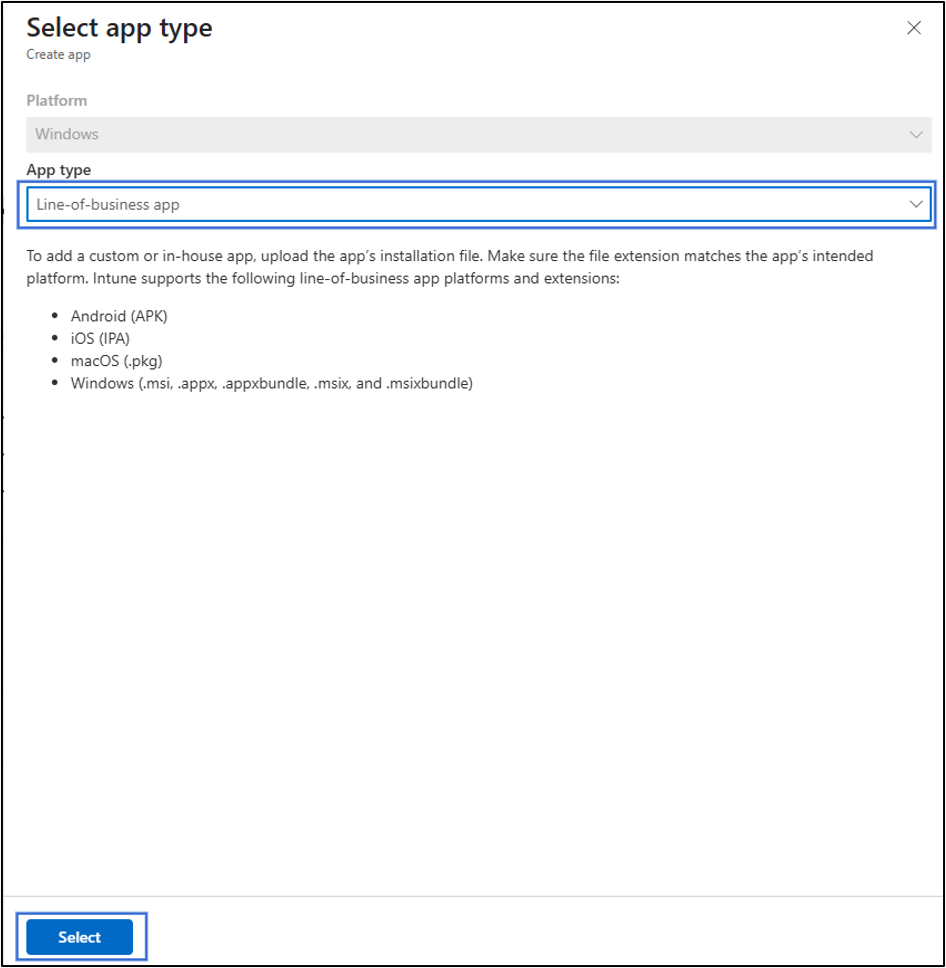

   The **Add App** screen is displayed.
5. On **App Information** tab, do the following:
   1. Click **Select app package file**.

      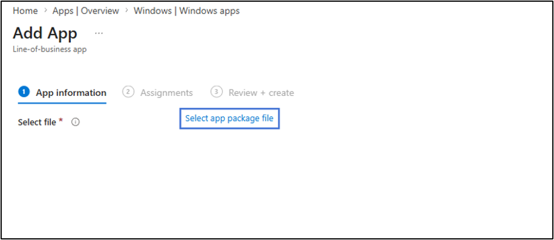

      The add Package file screen is displayed.
   2. Browse and upload the **Windows Login v1.0 installer file.**

      <Note>
        **Note:** Upload the MSI file from the package.
      </Note>

   3. Click **OK**.

      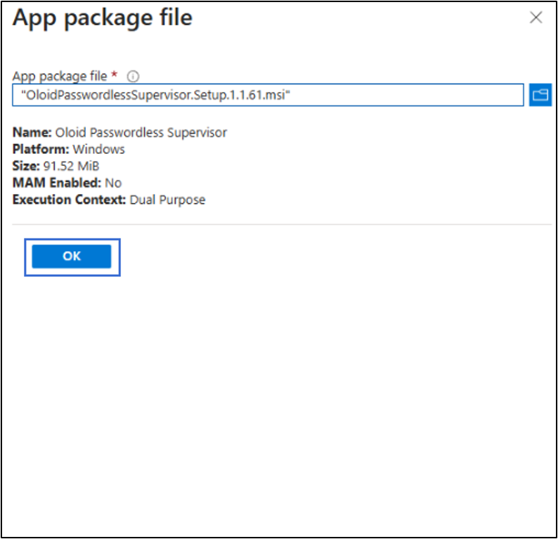

      The **App information** tab is displayed.
   4. Enter Publisher.
   5. Click **Next**.

      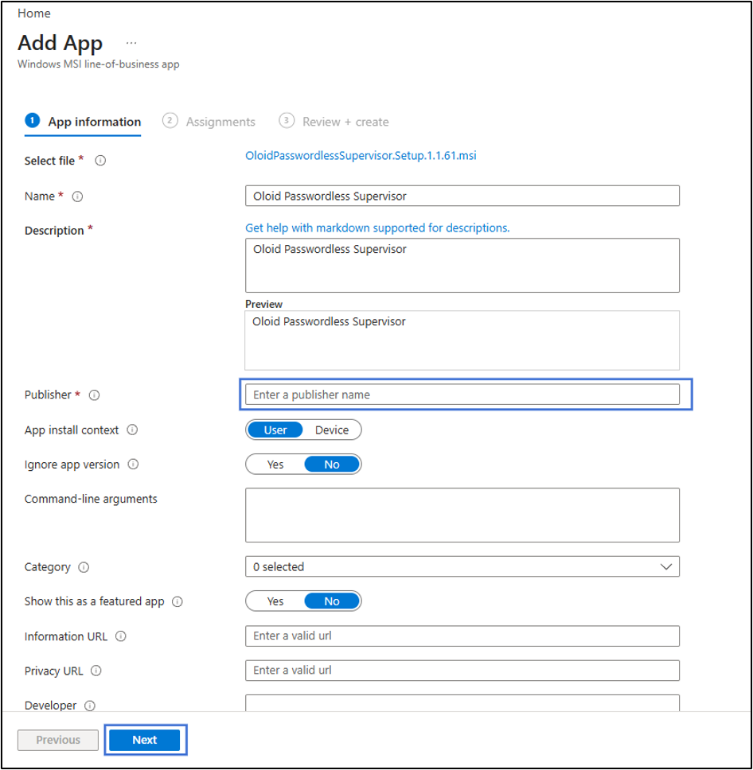

      The **Assignments** tab is displayed.
6. On the Assignments tab, do the following.
   1. On **Required** section, click **Add group** to assign this profile to your target device groups.

      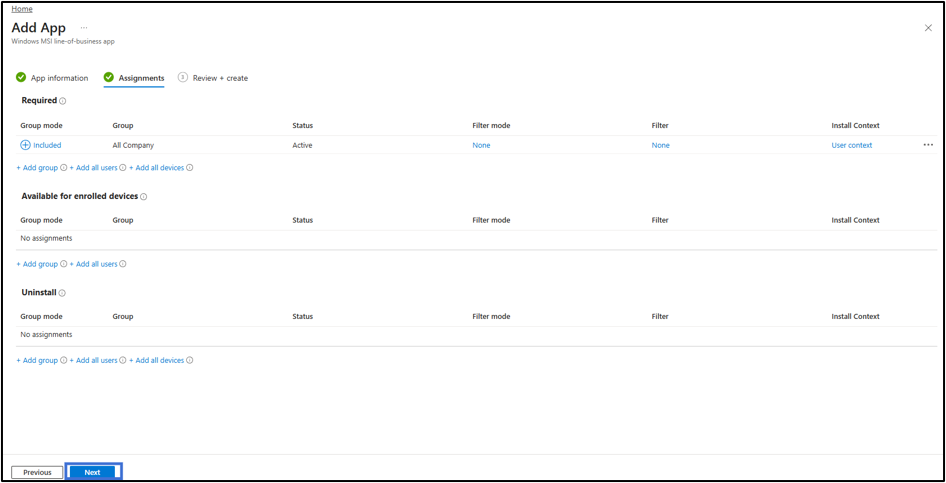

      The **Select groups** pop-up is displayed.
   2. Do the following.
      1. Select the **group(s**) from the list.

         <Note>
           **Note:** You can select multiple groups (If required).
         </Note>

      2. Click **Select**.

         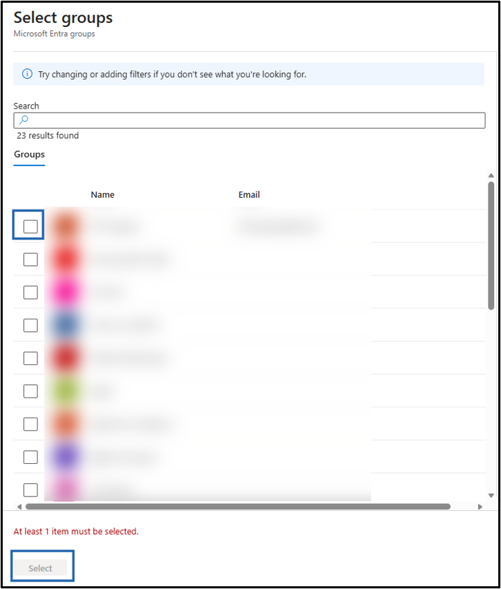

         The Group is added in the list.
   3. Click **Next**.

      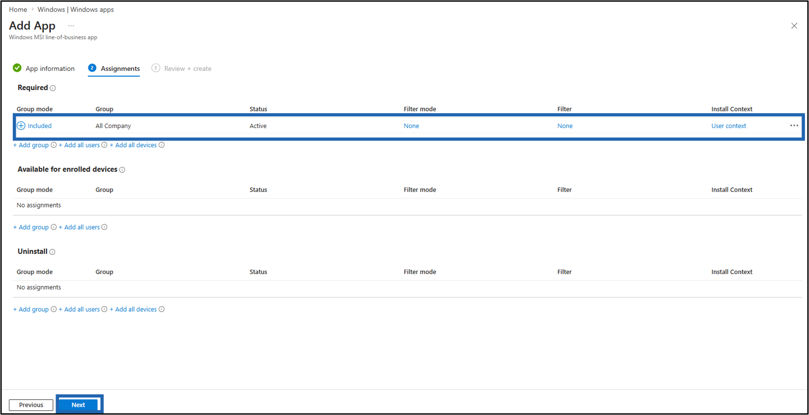

      The Assignment tab is configured successfully and **Review + create** tab is displayed.

      <Note>
        **Note:** To assign groups under the **Available for enrolled devices** and **Uninstall sections**, repeat Steps **6a** and **6b** as required.
      </Note>

7. Review all settings and click **Create.**

   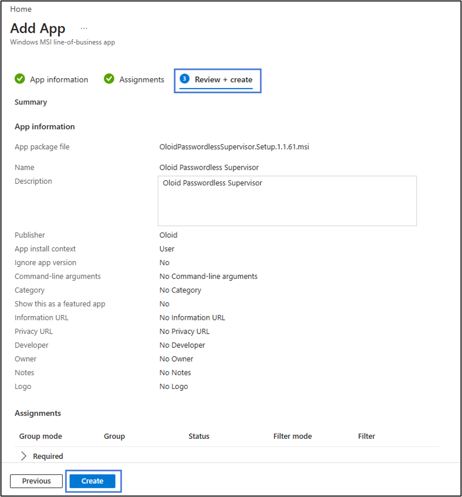

   The app the created successfully and added in the apps screen.

   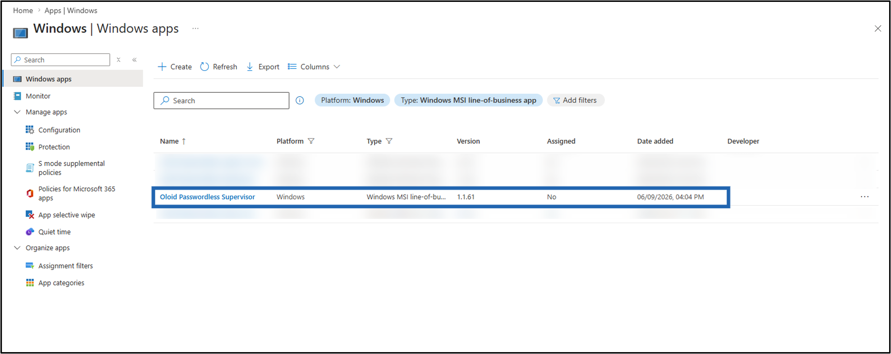
