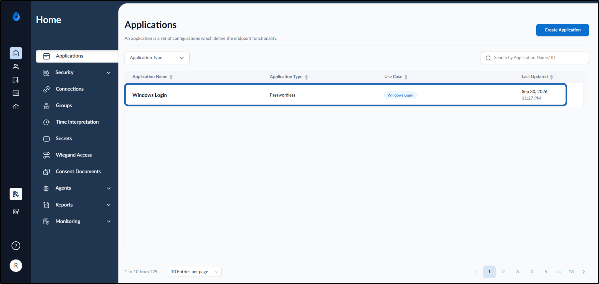
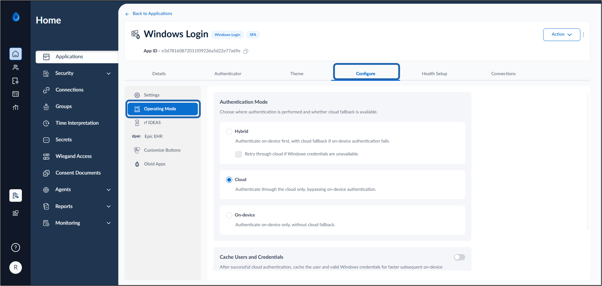
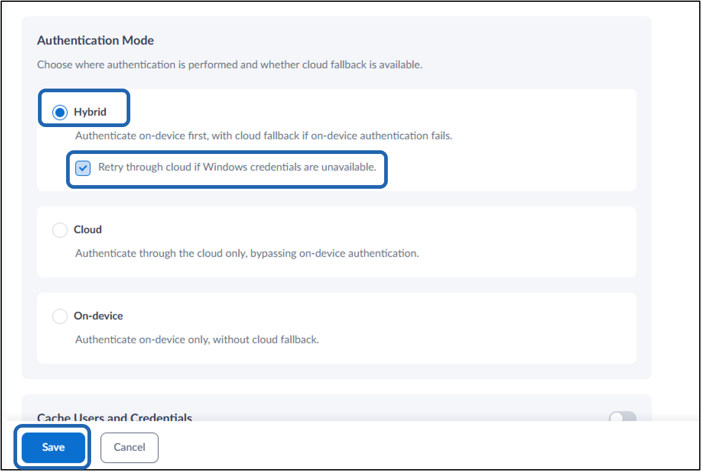
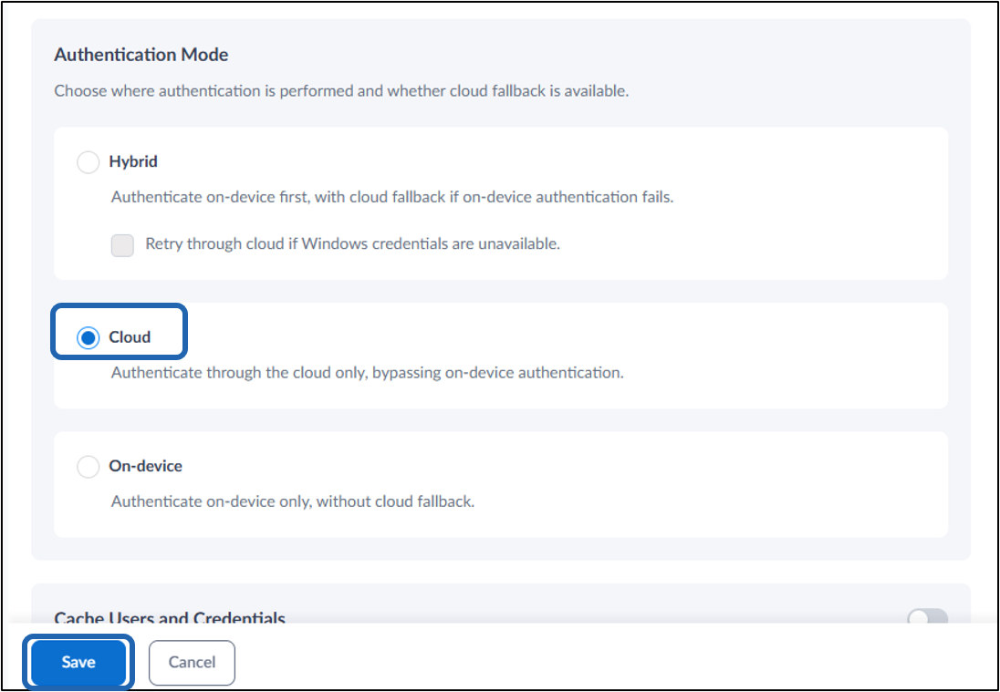
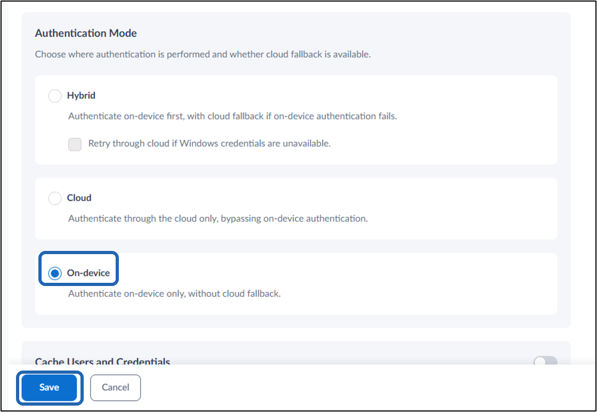
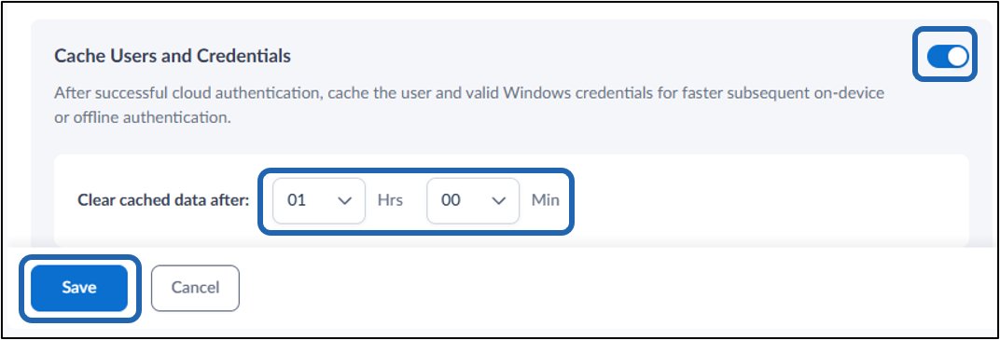
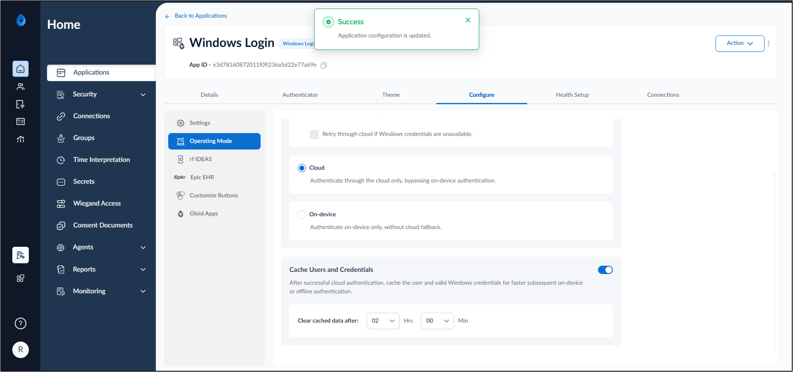

{/* Source: Intercom article 17212124 - https://oloid.help/en/articles/17212124-windows-login-2-0-how-to-configure-operating-modes-and-hybrid-cache-validity-for-windows-login-application */}
{/* Generated by intercom_to_mintlify.py - re-running overwrites this file. */}

## Introduction

This document explains how to set the operating mode for a Windows Login application in the Tenant Admin Portal, and how to cache users and credentials on the device. You can choose one of three modes: **Hybrid, Cloud** or **On-device.**

## Prerequisites

- You must have admin access to the Tenant Admin Portal.
- Windows Login Application must already be created. for more information refer: [Windows Login - How to create and configure Windows Login application in the Tenant Admin Portal](/platforms/windows/windows-login/windows-login-how-to-create-and-configure-windows-login-application)

## **Steps to** Configure Operating Mode

1. Log in to the **Tenant Admin Portal**.
2. On the **Applications** page, click **the Application** from the list.

   

   The application details page is displayed.
3. Click **Configure** Tab > Click **Operating Mode**

   

   The Authentication Mode section is displayed.
4. In the Authentication Mode section, Select one of the following modes
   1. **Hybrid:** Authenticates on the device first, and falls back to the cloud if on-device authentication fails.
      (Optional) Select the **Retry through cloud if Windows credentials are unavailable** check box.

      

   2. **Cloud:** Authenticates through the cloud only, without on-device authentication.

      

   3. **On-device:** Authenticates on the device only, without cloud fallback.
5. Click **Save.**

   

6. Turn on the **Cache Users and Credentials** toggle.
   1. Set the **Clear Cache Data After** duration.

      <Note>
        **Note:** When caching is on, user and credential data is stored on the device so users can authenticate on-device, including when the cloud isn’t reachable. **Clear Cache Data After** sets how long this cached data is kept. When the duration ends, the cached data is cleared from the device, and users must authenticate through the cloud again before the data is cached again.
      </Note>

   2. Click **Save.**

      

      The operating mode and cache settings are updated successfully.

      
