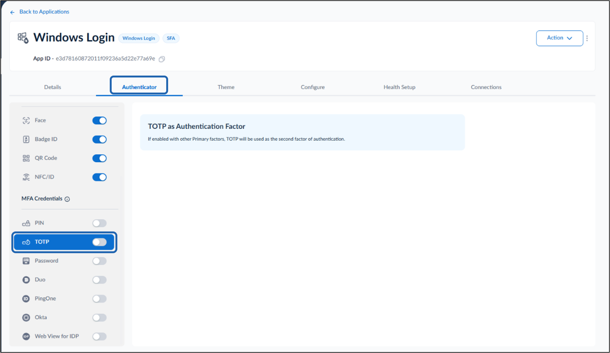
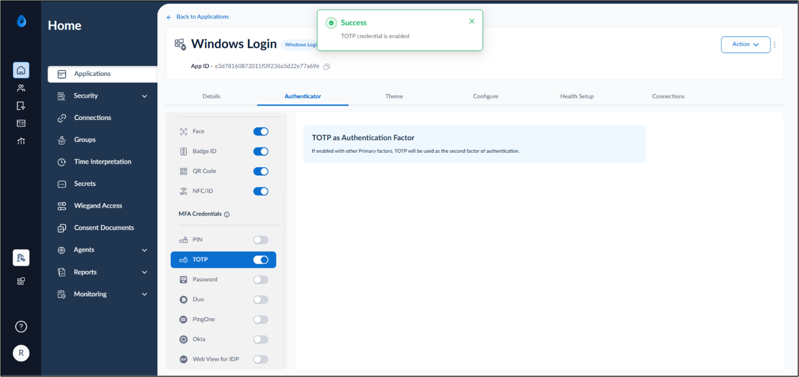

{/* Source: Intercom article 17766656 - https://oloid.help/en/articles/17766656-windows-login-2-0-how-to-enable-totp-for-windows-login-in-the-tenant-admin-portal */}
{/* Generated by intercom_to_mintlify.py - re-running overwrites this file. */}

## Introduction

The TOTP (Time-based One-Time Password) feature in the Tenant Admin Portal allows admins to enable TOTP as a second-factor authentication for the Windows Login application. When TOTP is enabled with other primary factors, users log in to endpoints by completing the primary factor and then entering a time-based one-time password generated by an authenticator app on their mobile device.

## Prerequisites

- You must have access to the Tenant Admin Portal.
- You must create and configure Windows Login application in the Tenant Admin portal. For more, refer to[How to create and configure Windows Login application in the Tenant Admin Portal](/platforms/windows/windows-login/windows-login-how-to-create-and-configure-windows-login-application)

## Steps to Enable TOTP

1. Log in to the **Tenant Admin Portal**.
2. On the **Applications** page, select the Windows Login application.

   

   The application page is displayed.

   

3. Go to **Authenticator** tab > select **TOTP** > Turn on **TOTP** toggle to use TOTP as a MFA credential.

   

   TOTP is successfully enabled for the Windows Login application.

   
