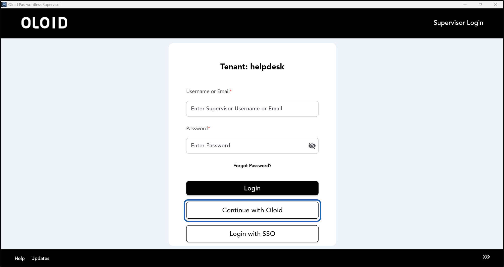
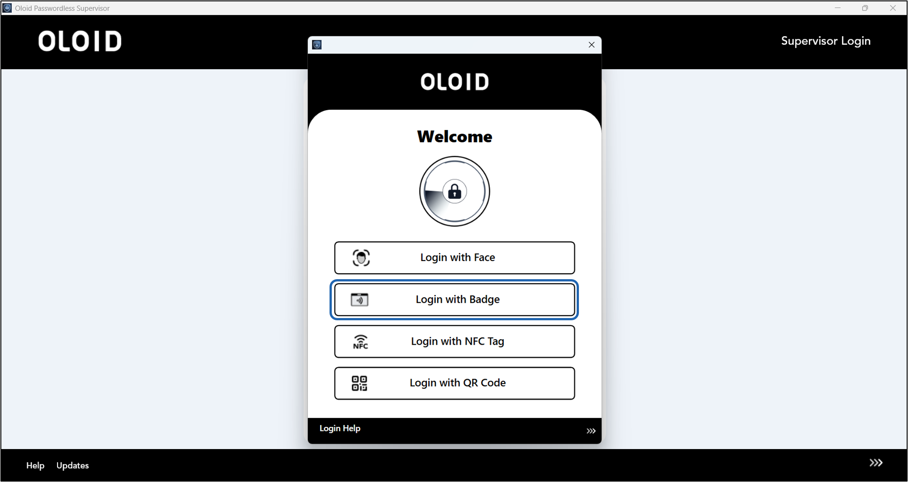
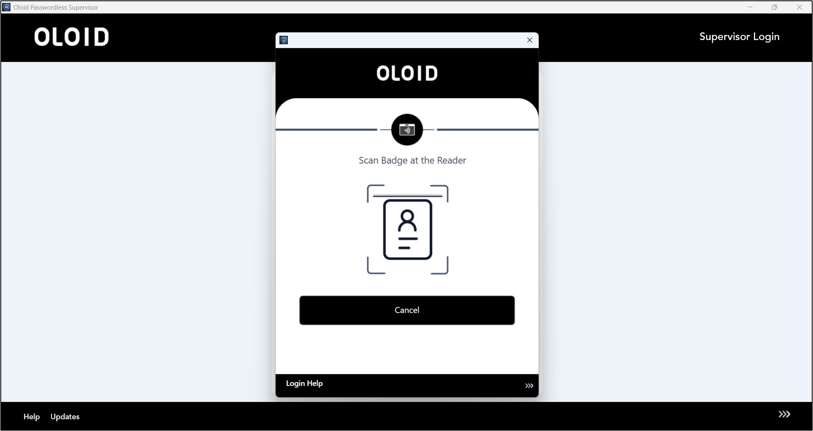
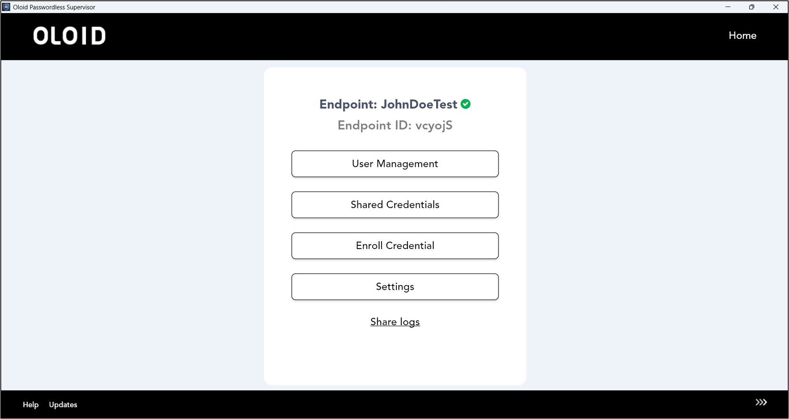

{/* Source: Intercom article 16817007 - https://oloid.help/en/articles/16817007-windows-login-2-0-how-to-login-to-supervisor-app-using-badge-via-continue-with-oloid-option */}
{/* Generated by intercom_to_mintlify.py - re-running overwrites this file. */}

## Introduction

This document provides step-by-step instructions for logging in to the Supervisor App using badge authentication. Users can authenticate by scanning their assigned badge on a compatible badge reader.

## Prerequisites

- You must have an Admin or Supervisor account access.
- Ensure the Continue with Oloid option checkbox is selected in the Tenant Admin Portal. For more information, refer: [Windows Login - How to Configure Login options for Oloid Apps](/platforms/windows/windows-login/windows-login-how-to-configure-login-options-for-oloid-apps)
- Windows Login Application must be created in the Tenant Admin Portal. For more information, refer: [How to create and configure Windows Login application in the Tenant Admin Portal](/platforms/windows/windows-login/windows-login-how-to-create-and-configure-windows-login-application)
- Ensure the endpoint is paired with the Windows Login application. refer [Windows Login - How to Manually Pair the Supervisor App](/platforms/windows/supervisor-app/windows-login-how-to-manually-pair-the-supervisor-app)
- Assign Badge ID to the user. For more details, refer [How to assign Badge ID as credential to users](/platform/tenant-admin-portal/how-to-assign-badge-id-as-credential-to-users)
- Enable Badge as an authenticator in the Windows application. For more details, refer [How to enable Badge in Windows application](/platforms/windows/windows-login/windows-login-how-to-create-and-configure-windows-login-application)

## Steps to Login using Badge

1. Double-click on the **Supervisor App** to start.

   

   The Login screen is displayed.
2. Click **Continue with Oloid**.

   

   The Credential screen is displayed.
3. Click **Login with Badge.**

   

   The Scan badge screen is displayed.
4. Tap the **Badge** on the **Badge Reader** to scan it.

   

   On successful authentication User is logged in to Supervisor App.

   
