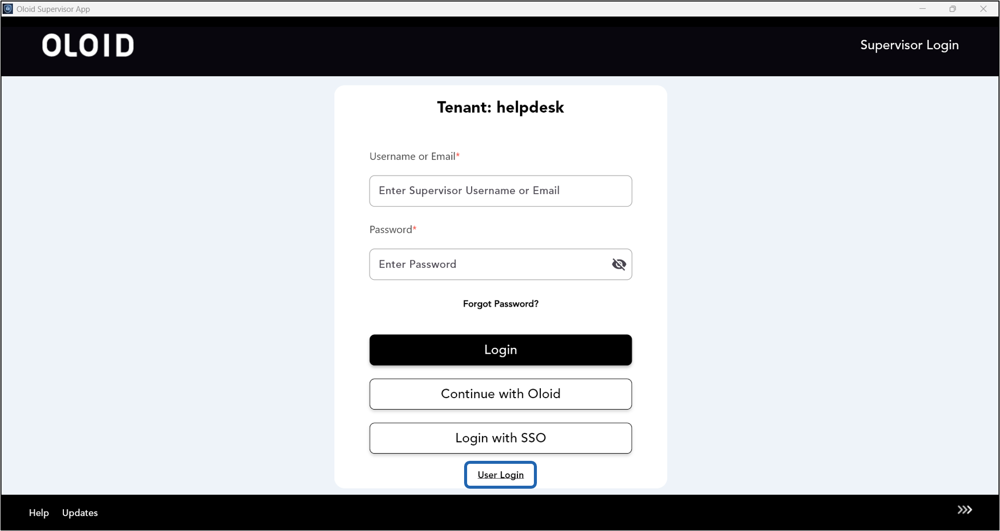
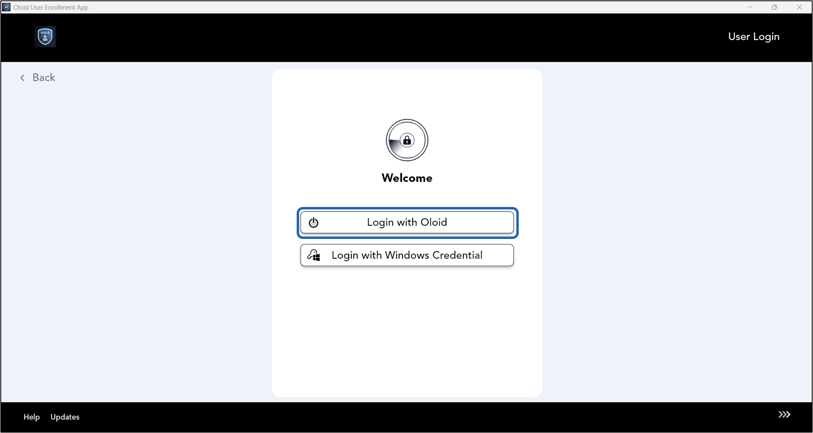
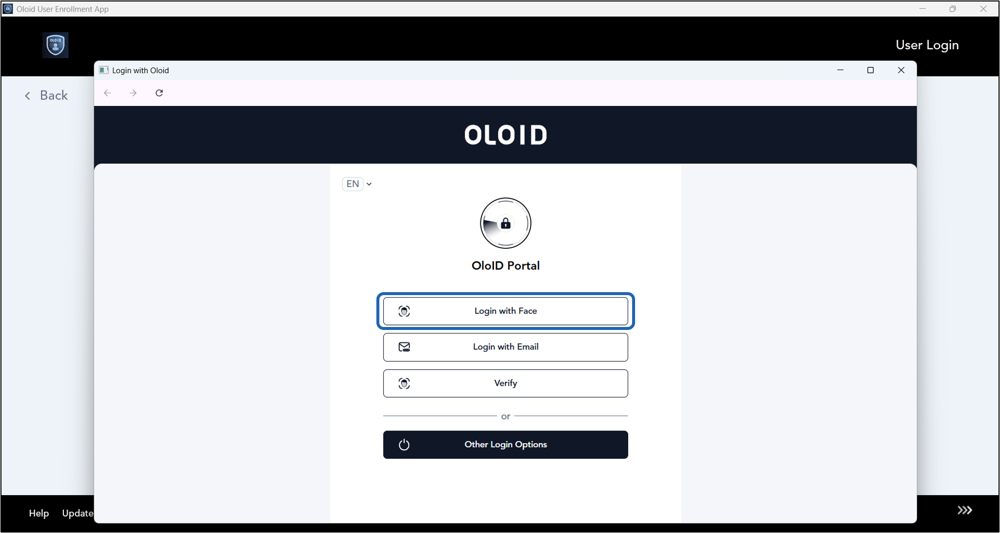
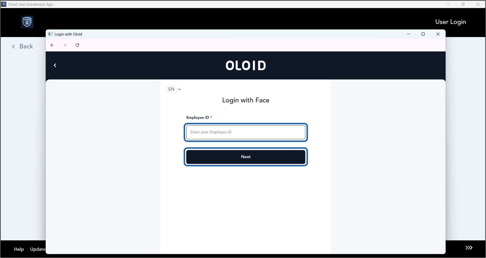
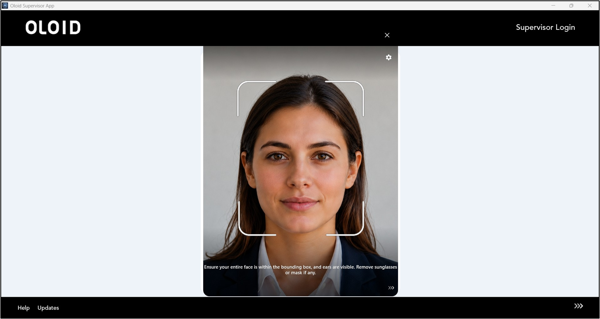
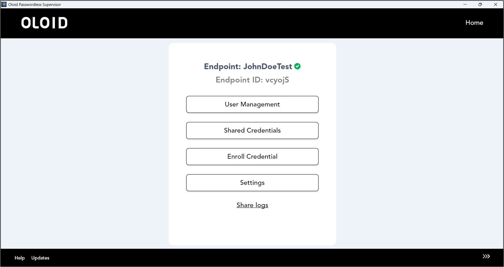

{/* Source: Intercom article 17271241 - https://oloid.help/en/articles/17271241-windows-login-2-0-how-to-login-to-supervisor-app-using-face-via-oloid-user-portal */}
{/* Generated by intercom_to_mintlify.py - re-running overwrites this file. */}

## Introduction

This document provides step-by-step instructions for logging in to the Supervisor App using face authentication through the Oloid User Portal. Users can authenticate their identity using their enrolled face credential to securely access the Supervisor App.

## Prerequisites

- You must have an Admin or Supervisor account access.
- Ensure the Continue with Oloid option checkbox is selected in the Tenant Admin Portal. For more information, refer: [Windows Login - How to Configure Login options for Oloid Apps](/platforms/windows/windows-login/windows-login-how-to-configure-login-options-for-oloid-apps)
- Windows Login Application must be created in the Tenant Admin Portal. For more information, refer: [How to create and configure Windows Login application in the Tenant Admin Portal](/platforms/windows/windows-login/windows-login-how-to-create-and-configure-windows-login-application)
- Ensure the endpoint is paired with the Windows Login application. refer [Windows Login - How to Manually Pair the Supervisor App](/platforms/windows/supervisor-app/windows-login-how-to-manually-pair-the-supervisor-app)
- Enable Face under the Windows application. For more details, refer [How to create and configure Windows application](/platforms/windows/windows-login/windows-login-how-to-create-and-configure-windows-login-application)

## **Steps to** Login to Supervisor App using Oloid User Portal

1. Double-click on the **Supervisor App** to start.

   

   The Login screen is displayed.
2. Click **User Login**.

   

   The **Welcome Screen** is displayed.
3. Click **Login with Oloid.**

   

   The Oloid User Portal pop-up is displayed.
4. Click **Login with Face.**

   

   The Login with Face screen is displayed.
5. Enter **Employee ID.**
6. Click **Next**.

   

7. The camera opens.

   <Note>
     **Note:** Provide camera permission if prompted.
   </Note>

8. Position your face in front of the camera to authenticate face.

   

   On successful authentication User is logged in to Supervisor App.

   
