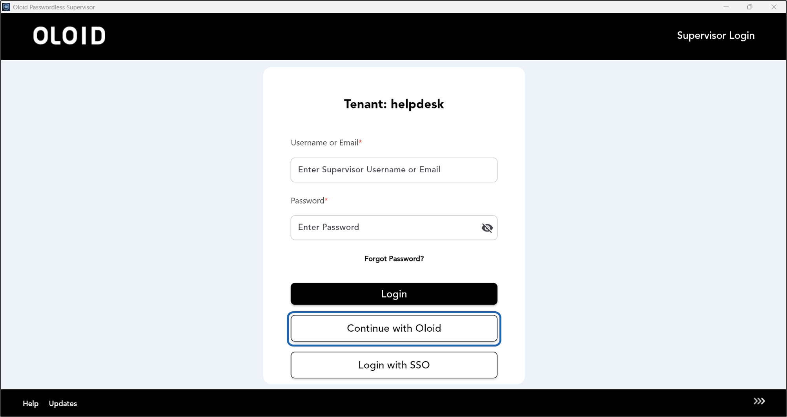
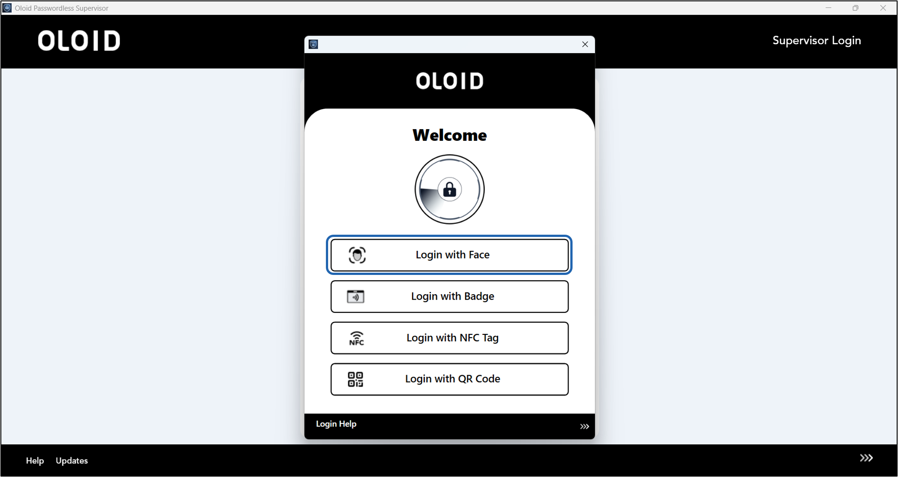
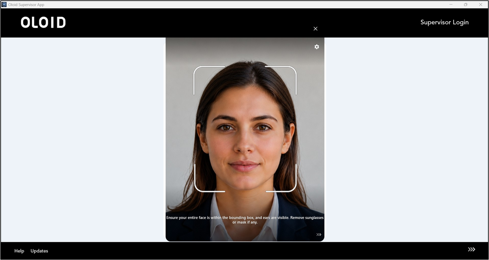
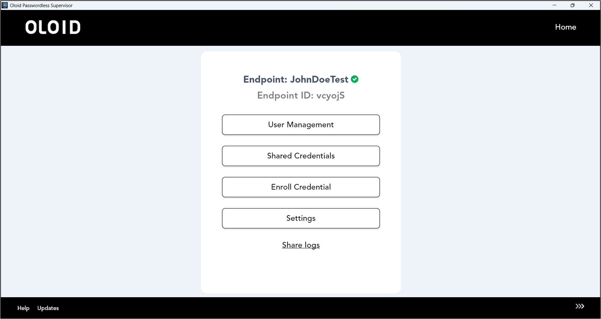

{/* Source: Intercom article 16816423 - https://oloid.help/en/articles/16816423-windows-login-2-0-how-to-login-to-supervisor-app-using-face-via-continue-with-oloid-option */}
{/* Generated by intercom_to_mintlify.py - re-running overwrites this file. */}

## Introduction

This document provides step-by-step instructions for logging in to the Supervisor App using face authentication. When configured, users can authenticate their identity using their enrolled face to securely access the Supervisor App.

## Prerequisites

- You must have an Admin or Supervisor account access.
- Ensure the Continue with Oloid option checkbox is selected in the Tenant Admin Portal. For more information, refer: [Windows Login - How to Configure Login options for Oloid Apps](/platforms/windows/windows-login/windows-login-how-to-configure-login-options-for-oloid-apps)
- Windows Login Application must be created in the Tenant Admin Portal. For more information, refer: [How to create and configure Windows Login application in the Tenant Admin Portal](/platforms/windows/windows-login/windows-login-how-to-create-and-configure-windows-login-application)
- Ensure the endpoint is paired with the Windows Login application. refer [Windows Login - How to Manually Pair the Supervisor App](/platforms/windows/supervisor-app/windows-login-how-to-manually-pair-the-supervisor-app)
- Ensure Face is added to the User. For more information, refer: [Tenant Admin Portal - How to Add Face of a Single User](/platform/tenant-admin-portal/tenant-admin-portal-how-to-add-face-of-a-single-user)
- Enable Face under the Windows application. For more details, refer [How to create and configure Windows application](/platforms/windows/windows-login/windows-login-how-to-create-and-configure-windows-login-application)
- Ensure the User Face is added to HR Picture Verification.

## Steps to Login using Face

1. Double-click on the **Supervisor App** to start.

   

   The Login screen is displayed.
2. Click **Continue with Oloid**.

   

   The Credential screen is displayed.
3. Click **Login with Face**.

   

4. The camera opens.

   <Note>
     **Note:** Provide camera permission if prompted.
   </Note>

5. Position your face in front of the camera to authenticate face.

   

   On successful authentication User is logged in to Supervisor App.

   
