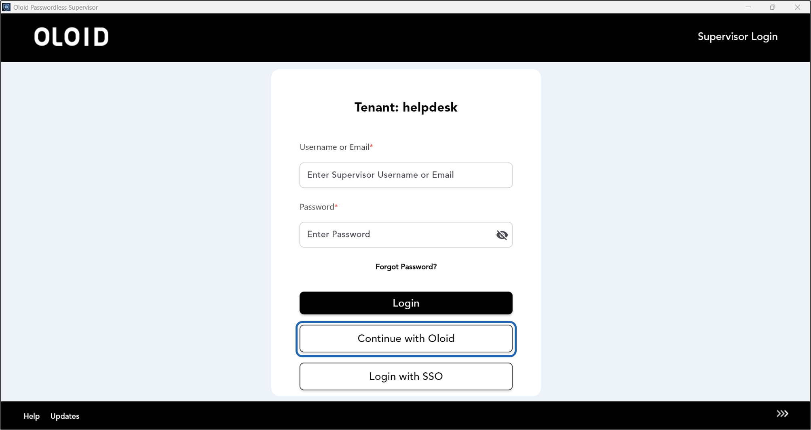
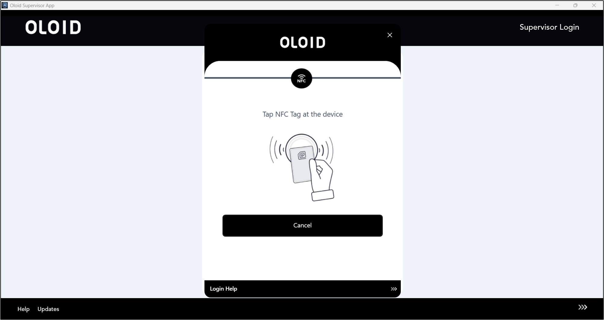
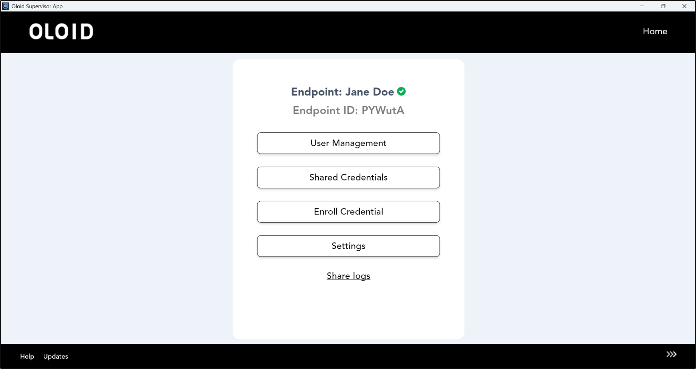

{/* Source: Intercom article 17132771 - https://oloid.help/en/articles/17132771-windows-login-2-0-how-to-login-to-supervisor-app-using-nfc-id-via-continue-with-oloid-option */}
{/* Generated by intercom_to_mintlify.py - re-running overwrites this file. */}

## Introduction

O**LOID** Windows Login lets users sign in to the Supervisor App on a shared Windows endpoint without typing a username or password. With NFC login, users sign in by tapping an NFC-enabled card or tag on the NFC reader connected to the endpoint. This makes sign-in quick and secure for frontline and shared-device workers.

### Prerequisites

- You must have an Admin or Supervisor account access.
- Ensure the Continue with Oloid option checkbox is selected in the Tenant Admin Portal. For more information, refer: [Windows Login - How to Configure Login options for Oloid Apps](/platforms/windows/windows-login/windows-login-how-to-configure-login-options-for-oloid-apps)
- The Windows Login application must be created in the Tenant Admin Portal. For more information, refer to [How to create and configure Windows Login application in the Tenant Admin Portal](/platforms/windows/windows-login/windows-login-how-to-create-and-configure-windows-login-application).
- The endpoint must be paired with the Windows Login application. For more information, refer to [Windows Login - How to Manually Pair the Supervisor App](/platforms/windows/supervisor-app/windows-login-how-to-manually-pair-the-supervisor-app).
- An NFC credential must be assigned to the user. For more information, refer to [How to assign NFC as a credential to users](/platform/tenant-admin-portal/how-to-assign-nfc-id-as-a-credential-to-the-user).
- NFC must be enabled as an authenticator in the Windows application. For more information, refer to [How to enable NFC in Windows application](/platforms/windows/windows-login/windows-login-how-to-enable-nfc-id-credential-for-windows-login-in).
- An NFC reader must be connected to the endpoint and working.

### Steps to Login using NFC ID

1. Double-click the Supervisor App to start it.

   

   The Login screen is displayed.
2. Click **Continue with Oloid**.

   

   The Credential screen is displayed.
3. Click **Login with NFC Tag**.
   The Scan NFC screen is displayed.
4. Tap the NFC card or tag on the NFC reader to scan it.

When authentication succeeds, the user is logged in to the Supervisor App.

