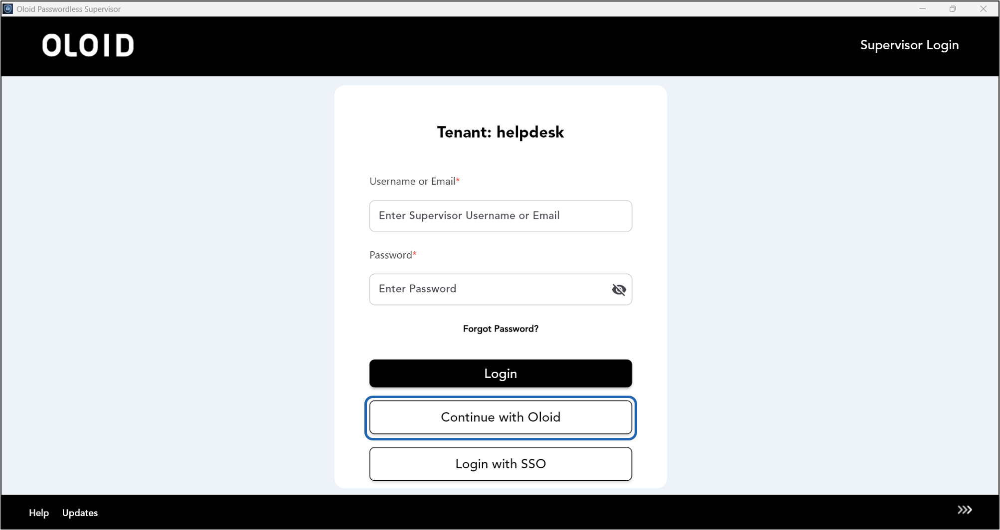
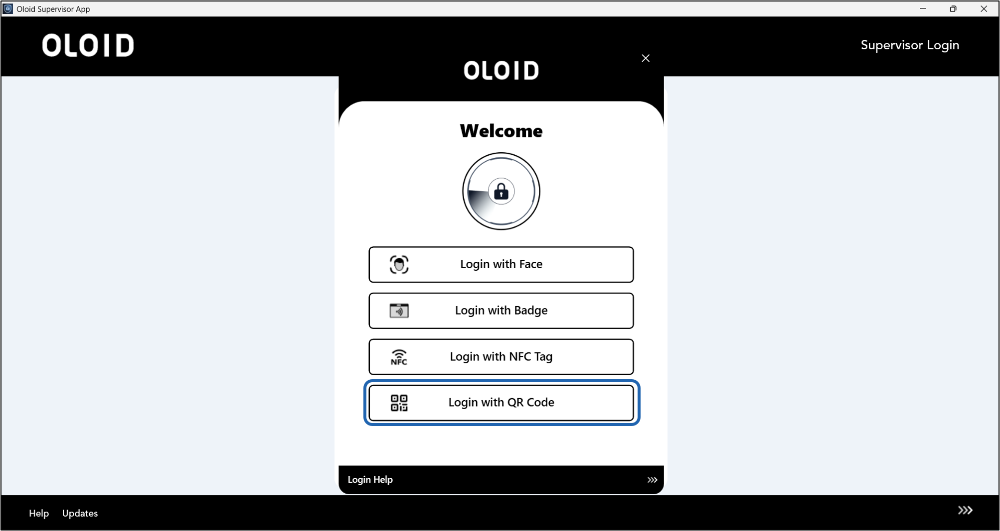
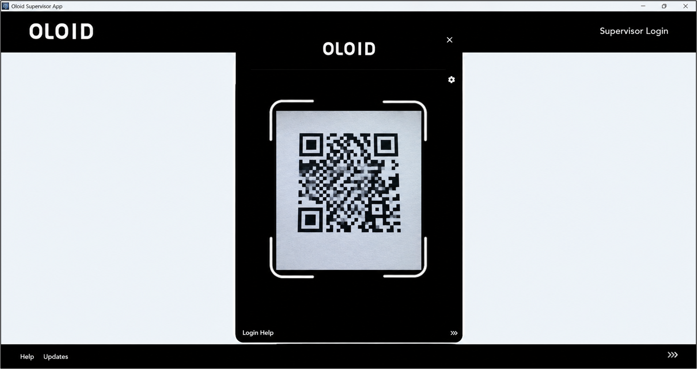
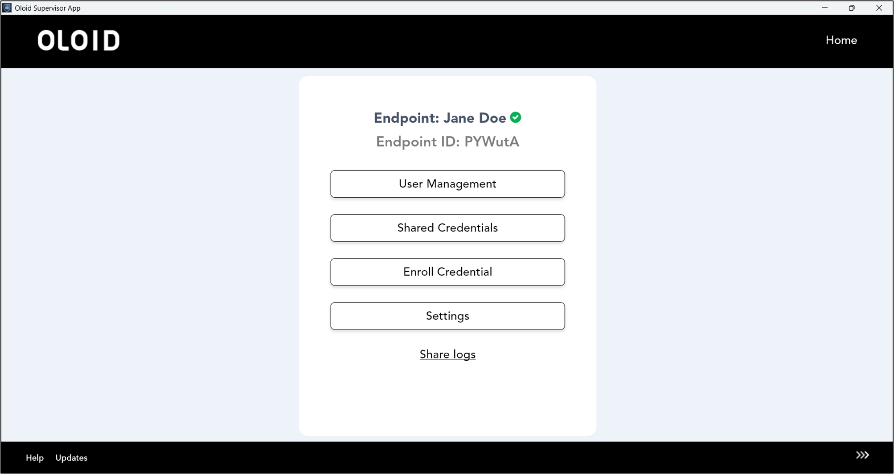

{/* Source: Intercom article 17132800 - https://oloid.help/en/articles/17132800-windows-login-2-0-how-to-login-to-supervisor-app-using-qr-code-via-continue-with-oloid-option */}
{/* Generated by intercom_to_mintlify.py - re-running overwrites this file. */}

## Introduction

Oloid Windows Login lets users sign in to the Supervisor App on a shared Windows endpoint without typing a username or password. With QR login, users sign in by showing their assigned QR code to the endpoint's camera. This makes sign-in fast and contactless on shared devices.

## Prerequisites

- You must have an Admin or Supervisor account access.
- Ensure the Continue with Oloid option checkbox is selected in the Tenant Admin Portal. For more information, refer: [Windows Login - How to Configure Login options for Oloid Apps](/platforms/windows/windows-login/windows-login-how-to-configure-login-options-for-oloid-apps)
- The Windows Login application must be created in the Tenant Admin Portal. For more information, refer to [How to create and configure Windows Login application in the Tenant Admin Portal](/platforms/windows/windows-login/windows-login-how-to-create-and-configure-windows-login-application).
- The endpoint must be paired with the Windows Login application. For more information, refer to [Windows Login - How to Manually Pair the Supervisor App](/platforms/windows/supervisor-app/windows-login-how-to-manually-pair-the-supervisor-app).
- A QR code credential must be assigned to the user. For more information, refer to [How to assign QR code as a credential to users](/platform/tenant-admin-portal/tenant-admin-portal-how-to-create-and-share-qr-code-credential-with).
- QR must be enabled as an authenticator in the Windows application. For more information, refer to [How to enable QR in Windows application](/platforms/windows/windows-login/windows-login-how-to-enable-qr-code-credential-for-windows-login-in).

## Steps to Login using QR Code

1. Double-click the Supervisor App to start it.

   

   The Login screen is displayed.
2. Click **Continue with Oloid**.

   

   The Credential screen is displayed.
3. Click **Login with QR**.

   

   The Scan QR screen is displayed and the camera turns on.
4. Hold the QR code in front of the camera, inside the scan frame, until it is scanned.

   

   When authentication succeeds, the user is logged in to the Supervisor App.

---
