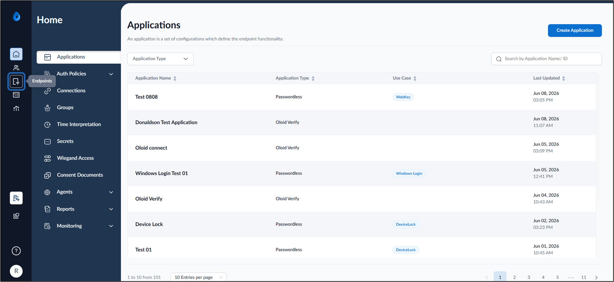
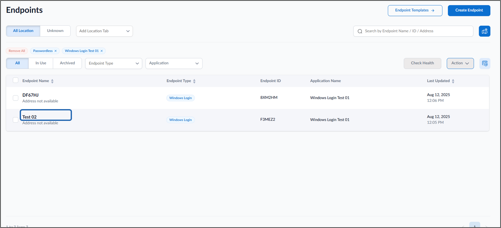
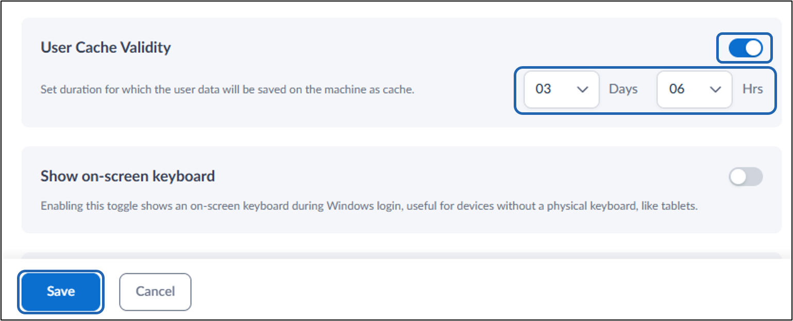
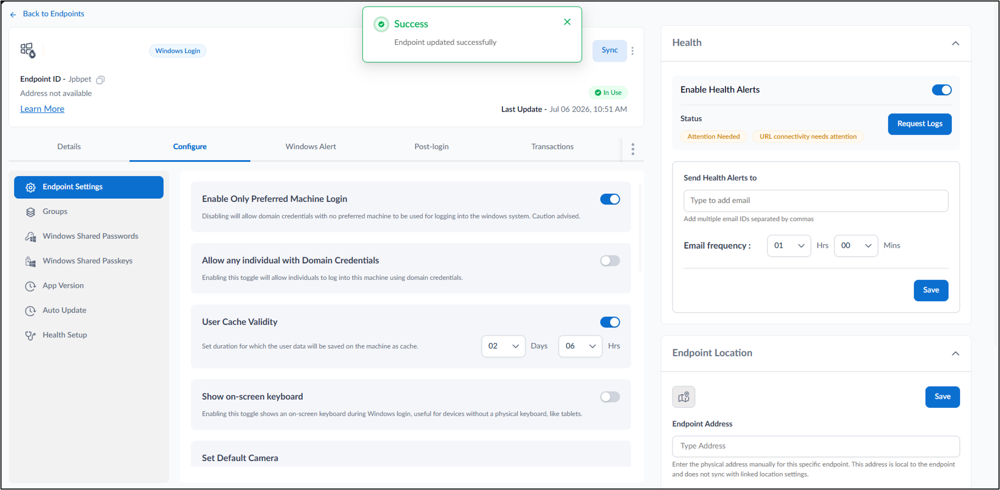

{/* Source: Intercom article 15431849 - https://oloid.help/en/articles/15431849-windows-login-2-0-how-to-set-user-cache-validity */}
{/* Generated by intercom_to_mintlify.py - re-running overwrites this file. */}

## Introduction

User Cache Validity controls how long user data is stored locally on an endpoint after authentication. This document explains how to configure the User Cache Validity duration for an endpoint in the Tenant Admin Portal.

## Prerequisites

- You must have access to the Tenant Admin Portal.
- Ensure Windows Login Application is created. [Windows Login - How to create and configure Windows Login application in the Tenant Admin Portal](/platforms/windows/windows-login/windows-login-how-to-create-and-configure-windows-login-application)
- Ensure the Endpoint is paired with the application. Refer: [Windows Login - How to pair Supervisor App using auto-pair config file option](/platforms/windows/supervisor-app/windows-login-how-to-pair-supervisor-app-using-auto-pair-config-file)

## Steps to Set User Cache Validity

1. Log in to the **Tenant Admin Portal**.
2. On the Left menu Panel of the Home page select **Endpoints**.

   

   The **Endpoints** page is displayed.
3. Select the **Endpoint name** to edit.

   

   The **Endpoints** Details page is displayed.
4. Go to **Endpoint Tab** > **Endpoint Settings**.

   

   The **Endpoint Settings** page is displayed.
5. Enable the **User Cache Validity** toggle.
6. Under User Cache Validity set the **Duration** as required.

   <Note>
     **Note:** User Cache validity is the duration for which the user data will be saved on the machine as cache.
   </Note>

7. Click **Save**.

   

   The User Cache Validity duration is set.

