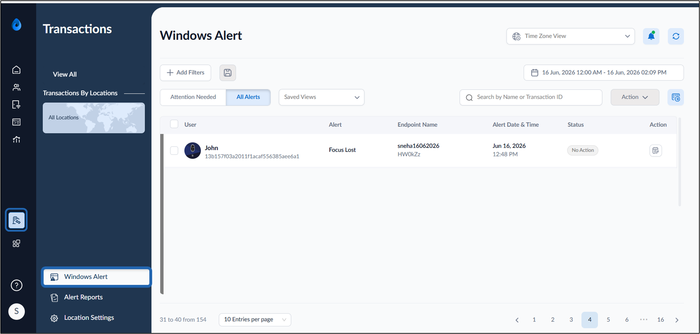
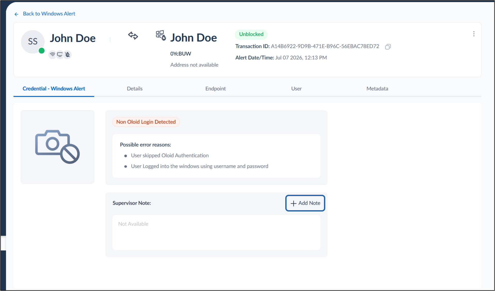
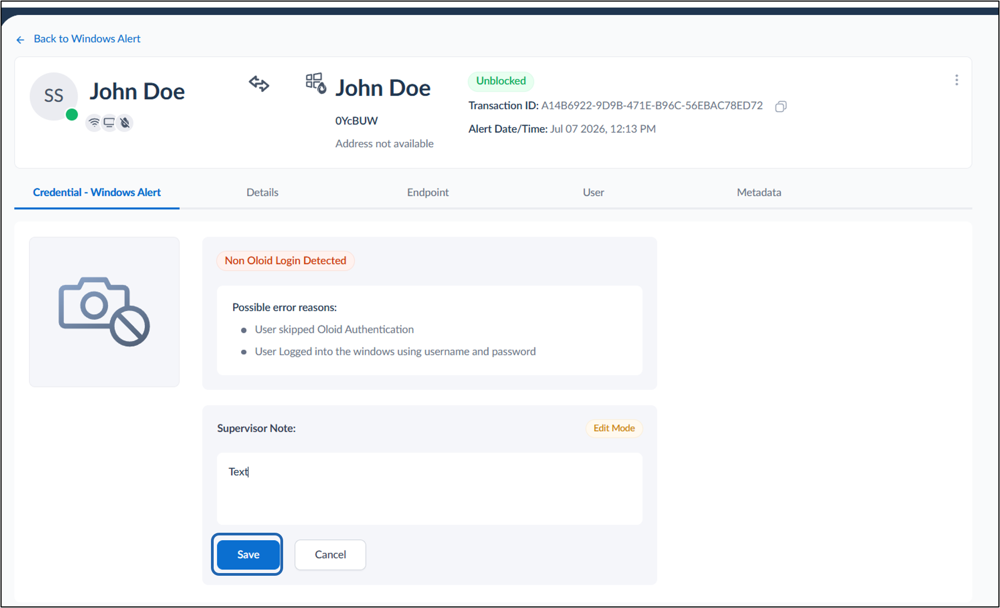
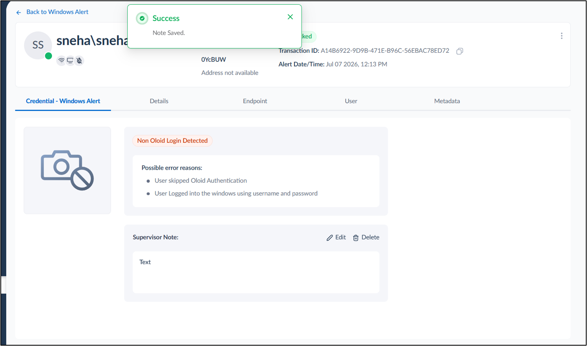
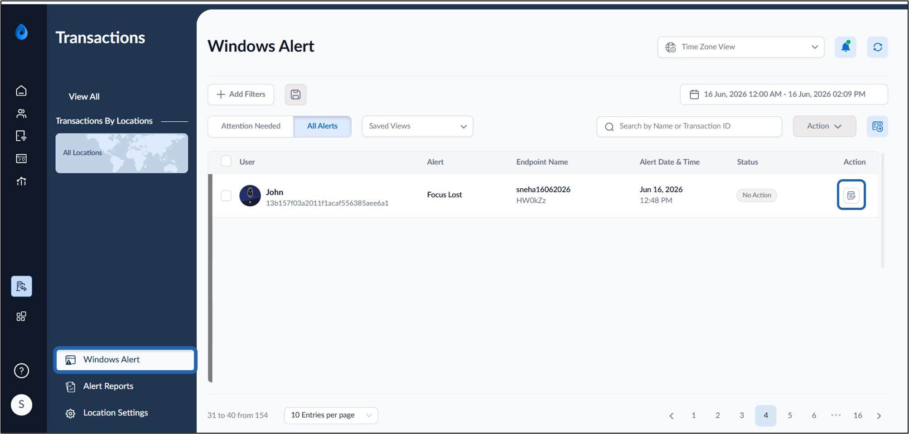
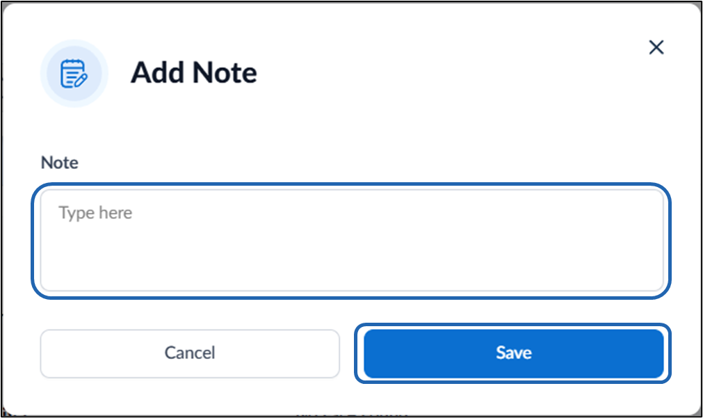

{/* Source: Intercom article 15516986 - https://oloid.help/en/articles/15516986-windows-login-v2-0-how-to-add-supervisor-note-in-windows-alerts */}
{/* Generated by intercom_to_mintlify.py - re-running overwrites this file. */}

## Introduction

This document explains how to add a supervisor note to a Windows Alert in the Tenant Admin Portal.

## Prerequisite

- You must have access to the Tenant Admin Portal.
- Ensure that Windows Alerts are enabled and configured.

## Steps to Add Supervisor Note in Windows Alert

1. Log in to the **Tenant Admin Portal**.
2. Click **Transactions** on the left menu panel > click **Windows Alert**.

   

   The Windows Alert list page is displayed.
3. Click **All Alerts**.
4. Do one of the following:
   1. Click the **Alert Name**
      The **Windows Alerts** Credential page is displayed.
   2. Click **+ Add Note.**

      

   3. Enter the **Note** in the Note field > Click **Save**.

      

      The Note is added.

      

      (OR)
   4. Select the **Notes** icon in the **Action** column for the required Windows alert.

      

   5. The **Add Note** pop-up box is displayed.

Enter the **Note** in the Note field > Click **Save**.

Note is added for the selected alert.

