{/* Source: Intercom article 15701076 - https://oloid.help/en/articles/15701076-windows-login-v2-0-how-to-configure-windows-alert-for-presence-detection */}
{/* Generated by intercom_to_mintlify.py - re-running overwrites this file. */}

## Introduction

Windows Alerts enable administrators to monitor security-related events detected by the Presence Detection engine on Windows endpoints. When configured, the system can identify events such as non-Oloid logins, camera obstruction, face tracking failures, multiple face detection, unauthorized gadget usage, loss of user focus, and emotion monitoring.

## Prerequisites

- You must have access to the **Tenant Admin Portal**.
- Ensure the endpoint is paired with the Windows Login application. refer: [How to pair endpoint using Pair as Supervisor in Supervisor App](/platforms/windows/supervisor-app/windows-login-how-to-manually-pair-the-supervisor-app)
- Ensure that your system is unlocked
- Ensure that your system's camera is working properly

## Steps to configure Windows Alert

1. Log in to Tenant Admin Portal.
2. On the home page of the portal, click **Endpoints** on the left menu panel.

   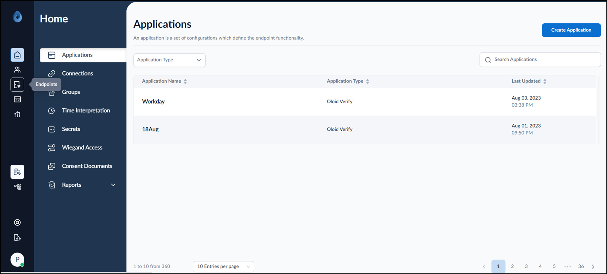

   The Endpoints page is displayed.
3. Click endpoint name (Windows Login) to edit from the listed endpoints.

   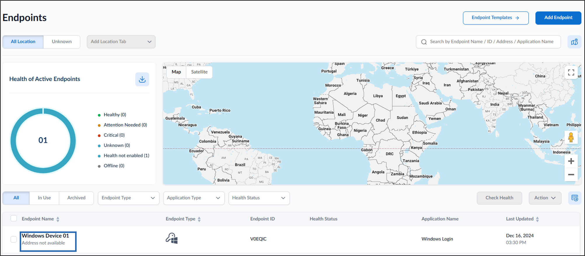

   The Endpoint details page is displayed.
4. Go to **Windows Alert** tab.

   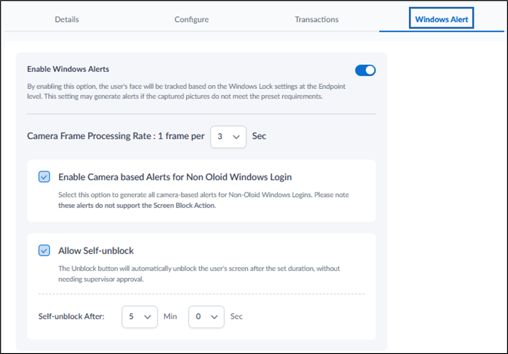

5. Do the following:
   1. **Enable Windows Alerts:** Turn on this button to track the user's face based on Windows Lock settings. It generates alerts when captured images fail to meet preset requirements.

      <Note>
        **Note:** Turn on this feature to enable the rest of the settings on the Windows tab.
      </Note>

      1. **Enable Camera-based Alerts for Non-Oloid Windows Login:** Select this option to generate alerts for Non-Oloid Windows Logins.
      2. **Allow Self-Unblock**: Select this option to let users automatically unblock their screen after a specified duration, without supervisor approval.
         **Set Self-Unblock Duration**: Set the duration (in minutes and seconds) after which the screen is automatically unblocked.
         **Default Setting**: 5 minutes and 0 seconds

         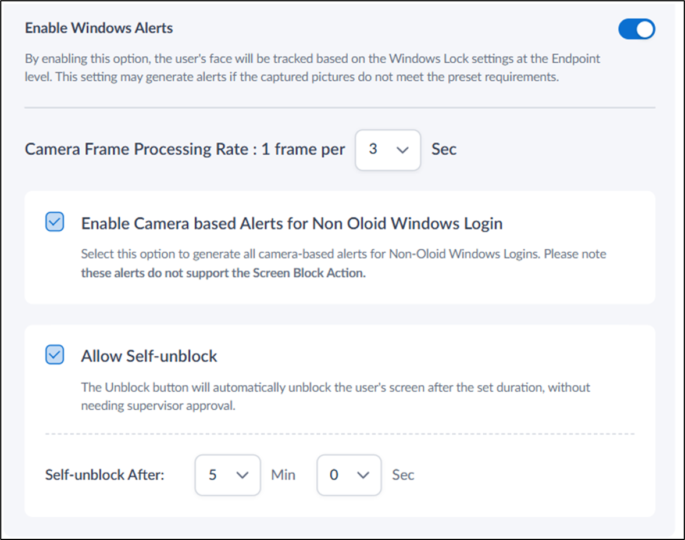

   2. **Non Oloid Windows Login Detected:** Turn on this button to generate alerts when users log in to the Windows device using their Windows username and password without authenticating through Oloid credentials.
      1. Do any of the following:
         - **Screen Block:** The user’s screen is blocked, but they are not logged out of their session. See [Sample screen for a blocked user](/platforms/windows/windows-login/windows-login-how-to-configure-windows-alert-for-presence-detection)
         - **Windows Lock:** The user's screen is locked, but they are not logged out of their session. See, [Sample screen for a locked user](/platforms/windows/windows-login/windows-login-how-to-configure-windows-alert-for-presence-detection)
         - **No Action:** No immediate response from the system, but a desktop notification is sent if notifications are enabled in the browser settings. See

           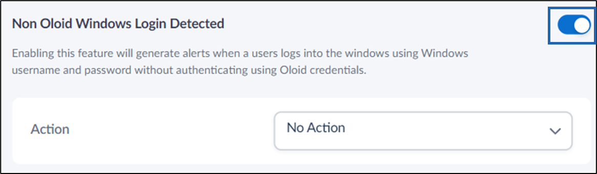

   3. **Camera Block Detected:** System will not track user activity or generate any of the following Windows Alerts when a user logs in using the Windows username and password without authenticating using Oloid credentials.

      <Note>
        **Note:** Ensure that the system (endpoint) camera is not blocked.
      </Note>

      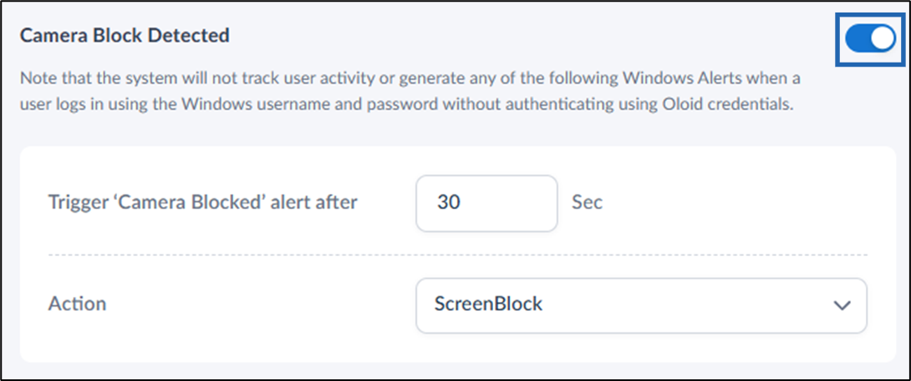

      Do the following:
      1. **Trigger 'Camera Blocked' alert after:** Set the number of seconds after which an alert will be triggered.
      2. **Action:** Choose from the dropdown list of actions upon detecting a camera block.
         - **Screen Block:** The user’s screen is blocked, but they are not logged out of their session. See, [Sample screen for a blocked user](/platforms/windows/windows-login/windows-login-how-to-configure-windows-alert-for-presence-detection)
         - **Windows Lock:** The user's screen is locked, but they are not logged out of their session. See, [Sample screen for a locked user](/platforms/windows/windows-login/windows-login-how-to-configure-windows-alert-for-presence-detection)
         - **No Action:** No immediate response from the system, but a desktop notification is sent if notifications are enabled in the browser settings.
6. Configure the following section:
   1. [Face Tracking Violation](/platforms/windows/windows-login/windows-login-how-to-configure-windows-alert-for-presence-detection)
   2. [Multiple Faces Detected](/platforms/windows/windows-login/windows-login-how-to-configure-windows-alert-for-presence-detection)
   3. [Gadget Detected](/platforms/windows/windows-login/windows-login-how-to-configure-windows-alert-for-presence-detection)
   4. [Focus Monitor](/platforms/windows/windows-login/windows-login-how-to-configure-windows-alert-for-presence-detection)
   5. [Check Emotions](/platforms/windows/windows-login/windows-login-how-to-configure-windows-alert-for-presence-detection)
7. Click **Save** to apply your changes.
   The Changes are applied.

### Face Tracking Violation

If the system is unable to reliably detect or track the user's face for the configured duration, it triggers the selected action.

Do the following:

1. **Min required Face Landmark config:** Set the required percentage of face visibility for face detection.
2. **Trigger 'No Face Found' alert after:** Define the time (in seconds) after which an alert will be generated if no face is found.
3. **Action:** Select a predefined action to take when a face tracking violation occurs.
   - **Screen Block:** The user’s screen is blocked, but they are not logged out of their session. See, [Sample screen for a blocked user](/platforms/windows/windows-login/windows-login-how-to-configure-windows-alert-for-presence-detection)
   - **Windows Lock:** The user's screen is locked, but they are not logged out of their session. See, [Sample screen for a locked user](/platforms/windows/windows-login/windows-login-how-to-configure-windows-alert-for-presence-detection)
   - **No Action:** No immediate response from the system, but a desktop notification may be sent if notifications are enabled in the browser settings.

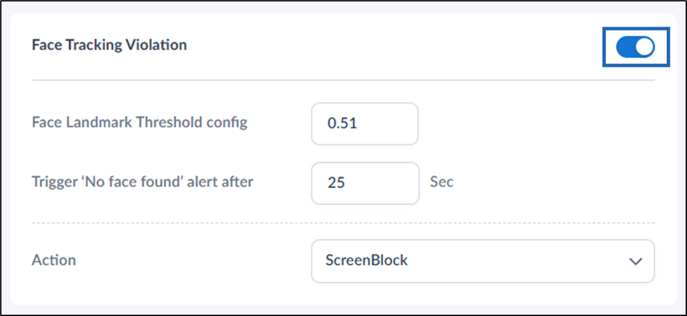

### Multiple Faces Detected

**Multiple Faces Detected:** Turn on this button to set an alert when more than one face is detected.

Do the following:

1. **Multiple Face Detection Threshold:** Set the threshold level required to confirm the detection of multiple faces.
2. **Trigger 'Multiple Faces' alert after:** Set the number of seconds after which an alert is triggered when multiple faces are detected.
3. **Action:** Choose an action from a drop-down list in response to multiple face detection.
   - **Screen Block:** The user’s screen is blocked, but they are not logged out of their session. See, [Sample screen for a blocked user](/platforms/windows/windows-login/windows-login-how-to-configure-windows-alert-for-presence-detection)
   - **Windows Lock:** The user's screen is locked, but they are not logged out of their session. See, [Sample screen for a locked user](/platforms/windows/windows-login/windows-login-how-to-configure-windows-alert-for-presence-detection)
   - **No Action:** No immediate response from the system, but a desktop notification may be sent if notifications are enabled.

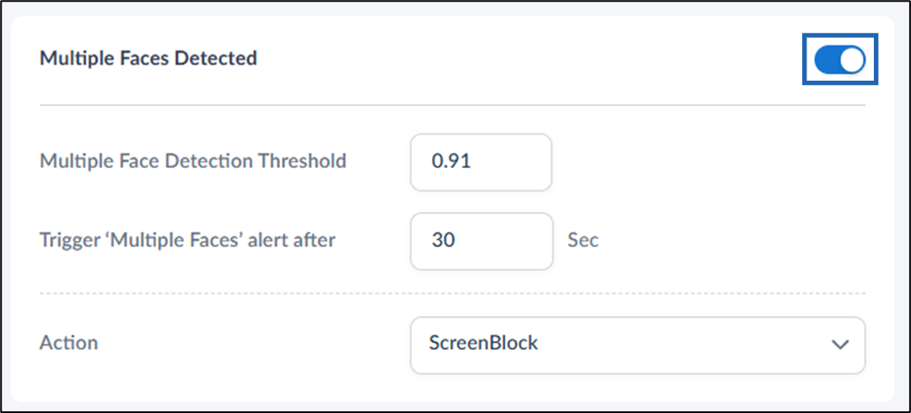

### Gadget Detected

**Gadget Detected:** Turn on this button to set an alert when an unauthorized gadget is detected.

Do the following:

1. **Gadget Detection Threshold config:** Set the threshold level based on the desired detection sensitivity for detecting gadgets.
2. **Trigger 'Gadget Detected' Alert After:** Define the time (in seconds) after which an alert is generated when a gadget is detected.
3. **Action:** Select the action to perform when an unauthorized gadget is detected.
   - **Screen Block:** The user’s screen is blocked, but they are not logged out of their session. See, [Sample screen for a blocked user](/platforms/windows/windows-login/windows-login-how-to-configure-windows-alert-for-presence-detection)
   - **Windows Lock:** The user's screen is locked, but they are not logged out of their session. See, [Sample screen for a locked user](/platforms/windows/windows-login/windows-login-how-to-configure-windows-alert-for-presence-detection)
   - **No Action:** No immediate response from the system, but a desktop notification may be sent if notifications are enabled.

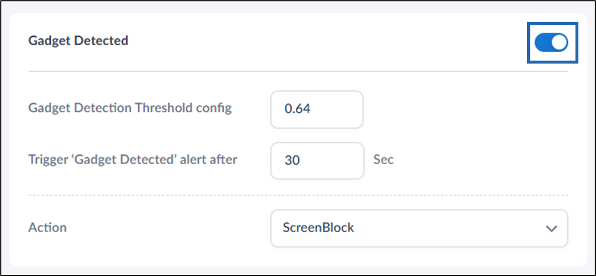

### Focus Monitor

Focus Monitor helps detect when a user looks away from the screen beyond a specified angle for a defined period of time.

Do the following:

1. Enable the **Focus Monitor** toggle button.
2. Enter the **Look-away angle**.
   The **Look-away Angle** defines the maximum angle (in Degrees) a user can turn away from the screen before focus is considered lost.
3. Enter the duration for **Focus Lost**.
   This defines how long the user must remain outside the allowed angle before an alert is triggered.
4. Select **Action** from drop down.
5. Click **Save.**

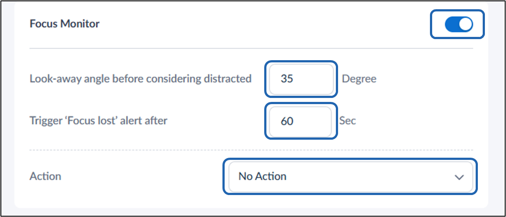

### Check Emotions

Check Emotions analyzes user facial expressions at configured intervals and can trigger actions based on the detected emotional state.

Do the following:

1. Enable the **Check Emotions** toggle button.
2. Configure the **Check Emotions frequency**.
   The **Check Emotions Frequency** to defines how often emotion analysis is performed.
3. Select **Action** from drop down.
4. Click **Save.**

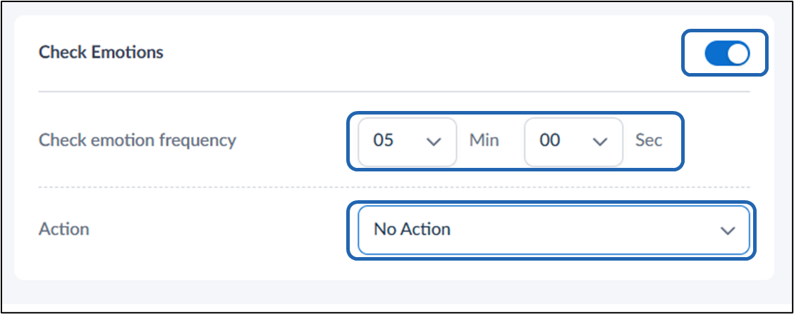

Windows Alerts for presence detection is configured.

---

### Video Tutorial

Watch the video [How to configure Windows alert for presence detection in Oloid Platform](/platforms/windows/videos/how-to-configure-windows-alert-for-presence-detection-in-oloid)

---

### Sample User Screens

**Scenario 1:** User Blocked screen

### Screen block as Non-Oloid Login detected

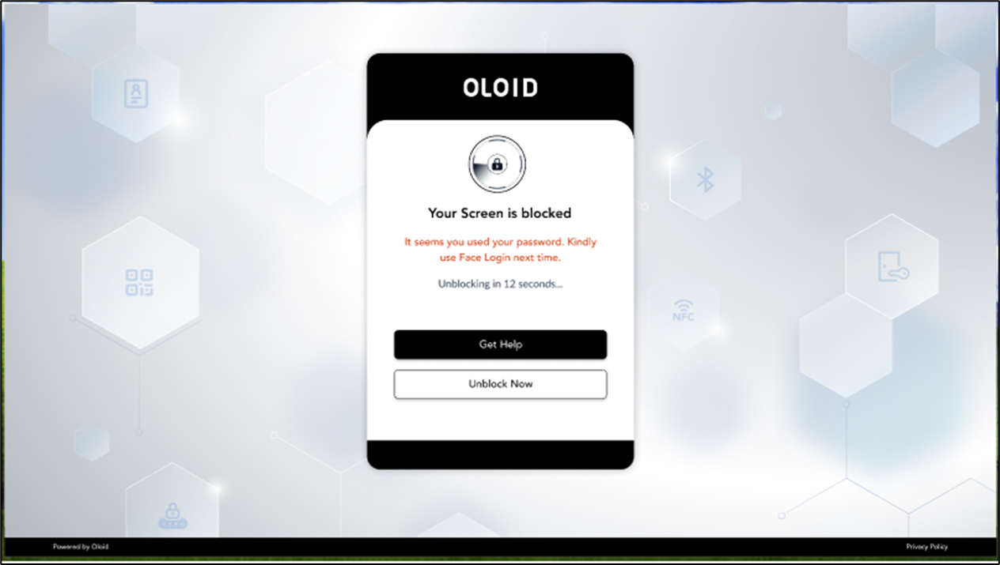

### Screen block as Camera issue detected

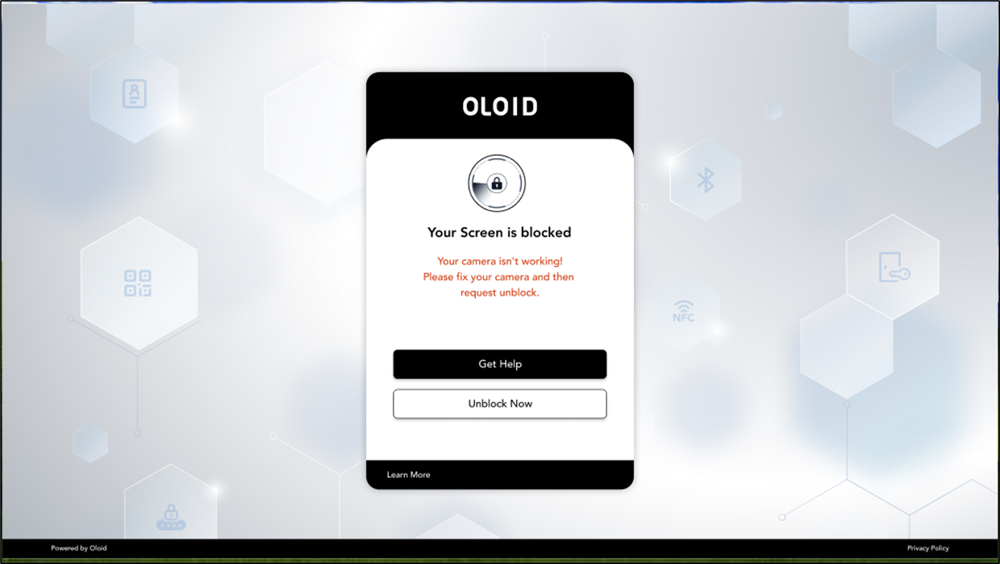

### Screen block on Multiple faces detected

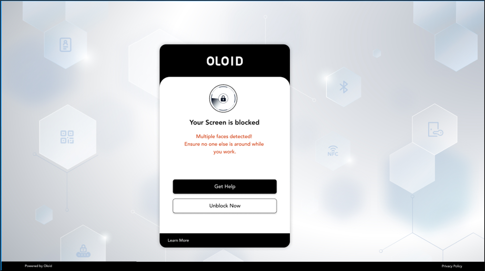

### Screen block on Face Tracking Violation

### Screen block on Gadgets detected

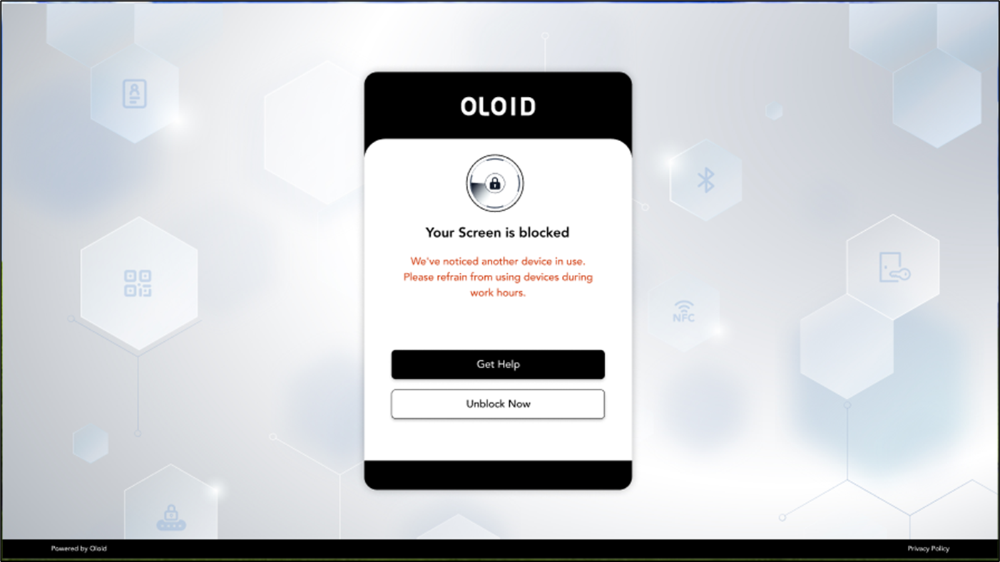
