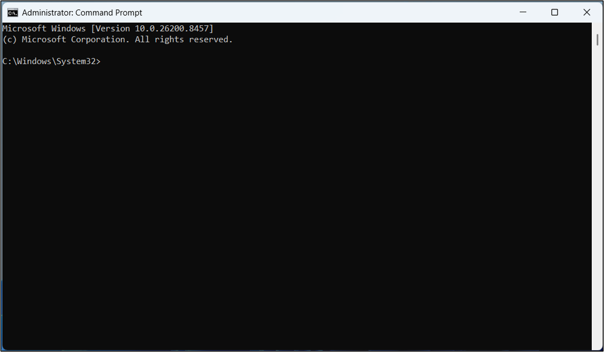
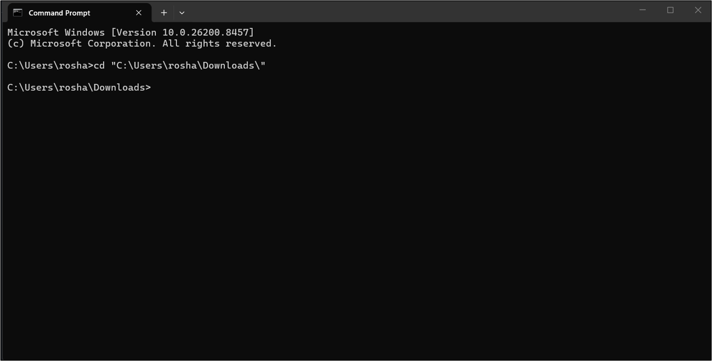
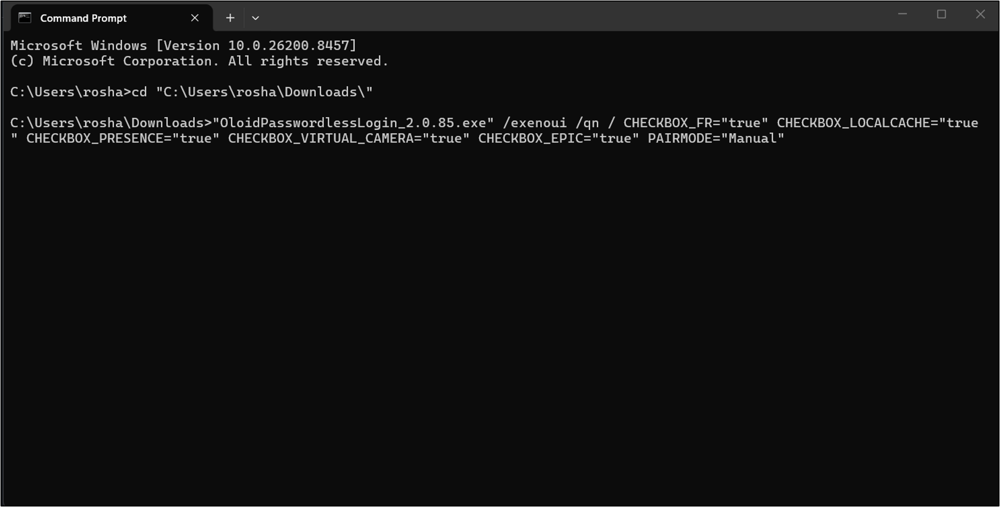

{/* Source: Intercom article 15885299 - https://oloid.help/en/articles/15885299-windows-login-v2-0-how-to-deploy-windows-passwordless-2-0-using-command-line */}
{/* Generated by intercom_to_mintlify.py - re-running overwrites this file. */}

## Introduction

Windows Login v2.0 supports unattended installation through command-line parameters, allowing administrators to deploy the application using scripts, software deployment tools, or endpoint management solutions. During installation, administrators can specify the features to install, configure the device pairing method, and enable optional components without user interaction.

## Prerequisites

- All apps using camera access must be closed.
- You must download the **Windows Login v2.0 installer file**. For more information, refer to [Windows Login v2.0 - How to download Windows Login v2.0 installer file from Tenant Admin Portal](/platforms/windows/windows-login/v2/windows-login-v2-0-how-to-download-windows-login-v2-0-installer-file)

## Steps to Deploy Windows Passwordless 2.0 using Command Line

1. Launch a command prompt window in Administrator mode.
   The Command Prompt window is displayed.

   

2. Navigate to the folder where the **Windows Login installer (.exe)** is located.

   <Note>
     **Note:** The Windows Installer Zip file must be extracted.
   </Note>

Enter the following command:

```
cd "C:\Users\<Username>\Downloads\"
```

3. 

Enter the Installation command:

```
"OloidPasswordlessLogin_2.0.85.exe" /exenoui /qn / CHECKBOX_FR="true" CHECKBOX_LOCALCACHE="true" CHECKBOX_PRESENCE="true" CHECKBOX_VIRTUAL_CAMERA="true" CHECKBOX_EPIC="true" PAIRMODE="Manual"
```

4. **Note:** Refer the [Glossary section](#glossary) to see the description of installation parameters.
5. Press **Enter** key on keyboard to begin installation.



The Installation takes place silently in the background. The system will be restared after installation.

<Note>
  **Note:**

  - Please change the version number of the installer EXE (Oloid Passwordless Login Ver 2.0. **28**.exe) accordingly.
  - CHECKBOX_LOCALCACHE, CHECKBOX_ADMIN, CHECKBOX_FR, CHECKBOX_PRESENCE and CHECKBOX_EPIC can be set to “true” or “false” as per the feature requirement.
  - When the PAIRMODE="Automatic" the encoded string is needed for pairing. Refer: [Windows Login - How to generate Auto-Pair config file for Windows Login in Tenant Admin Portal](/platform/tenant-admin-portal/windows-login-how-to-generate-and-download-auto-pair-config-file-for))
  - This will automatically restart the system after the installation completes. To avoid automatic restart, use the following command:
</Note>

```
"Oloid Passwordless Login Ver 2.0. 28.exe" /exenoui /qn /norestart CHECKBOX_LOCALCACHE="false" CHECKBOX_ADMIN="false" CHECKBOX_FR="true" CHECKBOX_PRESENCE="true" CHECKBOX_EPIC="true"
```

---

#### Glossary

This glossary describes the command-line parameters that can be used during installation. Each parameter defines a specific installation option, feature, or configuration setting. Use the supported values for each parameter, and ensure that any dependent parameters are configured only when the required feature is enabled.

| Command-line Parameter | Description | Accepted Values | Notes |
| --- | --- | --- | --- |
| **CHECKBOX_FR** | Enables or disables Face Recognition functionality during installation. | `"true"` / `"false"` | Set to `"true"` to install with Face Recognition enabled. |
| **CHECKBOX_LOCALCACHE** | Enables or disables Local Cache functionality. | `"true"` / `"false"` | Set to `"true"` to enable Local Cache. |
| **CHECKBOX_PRESENCE** | Enables or disables Presence Detection. | `"true"` / `"false"` | Set to `"true"` to enable Presence Detection. |
| **CHECKBOX_VIRTUAL_CAMERA** | Enables or disables the Virtual Camera feature. | `"true"` / `"false"` | Set to `"true"` to install the Virtual Camera component. |
| **CHECKBOX_OLOID_LAUNCHER** | Enables or disables the Oloid Launcher installation. | `"true"` / `"false"` | Required to use the **EDIT_USERNAME** parameter. |
| **EDIT_USERNAME** | Specifies the Windows user account that the Oloid Launcher runs under. | `"OloidKiosk"` or another valid Windows username | This parameter is supported only when **CHECKBOX_OLOID_LAUNCHER="true"**. |
| **CHECKBOX_EPIC** | Enables or disables Epic integration during installation. | `"true"` / `"false"` | Set to `"true"` to install Epic integration components. |
| **PAIRMODE** | Specifies the device pairing method. | `"Manual"` / `"Automatic"` | When set to `"Automatic"`, the **ENCODED_CONFIG** parameter is required. |
| **ENCODED_CONFIG** | Specifies the Base64-encoded configuration string used for automatic pairing. | Encoded configuration string | This parameter is supported only when **PAIRMODE="Automatic"**. |

Example:

CHECKBOX_FR="true"

CHECKBOX_LOCALCACHE="true"

CHECKBOX_PRESENCE="false"

CHECKBOX_VIRTUAL_CAMERA="true"

CHECKBOX_OLOID_LAUNCHER="true"

EDIT_USERNAME="OloidKiosk"

CHECKBOX_EPIC="false"

PAIRMODE="Automatic"

ENCODED_CONFIG="&lt;Base64-encoded configuration>"

---
