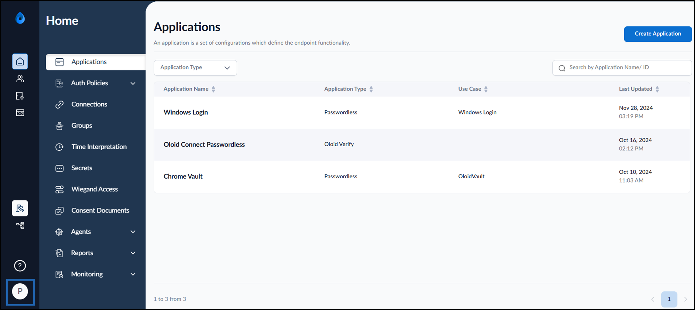
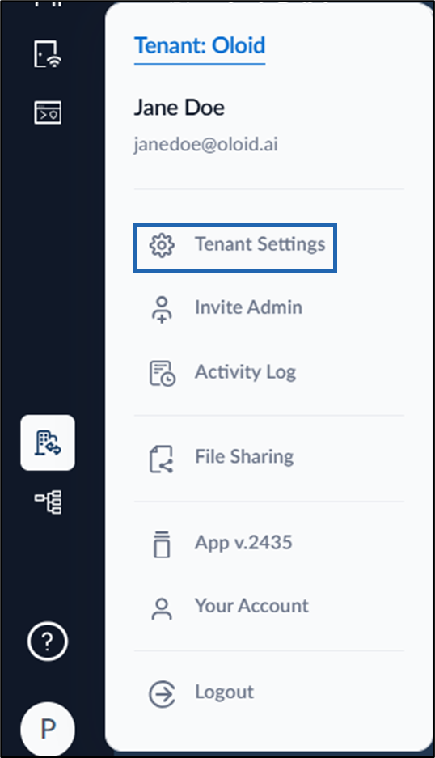
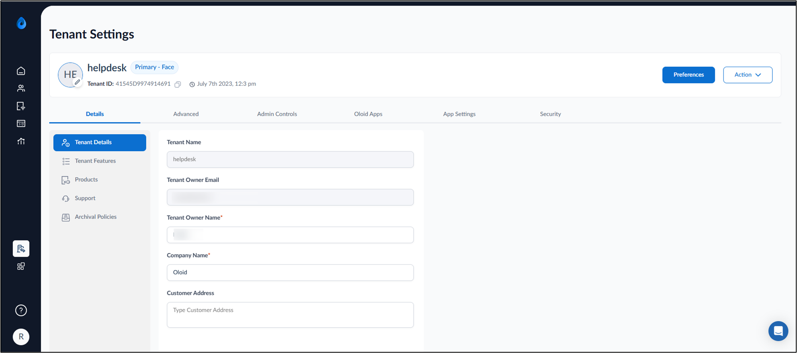
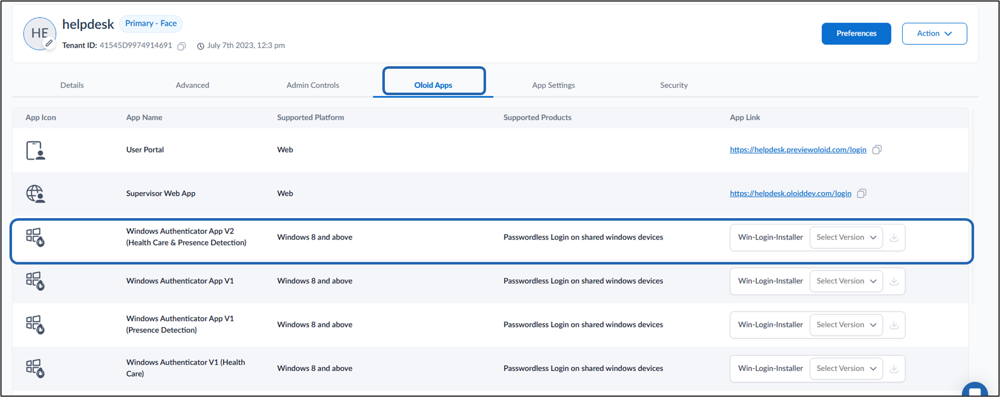

{/* Source: Intercom article 15069295 - https://oloid.help/en/articles/15069295-windows-login-v2-0-how-to-download-windows-login-v2-0-installer-file-from-tenant-admin-portal */}
{/* Generated by intercom_to_mintlify.py - re-running overwrites this file. */}

## Introduction

This document explains how to download the **Windows Login v2.0** installer from the Tenant Admin Portal. After downloading the installer, you can proceed with the installation and setup of the Windows Login application on your system.

## Prerequisites

- You must have access to a Tenant Admin account.
- You have local administrator access on the Windows machine.
- Check System Requirements. For more information, refer: [Windows Login Version 2 - Hardware and Software Requirements](/platforms/windows/windows-login/v2/windows-login-v2-0-hardware-and-software-requirements)

## Steps to download Windows Login v 2.0

1. Log in to **Tenant Admin Portal**.
2. On the homepage of the portal, click **User profile icon** on the bottom left corner of the menu panel.

   

3. The user profile menu is displayed.
4. Select **Tenant Settings**.

   

   The **Tenant Settings** screen is displayed.

   

5. Go to **Oloid Apps** tab > **Windows Authenticator App V2** Login.

   

6. Select the preferred version from the **Win-Login-Installer** dropdown list, then click the **Download** button  icon.

   

   The installer file is downloaded to your local device.
   After the download is complete, you can proceed with installing Windows Login App.

---

##### Related Documentation

[Windows Login v2.0 - How to Download, Install, and Auto-Pair Windows Authenticator App](/platforms/windows/windows-login/v2/windows-login-v2-0-how-to-install-and-auto-pair-windows-login-v2-0-app)
